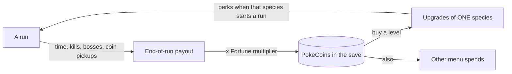
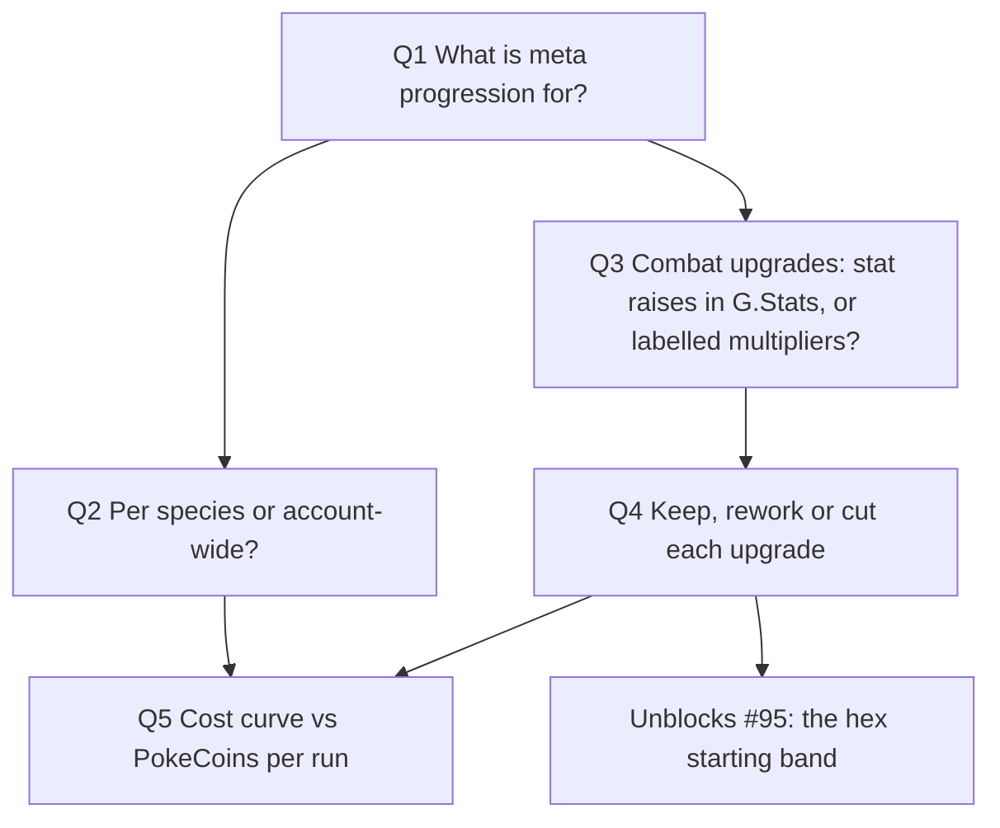

# 97 - Upgrade System Review (2026-11-15)

What the permanent upgrades are today, and the calls needed before the #97 slice opening. No code.

## Today's loop

- Source: js/data/upgrades.js (13 upgrades), applied at run start in js/game.js (perks of the starting Pokemon's dex).
- Per species: every species has its own levels.
- Cost: base x grow^level, rounded to 10. Maxing every upgrade on one species costs **40,000** PokeCoins.

## The 13 upgrades

| Upgrade | Per level | Max | First / last level | Total | Fits the stat model? |
|---|---|---|---|---|---|
| Vitality (hp) | +8 HP flat | 10 | 60 / 890 | 3,270 | No: flat HP outside G.Stats (#95) |
| Strength (atk) | +4% damage | 10 | 80 / 1,450 | 5,050 | No: multiplier, not a stat raise |
| Stride (spd) | +3% move speed | 8 | 70 / 740 | 2,420 | No: multiplier |
| Reflexes (cd) | -3% cooldown | 8 | 90 / 1,050 | 3,340 | Ruling needed |
| Carapace (def) | +2% damage cut | 8 | 80 / 840 | 2,750 | No: multiplier |
| Synthesis (regen) | +0.2 HP/s | 5 | 120 / 610 | 1,590 | Ruling needed |
| Magnet | +20% pickup range | 6 | 50 / 270 | 820 | Utility |
| Wisdom (xp) | +5% XP | 8 | 100 / 1,160 | 3,700 | Clashes with the #125 XP ruling |
| Fortune (coins) | +8% PokeCoins | 8 | 120 / 1,620 | 4,950 | Utility (the gold loop) |
| Repertoire | start with 2 moves | 1 | 1,500 | 1,500 | Interacts with the move economy (#124) |
| Critical Hit | +3% crit (x1.5) | 10 | 90 / 1,860 | 6,300 | Ruling needed |
| Card Reroll | +1 level card reroll per run | 5 | 150 / 980 | 2,360 | Utility |
| Veto | ban 1 move from cards | 3 | 300 / 1,080 | 1,950 | Utility |

## Calls for Jess (the slice cannot open without these)

| # | Question | What we already have |
|---|---|---|
| Q1 | Purpose: catch-up power, sidegrades, or unlocks? | #125 ruling: poor play falls behind the world, then "restarts stronger via meta progression". That reads as catch-up power. |
| Q2 | Per species (today) or account-wide, or a mix? | Per species means 40,000 per Pokemon. Acquisition (#128) changes how many species you own. |
| Q3 | Should HP, attack, defence and speed upgrades become stat raises through G.Stats (so the hex shows them), or stay multipliers with their own label? | CLAUDE.md: new combat-stat formulas live in G.Stats. #95 needs this answer. |
| Q4 | Wisdom vs the #125 band; Repertoire vs move prices; Fortune feeding itself | Each needs keep, rework or cut. |
| Q5 | How many runs should maxing take? | Rough figure: time pays 1 per 5 s and kills 0.25 each, so a run pays hundreds, not thousands. A trace of the payout would firm this up. |

## Order note

The queue put #128 (acquisition) before #97. Q2 depends on it, so either answer Q2 now or keep that order.
