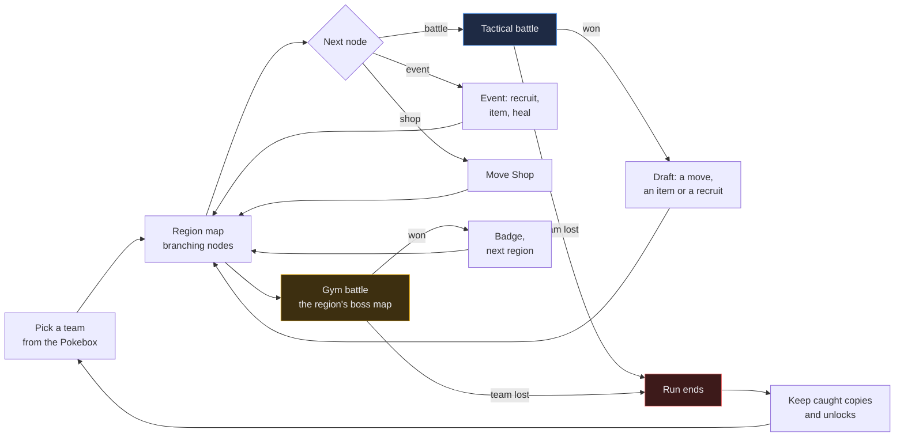
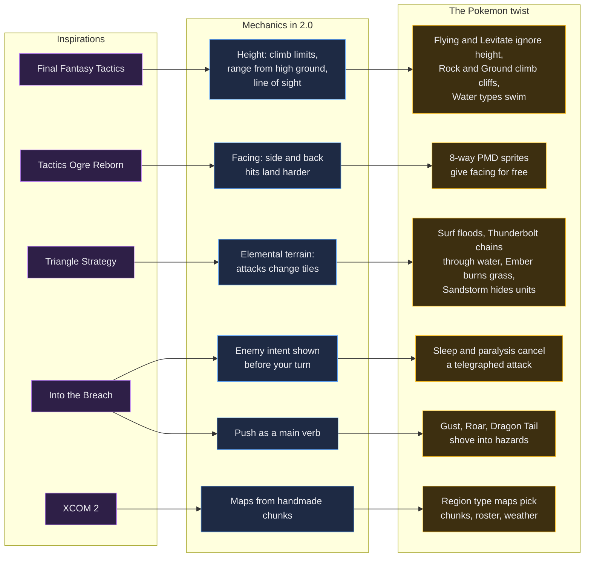
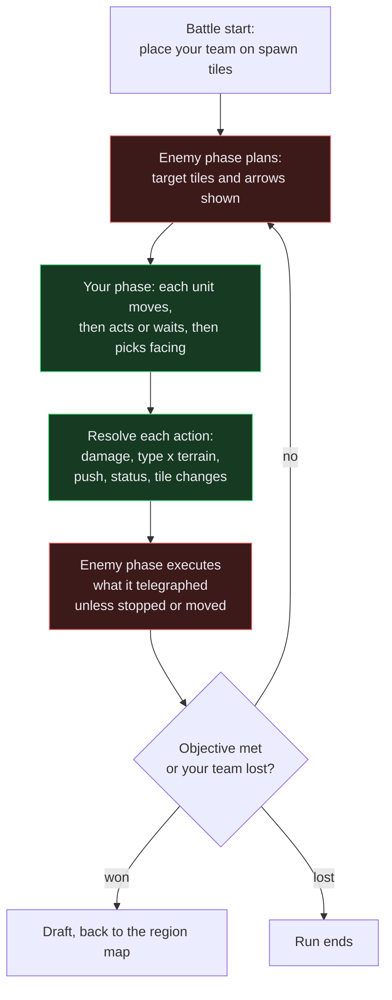
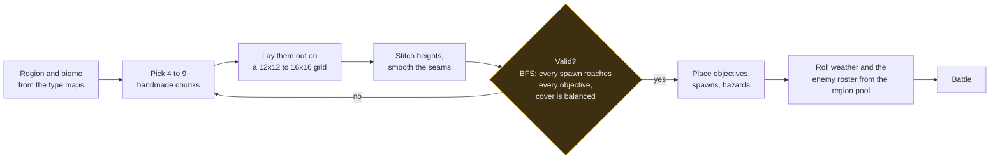
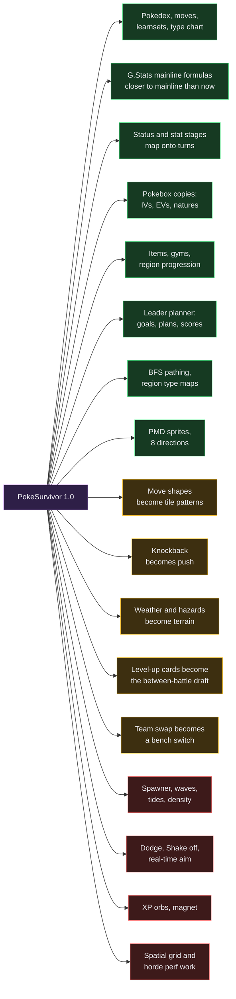

# Project 2.0: Pokemon tactics roguelite

Parked until 1.0 ships. Concept only, nothing decided (see "Open calls"). Written 2026-11-14.

An isometric tactics roguelite (FFT, Tactics Ogre Reborn, Triangle Strategy, Into the Breach) built on PokeSurvivor's data
and rules. Free fan game.

## 1. The run

Same skeleton as PokeSurvivor (run, drafts, gym bosses, a collection that persists). Only the fight changes.

## 2. What each inspiration brings, and the Pokemon twist

## 3. One battle round

Drawn Into the Breach style (enemies show intent, then you act). A Speed-based turn order like FFT is open call D3.

## 4. Making a map

Handmade chunks laid out at random, then checked. Random height alone tends to make flat or unfair maps.

## 5. What comes from PokeSurvivor

Green carries over, amber carries over changed, red is left behind.

## 6. Open calls (undecided)

| # | Question | Options | Why it matters |
|---|---|---|---|
| D1 | Can attacks miss? | Shown hit chance (Fire Emblem, mainline accuracy) or always hit (Into the Breach) | Decides the game's personality: Pokemon feel vs pure puzzle |
| D2 | What happens on a faint? | Permadeath for the run, or faint and back after the battle | How much a loss hurts, and how much the Pokebox matters |
| D3 | Turn order | Phases: all yours, then all theirs (FE, Into the Breach), or a Speed-based timeline (FFT) | Speed as a real stat vs clean telegraphs |
| D4 | Map size | 12x12 or 16x16 | Bigger means more walking per decision |
| D5 | Team on the field | 4 or 6 (bench for the rest) | Turn length and readability |
| D6 | Engine | Godot + GDScript, or Godot + Rust | About 20 units a map: GDScript is enough, and its web export suits a free fan game |

Free fan game: keep it free and never sell anything tied to it. Takedown risk grows with attention either way.
