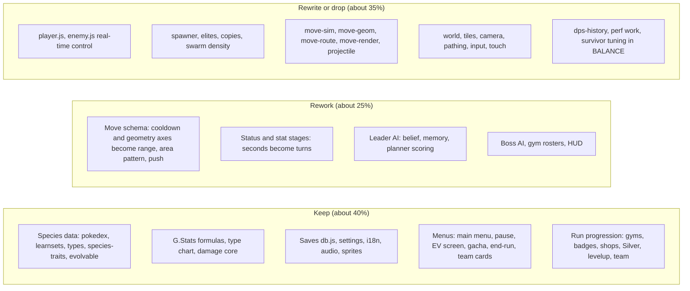
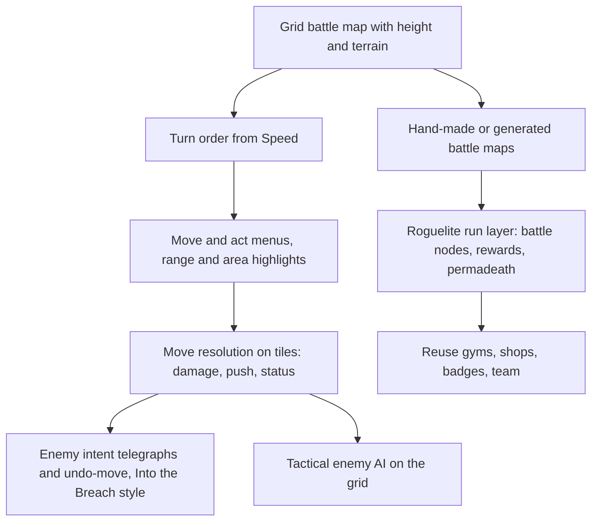

# Uplift estimate: survivor-like to turn-based tactics roguelite

Question (Jess, 2026-11-15): how big is converting the current game into a turn-based strategy RPG roguelite in the spirit of Into the Breach, Final Fantasy Tactics and Triangle Strategy?

Short answer: **large**. It is a new game built on the old one's data, progression and menus, not a conversion. Roughly 40% of the code carries over, about a quarter needs a rework, and the core of what makes it a game (combat loop, movement, spawning, move execution, maps) is a rewrite. Estimate: **4 to 8 months** at the current pace before it plays as well as the survivor build does now.

## Where the current code lands

## What has to be built new

## Size by piece

| Piece | Effort | Why |
|---|---|---|
| Grid, height, terrain, turn order | Large | Core new engine; FFT and Triangle Strategy height and facing add a lot |
| Battle UI (cursor, menus, range overlays, preview) | Large | All new; this is most of the feel |
| Move re-authoring (178 generated moves, 101 MOVE-INTENT entries) | Large | Every move needs a tile pattern; the intent docs and harness must be rewritten for turns |
| Tactical enemy AI | Medium | Leader AI scoring (belief, memory, planner) is a good fit for utility AI on a grid, so this is the best surprise reuse |
| Maps and encounters | Medium to large | Content, not code; tactics games live or die on map design |
| Run layer | Small to medium | Gyms, shops, Silver, badges and team building mostly carry over |
| Docs and process | Medium | COMBAT-RULES, MOVE-AXIS-SCHEMA, combat-architecture, BALANCE and the move harness all describe real-time combat |

## Which inspiration costs the most

| Model | Extra cost | Note |
|---|---|---|
| Into the Breach | Lowest | Small 8x8 grids, few units, push and telegraphs; fits Pokemon moves (Whirlwind, Dragon Tail) well |
| Final Fantasy Tactics | High | Height, facing, CT turn order, job system, large maps, isometric art |
| Triangle Strategy | Highest | All of FFT plus story choices, conviction system, terrain interaction |

## Risks

- The survivor identity (swarm, auto-attacks, power fantasy) is the current game's selling point; tactics throws that away.
- Isometric or height maps need new art; the current sprites are top-down overworld style.
- Two months of combat docs, intent rulings and the harness become history.

## Cheaper options if the goal is "more tactics"

| Option | Size | What it gives |
|---|---|---|
| Gym battles only become grid tactics, runs stay survivor | Medium | Tests the idea in one mode, keeps the core |
| Pause-to-command (real-time with pause) for the team | Small to medium | Tactical feel on the existing sim |
| Separate repo or branch prototype, Into the Breach scale, reusing data and G.Stats | Medium | Proves the fun in about 4 to 6 weeks before committing |

Recommendation: if this is a serious idea, build the Into the Breach scale prototype in its own branch with one gym's roster and about 20 moves, and decide after a feel test.
