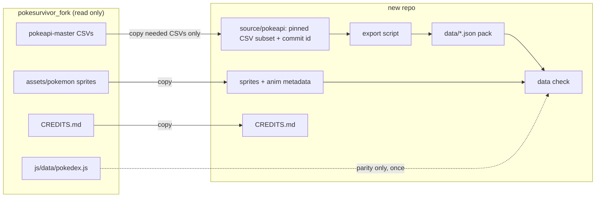
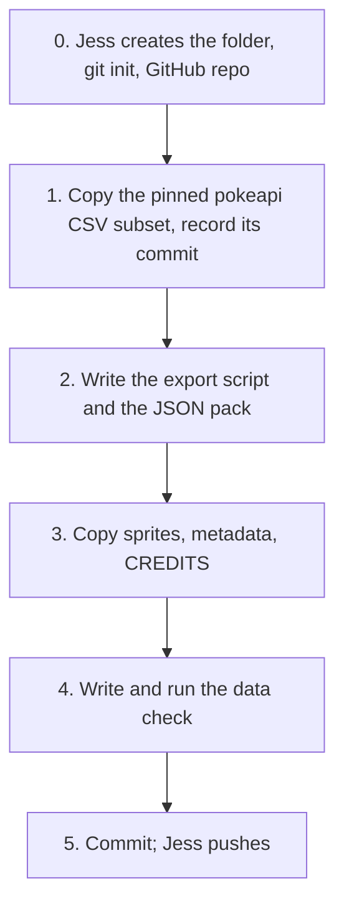

# Plan: raw data transfer to the new tactics repo

Status: [Proposed], 2026-11-15. Nothing is built until Jess agrees the slice opening and the decisions below.

Principle: carry over only **mainline facts and art**, never survivor tuning. The new repo regenerates its data from pokeapi itself, so it does not depend on this fork's code at all. That also keeps the original owner's code license (PolyForm Noncommercial) out of the new repo; only the sprite license (SpriteCollab, CC BY-NC, with credits) travels.

## Slice opening (to agree)

| | Proposal |
|---|---|
| Goal | The new repo holds an engine-neutral, English JSON data pack of mainline Pokemon facts plus the sprites, rebuilt from a pinned pokeapi subset by one script |
| Done when | The pack and sprites are committed, rerunning the script reproduces the pack with no diff, CREDITS is present, and the check below passes |
| End-goal test | Relations only: every species has six base stats above 0 and one or two known types; every learnset move and evolution target exists in the pack; the type chart is 18 by 18 with only 0, 0.5, 1 and 2; Fire on Grass beats neutral and Normal on Ghost is 0; every species with a sprite folder has its animation metadata; base stats and types match this fork's pokedex for every shared species (a parity check between two sources) |

## Flow

## What goes, what stays

| Goes (raw facts) | Source | Note |
|---|---|---|
| Species: names, base stats, types, abilities, height, weight, gender rate, EV yield, base XP, generation, legendary flag | pokeapi | Not the fork's derived hp/spd/atk |
| Evolution chains with triggers and levels | pokeapi | Fork only kept "can evolve" |
| All mainline moves: type, category, power, accuracy, PP, priority, target, effect chance, short effect text | pokeapi | Not moves-generated.js (survivor axes) |
| Learnsets with levels and method (level, egg, machine) | pokeapi | Fork's file dropped the levels |
| Type chart, natures, ability names and text | pokeapi | |
| Pokemon sprites (966 species, shiny, portraits) | assets/pokemon | About 111 MB |
| Animation metadata (frame sizes, durations, shadow) | sprites-meta.js or a fresh SpriteCollab fetch | See decision 4 |
| Item icons sheet and index | assets/items | Optional, decision 5 |
| CREDITS.md | repo root | Required by the sprite license |

| Stays behind (survivor or authored) | Why |
|---|---|
| moves-generated, move-attributes, overrides, handler, resolver | Real-time move grammar |
| items.js effects, ground-items, drops, upgrades, missions, achievements | Survivor tuning |
| enemies.js tiers, enemy-classes, leader-ai-settings | Swarm behavior |
| gyms.js, starters.js, music.js | Authored content; revisit as a later slice |
| tileset (308 MB), contact masks | Overworld art, not tactics maps |
| lang-en.js, changelog, funding | Spanish keys and fork history |

## Steps

## Decisions for Jess

| # | Question | Recommendation |
|---|---|---|
| 1 | Repo name and path under C:\dev | Yours |
| 2 | Bring a minimal CLAUDE.md, CONTEXT.md and the git guard hook in step 0, so the new repo's sessions follow the same rules? | Yes, trimmed to the rules that are not survivor specific |
| 3 | Learnset version: which game's learnsets | Latest game each species appears in (Scarlet and Violet, falling back to older games) |
| 4 | Animation metadata: convert the fork's sprites-meta.js, or refetch from SpriteCollab | Refetch: SpriteCollab has extra animations (Sleep, Hop, Swing and more) a tactics game will want, and the 8-direction rows suit facing |
| 5 | Item icons now or later | Later, with items |
| 6 | Forms (Alolan, Galarian, Mega) now or later | Default forms only for now |
| 7 | Script language: Node or Python | Node, matching tools/ here |
| 8 | Sprites in plain git or Git LFS | Plain git (111 MB is fine; this fork already does it) |
