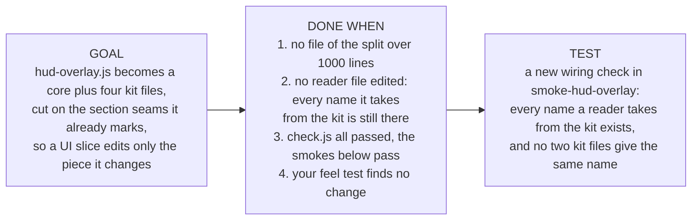
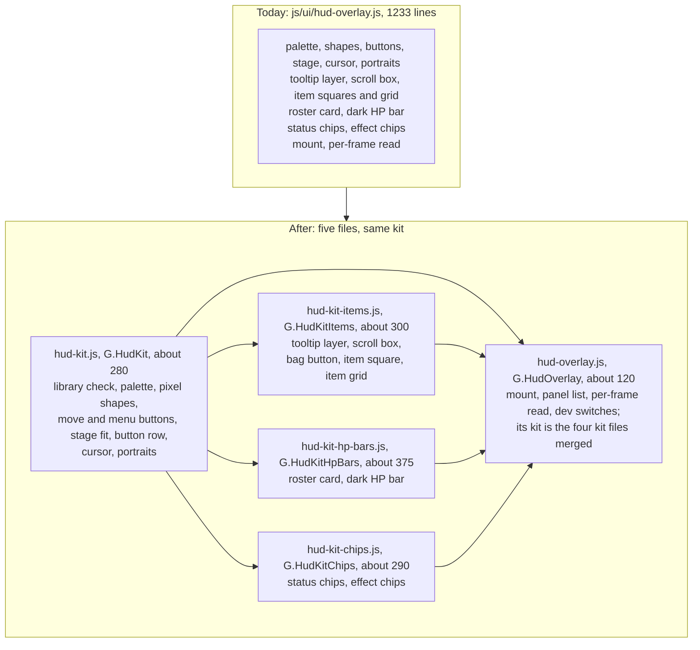
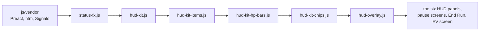
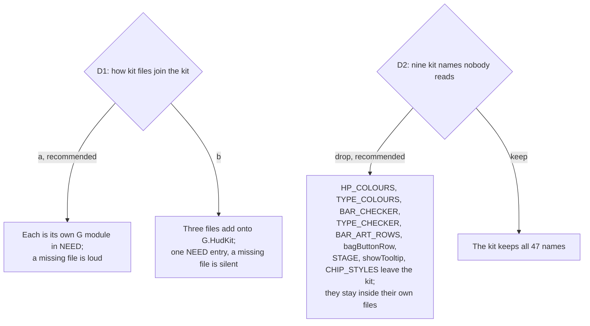

# F1: Split hud-overlay.js (Slice Opening and Plan)

Structural review F1 (decision 2026-11-14-structural-review-new-files-count), the first issue after the merge.
Branch: refactor/hud-kit-split off main. Behavior-neutral: nothing on screen changes.

**Built 2026-11-14 (approved: D1a, D2 drop).** Awaiting Jess's format, check.js, smokes, mutant and feel test.

| File | Lines |
|---|---|
| js/ui/hud-overlay.js | 1233 to 139 |
| js/ui/hud-kit.js (new) | 263 |
| js/ui/hud-kit-items.js (new) | 289 |
| js/ui/hud-kit-hp-bars.js (new) | 367 |
| js/ui/hud-kit-chips.js (new) | 280 |

Differences from the plan: the kit had 48 names, not 47 (hooks was missed), so 39 stay after D2. The dead TYPE_CHECKER
constant was removed, since D2 left it with no reader at all. A tenth unread kit name turned up, FOCUS_RIM (only a
comment in pause-menu.js names it); Jess ruled it dropped too, so 38 names stay. It is still used inside hud-kit.js.

## Opening (CLAUDE.md "Slice shape")

## Today and after

Measured on the file: the three later kit files read only from hud-kit.js, never from each other. Item squares
need the tooltip, so both sit in hud-kit-items.js. The roster card and the dark HP bar are the two HP displays.

## Load order

| Item | Detail |
|---|---|
| dev.html | Four new script lines just before hud-overlay.js |
| NEED (js/main.js) | HudKit, HudKitItems, HudKitHpBars, HudKitChips, before HudOverlay |
| No libraries | hud-kit.js does the one library check. Each kit file returns a not-ready stub, and G.HudOverlay keeps its stub with no kit, so the canvas HUD draws its old pieces as today |
| Readers | Unchanged. All 13 take their names from G.HudOverlay.kit, which holds the same names |
| Core | Keeps its own reference to Signals' batch for the per-frame read (no new kit name) |
| Build | build.js picks the new scripts up from the dev.html block; rebuild before publishing |
| CSS | css/hud-overlay.css unchanged |

## Plan check (coding principles)

| | |
|---|---|
| Reuses | The kit object every reader already destructures; the file's own section headers as the cut lines |
| New | Four files and four G names. One file per seam the review named; nothing existing fits since the pieces are the file |
| Not built | No reader edits, no renamed piece, no new kit name, no CSS split, no change to the panel registry |
| Size | Largest new file about 375; hud-overlay.js 1233 to about 120 |
| Touched-code cleanups | Only decision D2 below |

## Tests

| File | Change | Why |
|---|---|---|
| tools/smoke-hud-overlay.js | NEW CHECK: reads each js/ui file's names taken from the kit, then in the page checks each is defined on G.HudOverlay.kit; also that no two of the four kit modules give the same name. Prints only on failure | A dropped name or a missing kit file would only show as one broken screen. This is a relation check, no pinned list |
| docs/proposals/run-info-harness.js | Its ScrollBox drag check (section 8) and its override map point at hud-kit-items.js | The scroll box moves there |
| docs/proposals/run-info-mutate.js | The "scroll thumb cannot be dragged" mutant targets hud-kit-items.js | Same move; its text is unchanged |
| tools/check.js | No change | It syntax-checks every js/ file already, so the new ones are covered |
| New harness or mutate runner | None | The split changes no behavior, and the smokes already render every kit piece in a headless browser |
| Intent scenarios, debug sets | None | No moves touched; the feel test uses the screens as they are |

You run: npm run format, node tools/check.js, the smokes (smoke-hud-overlay plain and with --built,
smoke-pause-menu, smoke-pause-inventory, smoke-status-fx, smoke-berry-slots), then the run-info mutant with
MUTATE_ONLY=scroll.

Feel test, about a minute on dev.html?dev with a hard reload: the run HUD (roster, player panel, boss bar, map,
DPS panel, run items), the pause menu's three tabs with a tooltip and a scroll drag, End Run, the EV screen.

## Docs

HUD-STYLE.md's two file pointers (TooltipLayer to hud-kit-items.js, createEffectChipReader to hud-kit-chips.js);
an ONBOARDING module map line per new file; the hud-overlay.js header lists the four kit files. No changelog line,
since nothing a player sees changes.

## Risks

| Risk | Caught by |
|---|---|
| A kit file loads out of order or is missing | NEED shows the failed-to-load screen |
| A name falls out of the kit | The new wiring check |
| The built bundle behaves differently | smoke-hud-overlay --built |
| A moved line breaks a mutant | run-info-mutate (the only mutant on this file) |

## Decisions

D2 was checked against every js/, tools/ and docs/proposals/ file: none reads those nine from the kit.
