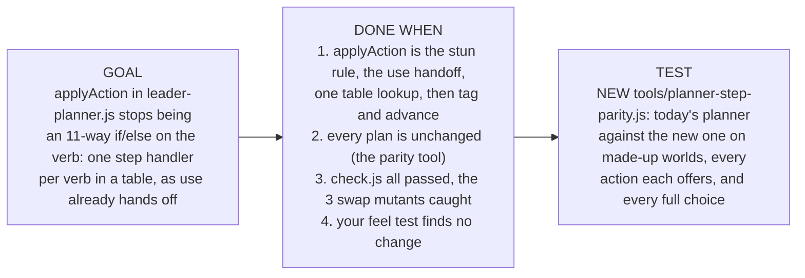
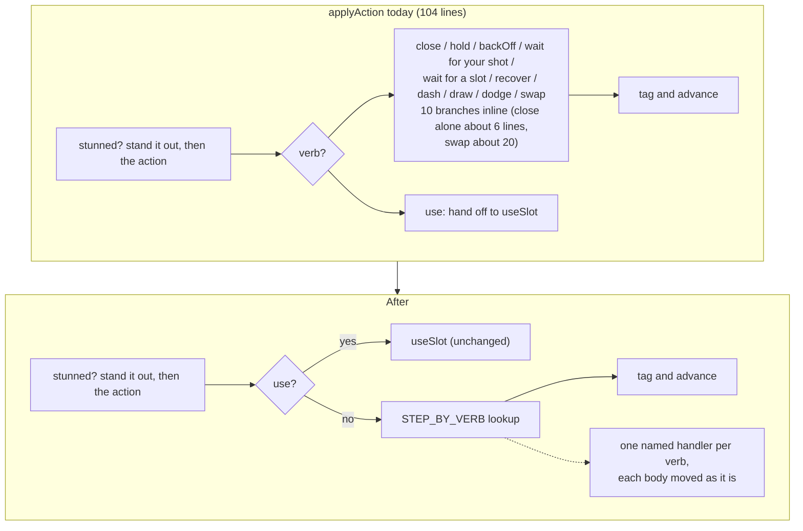
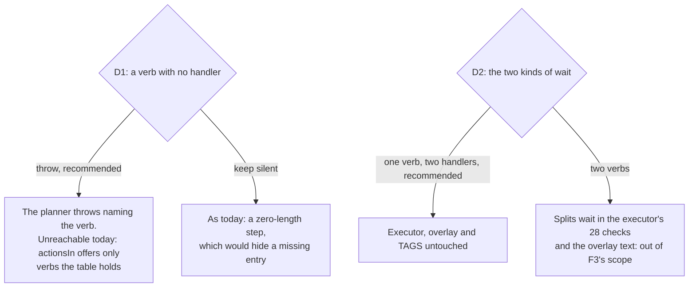

# F3: Planner Verb Table (Slice Opening and Plan)

Structural review F3 (decision 2026-11-14-structural-review-new-files-count). Branch: refactor/planner-verb-table off
main. Behavior-neutral: every plan the leaders make stays the same.

**Built 2026-11-14 (approved: D1 throw, D2 one wait verb).** Awaiting Jess's format, check.js, the parity tool, the
swap mutants and a feel test.

| File | Lines |
|---|---|
| js/systems/leader-planner.js | 709 to 756 (applyAction 104 to 27; a one-line doc per handler) |
| tools/planner-step-parity.js (new) | 248 |

Differences from the plan: the file grew by 47 lines, not about 16, since each handler got a one-line doc comment.
All 25 planner mutants in leader-ai-mutate still match their text exactly once (not just the 3 on swap), and every
code line of the old branches is present in a handler. The parity tool also checks D1 (a verb with no handler throws,
naming the verb) and fails if any of the 11 verb kinds goes unexercised. Quick could not run it (no Node evaluation in
its sandbox); Jess runs it.

## Opening (CLAUDE.md "Slice shape")

## Today and after

| Item | Detail |
|---|---|
| Where | js/systems/leader-planner.js only, the applyAction function (lines 333 to 436) and new handlers beside it |
| Handlers | One named function per verb (close, hold, backOff, wait, recover, dash, draw, dodge, swap), each given the world, the state, the action and the next state and step it fills in. Bodies move as written |
| The wait verb | Two handlers, wait for your shot and wait for a slot; the wait entry picks by whether the action names your move (decision D2) |
| Travel time | The closure four branches share becomes one small named helper beside the handlers (same formula) |
| The table | Frozen, keyed by verb, beside TAGS. TAGS is unchanged |
| apply() | Unchanged, so all ten harness calls to G.LeaderPlanner.apply are untouched |
| Size | 709 to about 725 lines (function headers). No new file, no dev.html or NEED change |

## Plan check (coding principles)

| | |
|---|---|
| Reuses | useSlot's handoff shape; the existing TAGS table pattern; every helper the branches call today (shotsDuring, spendCharge, recoverIn, dodgeSuccess, matchupRates, monOf, advance, copy) |
| New | The table, nine handlers, the travel helper, the parity tool. A table because a new verb then needs one entry, not one more branch |
| Not built | No change to the executor's verb checks in leader-ai.js (28 of them; out of F3's scope). No new verb, no TAGS change, no change to what any action costs |
| Where it lives | All in leader-planner.js: the planner owns its actions, and harness 15i requires it to read nothing but G.LeaderPlanner |
| Touched-code cleanups | None |

## Tests

| File | New or changed | What it does, and why |
|---|---|---|
| tools/planner-step-parity.js | NEW dev tool (never ships) | Loads two copies of the planner, each on its own G: today's (copied from main into tools/cache/leader-planner-before.js, which is git-ignored) and the working one. On a set of made-up worlds (near and far, stunned, a slot cooling, your shot due, a bench mon, dodge charges 0 and 2, a recover pending) it runs every action actionsIn offers through apply on both and compares the state and step field by field, then compares the full choose() ranking. Prints only differences; a clean run is one line. WHY: harness 15 and 16 check close, use, dash, draw, dodge and swap by number, but wait (both forms), recover, hold and backOff have no check on their step at all, and only 3 mutants sit on applyAction (all on swap). Parity with the old code is the only check that covers every moved branch. Relations rule: parity |
| docs/proposals/leader-ai-harness.js | No change | Sections 15 and 16 must pass as they are; 15i (the planner reads only G.LeaderPlanner) must still hold, since the table stays inside the module |
| docs/proposals/leader-ai-mutate.js | No change | Its 3 planner mutants on swap (no cost, ignores swapWill, no matchup term) match text with no leading spaces, so the re-indent keeps them matching. I check each still matches exactly once |
| tools/check.js | No change | It syntax-checks tools/, so the new tool is covered; it runs only docs/ harnesses, so you run the parity tool by hand |
| Mutation runner, intent scenarios, debug sets | None new | No behavior changes and no moves touched. The test gap above (no mutant on 7 of 10 verbs) is an issue draft, not folded in |

You run: npm run format, node tools/check.js, node tools/planner-step-parity.js,
MUTATE_ONLY=swap node docs/proposals/leader-ai-mutate.js.

Feel test, about a minute on dev.html?dev: fight Brock and Misty with the G.Debug.hitbox() overlay on; the decision
lines show the same kinds of plans (close, hold, back off, wait, draw, dodge, swap) as before.

## Docs

The leader-planner.js header names the table. LEADER-AI.md needs nothing (it names actions, not code paths). No
changelog line, since nothing a player sees changes.

## Risks

| Risk | Caught by |
|---|---|
| A moved line changes (a dropped term, a wrong variable) | The parity tool, field by field, on every verb |
| A verb loses its entry | The parity tool (that action's step goes missing) and D1 |
| The re-indent breaks a mutant | The exact-match check on the 3 swap mutants |

## Decisions

