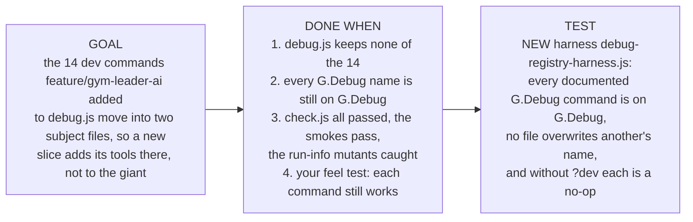
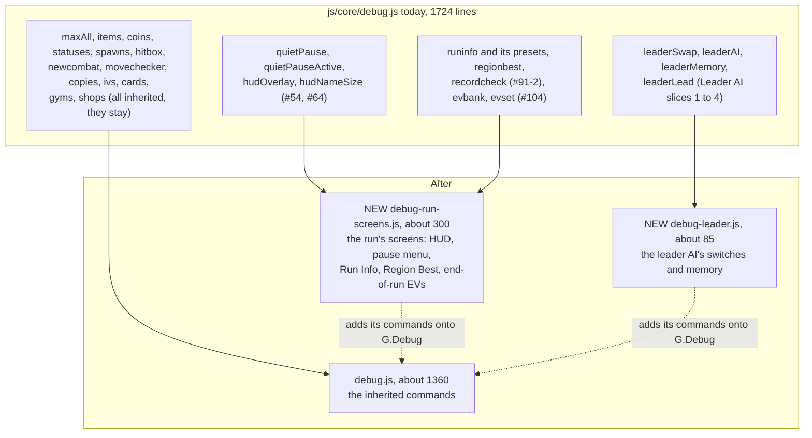
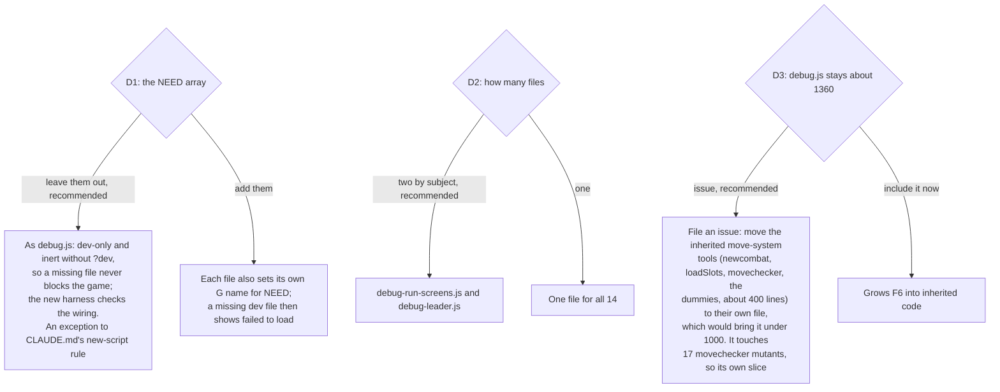

# F6: Split the Branch's Dev Tools out of debug.js (Slice Opening and Plan)

Structural review F6 (decision 2026-11-14-structural-review-new-files-count). Branch: refactor/debug-split off main.
Behavior-neutral: every G.Debug command keeps its name and does the same thing.

**Built 2026-11-14 (approved as recommended: D1 out of NEED, D2 two files, D3 an issue).** Awaiting Jess's format,
check.js, the smokes, the run-info mutants and a feel test.

| File | Lines |
|---|---|
| js/core/debug.js | 1725 to 1346 |
| js/core/debug-run-screens.js (new) | 320 |
| js/core/debug-leader.js (new) | 91 |
| docs/proposals/debug-registry-harness.js (new) | 112 |

Differences from the plan: it is 13 commands plus one internal helper (seedRunInfo), not 14 commands. run-info-mutate
has 2 mutants on the debug file, not 3 (its third, "behind reads as ahead", targets pause-run-info.js); both match the
new file exactly once. All 17 debug-movechecker mutants and the type-chart mutant still match debug.js exactly once.
The registry harness finds the debug files from dev.html itself, so a later debug-*.js is covered with no edit.
Quick could not run it (no Node evaluation in its sandbox); Jess runs it.

## Opening (CLAUDE.md "Slice shape")

## What moves

Measured: the 14 commands below are about 330 of the 382 lines the branch added (the rest are their header lines and
export entries). Each group reads only one thing from debug.js, its ?dev gate, so it moves without new plumbing.

| Item | Detail |
|---|---|
| Registration | Each new file adds its commands onto G.Debug (the same object), so every caller (game.js reads quietPauseActive; the smokes call runinfo, regionbest, recordcheck, quietPause, hudOverlay, leaderAI, leaderSwap) is unchanged |
| The gate | Each new file reads G.Debug.on, the flag debug.js already exports; the moved bodies keep their own ?dev warnings as written |
| Header docs | Each command's line in debug.js's header moves to the new file's header |
| Load order | dev.html: the two new scripts right after debug.js, before game.js. build.js picks them up from the block |
| Size | debug.js 1724 to about 1360. It stays over 1000: it was 1342 before the branch, inherited (decision D3) |

## Plan check (coding principles)

| | |
|---|---|
| Reuses | G.Debug itself and its exported on flag; the bodies as written; the run-info harness's text checks, repointed |
| New | Two files and one harness. Two, not one, because the leader tools and the screen tools change for different slices |
| Not built | No renamed command, no new command. The ?dev guard repeated in about 45 commands stays as it is (inherited; an issue if you want it) |
| Where it lives | js/core/, next to debug.js; dev tools only, inert without ?dev, as debug.js is |
| Touched-code cleanups | None |

## Tests

| File | New or changed | What it does, and why |
|---|---|---|
| docs/proposals/debug-registry-harness.js | NEW harness (check.js runs it) | Loads debug.js and the two new files in Node against small stubs (as debug-movechecker-harness does). Checks: (1) every command a header documents as G.Debug.name is a function on G.Debug; (2) no file overwrites a name another file already put on G.Debug; (3) without ?dev, each moved command returns without touching the game. WHY: nothing today checks that the registry is whole. A dropped name would only show as one smoke failure, or not at all for leaderMemory, leaderLead, evbank and evset, which no smoke calls. Relations rule: wiring (docs to registry) and shape (no collision) |
| docs/proposals/run-info-harness.js | Changed | Its text checks on runinfo, regionbest and recordcheck (section 8) and its override map read debug-run-screens.js instead of debug.js. Their exact text moves unchanged |
| docs/proposals/run-info-mutate.js | Changed | Its debug target points at debug-run-screens.js; its 3 mutants there keep their text. I check each matches exactly once |
| Smokes (pause, pause-menu, hud-overlay, leader-overlay) | No change | They call the commands on G.Debug in the page, so they also catch a broken load |
| debug-movechecker, team-cards, type-chart harnesses and mutate | No change | They read debug.js code that stays (movechecker, newcombat's rows, the dummies). I check every one of their patterns still matches |
| Mutation runner | None | The harness checks wiring, not behavior; a mutant would only drop a name, which check (1) already fails on |
| Intent scenarios, debug sets | None | No moves touched |

You run: npm run format, node tools/check.js, node tools/smoke-pause.js, node tools/smoke-pause-menu.js,
node tools/smoke-hud-overlay.js, MUTATE_ONLY=recordcheck,runinfo,behind node docs/proposals/run-info-mutate.js.

Feel test, about a minute on dev.html?dev: in the console run G.Debug.quietPause(), G.Debug.hudOverlay(),
G.Debug.runinfo('full') then pause, G.Debug.regionbest(), G.Debug.leaderAI() and G.Debug.leaderMemory() in a gym.

## Docs

ONBOARDING's js/core/ line names the two files. No changelog line, since nothing a player sees changes.

## Risks

| Risk | Caught by |
|---|---|
| A command drops off G.Debug | The new harness, check (1) |
| A new file loads before debug.js | It throws at load (no G.Debug yet): the smokes' "no page errors" checks |
| A moved line breaks a run-info check or mutant | The exact-match check on each |

## Decisions

