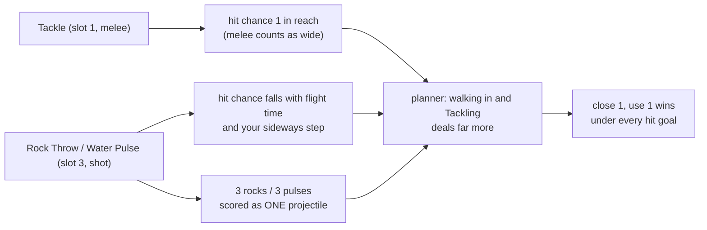

# #109 round 1: what the traces show

Read from tools/cache/leader-trace-Brock-2026-11-14T20-34-25-560Z.json (28.6 s, 95 choices) and
leader-trace-Misty-2026-11-14T20-35-49-258Z.json (91.5 s, 362 choices). No marks were placed. Your feel verdict is still
the done-condition; this is the evidence beside it.

Feel verdict (Jess, 2026-11-14): Brock felt a lot more stable; walk away and he shoots for a while, then comes in.
Misty clung to you. Next: "109 - Leader Reads Its Whole Kit Plan.md" (Jess: the planner must read the whole kit).

## The numbers

| | Brock | Misty |
|---|---|---|
| Time by goal | Finish 55%, Pressure 25%, Maintain 10%, Conserve 9%; Endurance 0% (his top weight) | Pressure 71%, Conserve 14%, Finish 12%, Kite 1% |
| Distance (quartiles) | 76 / 97 / 141 px, range 250 | 95 / 137 / 180 px, range 260 |
| Plans | Finish: "close 1, use 1, use 1, use 1" (walk in, Tackle) | Pressure: "close 1, use 1" (walk in, Tackle) |
| Back off as a first step | n/a | 2% of the fight (the running is gone) |
| Dashes | 4 (2 under Pressure at 196 and 230 px) | 12; 38 dodges wanted with no charge left, 11 within 3 s of her own dash |
| Half-HP trigger | fired at 19.1 s, Pressure 1.6 in force (T3 works) but Finish already led | line only, as authored |

## Why both walk in

- leader-belief.js moveView sizes a move by one hit of its power, and leader-planner.js hitChance treats a shot as one
  projectile. Neither reads `space.count`, the field the Count card raises. So Brock's 3-rock Rock Throw (count 2 in his
  loop 1 cards) and Misty's 3-pulse Water Pulse count as a third of what they throw. That is a gap in the planner's
  damage estimate, not a personality problem.
- Goal weights only scale a goal's value. Pressure and Finish win on cost (their fixed profiles weigh damage dealt high,
  so a Tackle chain has a large negative cost). Replaying Brock's recorded rankings: Finish stays at 52 to 55% of the
  fight even at Finish 0.3, Pressure 0.3, Maintain 2. More weight rounds cannot fix him.

## What it means for #109

| Row | Trace says |
|---|---|
| Brock closes only to throwing distance | fails: median 97 px, mostly Tackle |
| Brock: Defense Curl early, Rock Throw from where he stands | fails after about 5 s |
| Brock: half-HP push, then holding | push works, but he was never holding |
| Misty keeps firing, backs off only between shots | backing off fixed (2%) |
| Misty holds a Water Pulse distance | fails: median 137 px, Tackle |
| Misty dodges quickly, then answers | weakened: her dashes spend the charges her dodges need |
