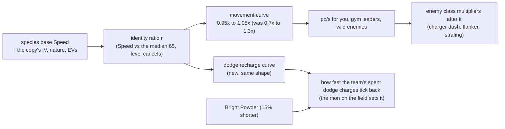

# #123: move speed 0.95x to 1.05x, Speed sets dodge recharge (plan)

Prose plan, no code. Ruling: decision 2026-11-15-123-speed-band-and-dodge-recharge. Branch: balance/109-template-check.

## Slice opening

| | |
|---|---|
| Goal | Move speed differs only a little between species, and Speed shows up as dodge recharge |
| Done when | The tests below pass, check.js is clean, and Jess's feel test with Turtwig, Bulbasaur and Froakie says early game is playable for all three, with the fast one still feeling better through more frequent dodges |
| End-goal test | A new small harness, docs/proposals/speed-band-harness.js (relations only), written first and red before the change |

## The model

Same curve shape for both, so one function serves both with its own bounds.

## Numbers

| Species (base Speed) | Movement now | Movement new | Dodge recharge new (0.8x to 1.25x rate) |
|---|---|---|---|
| Turtwig (31) | 76 | 102 | 8.7 s |
| Bulbasaur (45) | 82 | 102 | 8.6 s |
| Charmander (65, median) | 107 | 107 | 7.0 s (unchanged) |
| Froakie (71) | 116 | 112 | 6.5 s |
| Rattata (72) | 117 | 112 | (enemies have no dodge) |
| Pikachu (90) | 133 | 112 | 5.8 s |
| Jolteon (130) | 139 | 112 | 5.6 s |

Like movement, recharge saturates near its bounds: everything past about base 90 sits near the top, everything under
about 45 near the bottom. The slow side bottoms out around 8.75 s and the fast side tops out around 5.6 s.

## Changes, by file

| File | What changes |
|---|---|
| js/core/stats.js | Movement bounds 0.95 and 1.05. The curve function takes its bounds as arguments, so movement and dodge recharge share it. New dodge recharge bounds (0.8 and 1.25, named in the module's tunables) and a new function giving a species' dodge recharge rate from the same inputs as its movement (base Speed, IV, nature, EVs). Header comment updated |
| js/entities/player.js | Where a mon's movement is computed from its stats, its dodge recharge rate is computed beside it (fallback 1 when stats are absent, like movement). A new method gives the rate on the field: that rate times Bright Powder's. The recharge tick uses that method in place of its Bright Powder line |
| js/systems/leader-belief.js | When it reads when the leader's next charge returns, it divides the seconds left by the leader's recharge rate (that same method), so the leader's plan matches the real return. Today it ignores Bright Powder, so this also fixes that |
| js/entities/gym-leader.js, js/data/enemies.js, js/systems/gym.js | Nothing. Leaders extend the Player class and wild enemies call the same movement function |
| js/data/changelog.js | A patch note (free edit) |
| docs/proposals/pokebox-stats-harness.js, pokebox-evs-harness.js | Their speed checks pin exact px/s from the old bounds (written before the relations rule). They become relations: a higher IV, a raised nature and Speed EVs never move you slower and do move you faster below the cap |
| docs/proposals/speed-band-harness.js | New, the end-goal test (below) |
| docs/COMBAT-RULES.md, BALANCE.md | The SPEED rule and its doc gap note; the movement line and a dodge recharge line |

No new save fields: the rate is computed from stats the save already holds.

## End-goal test (speed-band-harness.js)

| Check | Relation |
|---|---|
| Band | Over every roster species, fastest movement divided by slowest is at most the band's max divided by its min (read from G.Stats) |
| Order | Sorted by base Speed, movement never falls; dodge recharge rate never falls |
| Median | The median species recharges at rate 1, so its charge takes exactly the dodge cooldown |
| Strict | A species with a higher Speed stat value recharges strictly faster than one with a lower |
| Wiring | Two Player entities, a fast and a slow species, each spend a charge and tick the same time: the fast one's charge is back first; Bright Powder on the slow one shortens it by its own share on top |
| Leader parity | A leader's Belief reading of when its next charge returns equals the time the tick really takes to bring it back, with and without Bright Powder |
| Enemies | A wild enemy's walking speed comes from the same movement function (same species, same px/s) |

## Plan check (coding-principles)

| Part | Reuses | New | Not built |
|---|---|---|---|
| Movement band | The existing curve and ratio; the existing bounds constants | Nothing but the two numbers | No separate enemy band (Jess: classes differentiate) |
| Dodge recharge | The same curve (given its bounds), the same ratio, the Bright Powder tick pattern | One G.Stats function, two named bounds, one Player method, one stored rate | No change to dodge distance, duration, charges or the gap; no enemy dodge; no UI readout of recharge (can be its own issue) |
| Belief read | The method above (asks the Player, does not reach into its items) | Nothing | No change to the planner's dodge model (distance, time) |

Where it lives: every stat formula in G.Stats (COMBAT-RULES "G.Stats"); the tick and its rate on the Player body; the
leader's read in Belief. Size: stats.js, player.js and leader-belief.js grow a few lines each; player.js is already
past 1000 lines (no split in this slice). Touched-code cleanups: the stats.js header and COMBAT-RULES doc gap note,
which still cite the old bounds.

## Risks

| Risk | Note |
|---|---|
| Wild plain chasers now all walk within about 10% of each other | By the ruling, class multipliers carry the texture. If hordes feel samey, a per-class walk multiplier is its own issue |
| Speed IVs, natures and EVs barely move you now | Their value moves into dodge recharge. Percent "Movement Speed" bonuses (cards, items) still stack on top, so they become the main way to get faster in a run |
| #109's feel changes | Brock's Geodude goes 75 to 102 px/s, Starmie 139 to 112; Misty's fast mons dodge more often. Feel-test #109 after this lands, alongside the score rule |
| Leader harness checks may move | Planner checks are relations on made-up worlds, but any that build a real leader can shift; fixed as relations if so |

## Decision for Jess

1. Dodge recharge bounds 0.8x to 1.25x (slowest about 8.7 s, median 7 s, fastest about 5.6 s). Recommended: a felt
   difference of about one dodge every 9 s against one every 6 s, without making slow mons helpless.
