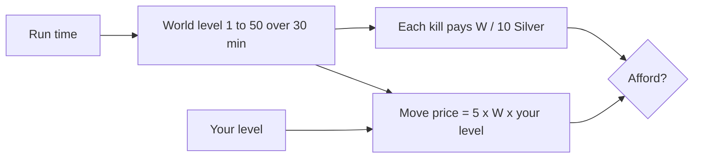
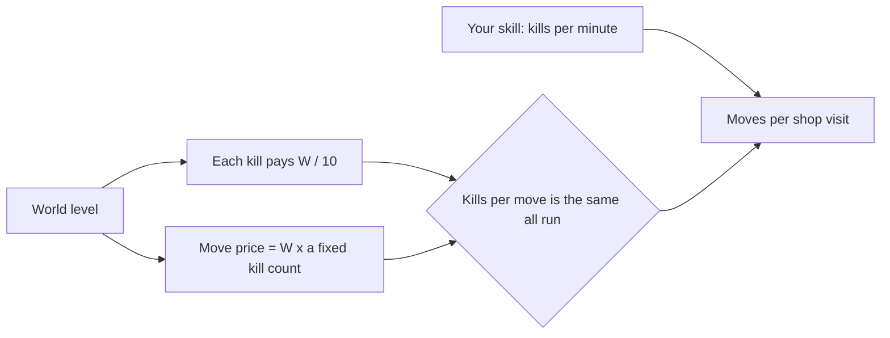

# #124 Economy pass: slice opening (draft for Jess)

Ruling: docs/decisions/2026-11-15-124-economy-independent-of-xp.md

## Today

Income and price both grow with W, so they cancel out. Price also grows with your level and income does not, so the faster you level, the more kills each move costs.

## Proposed

Your level drops out of the price, so a move costs the same number of kills from start to finish. Skill (kill rate) alone decides surplus or grind.

## The three opening items

| Item | Draft |
|---|---|
| Goal | Shop prices stop depending on your level; what a move costs is a fixed number of kills all run |
| Done when | Price at a given time is the same at any run level; an average-pace run affords at least one move per shop visit; a slow run affords fewer but can catch up by grinding; Jess feel test |
| End-goal test | New relations in the Silver harness, below |

## End-goal test (relations, written first)

| # | Relation |
|---|---|
| E1 | Same run time, different run levels: the price is equal |
| E2 | Price divided by Silver per kill is the same at every world level |
| E3 | Silver earned between two shop visits at the reference average kill rate is at least one price |
| E4 | At half that rate it is less than one price, and grinding longer always closes the gap (nothing grows faster than income) |

## Open, needs Jess

| # | Question | Blocks |
|---|---|---|
| O1 | How many kills should one move cost (or: how many moves should an average player afford per shop visit)? | E3, E4, the number in the price |
| O2 | The reference "average kill rate" for E3: from a recorded run of yours, or a figure you name? | E3 |
| O3 | Are other Silver sinks (Mart TMs, future items) priced on the same rule? | scope |
