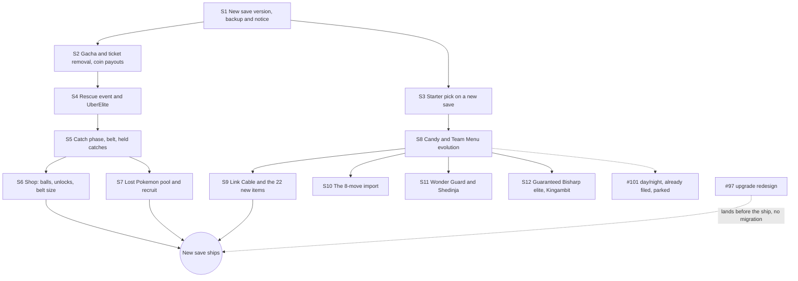

# 128 - Acquisition Slices Draft (2026-11-15)

The child issues for #128, drafted for Jess to approve before filing. Source: decision
2026-11-12-acquisition-no-gacha-catch-candy-legendaries and its spec, docs/ASCII Concept Maps/Old txt files/Acquisition v2 - Spec.txt
(section 12 "Build work this spawns"). Every slice still opens with its goal, done and end-goal test agreed with Jess.

## Order

## The slices

| # | Slice | Spec section | Done when (draft) | Blocked on |
|---|---|---|---|---|
| S1 | New save version: old save kept as a browser backup, a notice shows, nothing carries over | 9 | An old save loads as a fresh save, its backup is intact and the notice shows once | none |
| S2 | Gacha removal (banners, pulls, pity, tickets) and coin payouts where tickets were | 8 | No route gives a ticket or opens the gacha; every former ticket drop pays coins | coin amounts (economy) |
| S3 | Starter pick on a new save: all 9 regions' trios, the 3 of the chosen region, starting coins | 9 | A new save offers 9 trios and ends with the 3 starters in the Pokebox | starting coins (economy) |
| S4 | Rescue event: the per-minute roll, the "needs help!" toast with nature, arrow, UberElite with its clock | 2 | Roll odds, toast, 60 s window and the UberElite timer behave as the spec's relations | UberElite time limit (playtest, 60 s start) |
| S5 | Catch phase: game pauses, belt strip, our catch equation, Flee meter by nature, held catches to the run end | 3, 4 | A won rescue opens a catch; balls are used up; flee ends it; catches join the box only at the run end | FB4, FB5, FB6 (held catches) |
| S6 | Shop: restock Poke, Great, Ultra; unlock Great and Ultra; belt size | 4, 10 | Restock and unlocks work and persist; belt size is one shared count | Shop tab; prices (economy) |
| S7 | Lost Pokemon: Stage 1 pool from any region, floaters allowed, nature toast, 20 / 12 / 6% recruit | 5 | Delivering a Lost Pokemon recruits at the star odds, held like a catch | floater escort (H1, H2) |
| S8 | Candy and evolution: Exp Candy drops from gyms (unparked 2026-11-15), candy levels a copy (mainline XP curve), Team Menu evolve, in-run flags, ready popup, branch picking | 6 | A copy with enough candy and its requirement met evolves in the Team Menu | Exp Candy drop amounts (set at the slice opening) |
| S9 | Link Cable, Shed Shell, the 17 trade held items and 6 newer use-items in the Shop | 6, 10 | Every trade and item evolution has a source | Metal Coat and Razor Claw sources; prices |
| S10 | Import the 8 moves move-gated evolutions need (Mimic, Double Hit, Rollout, Taunt, Barb Barrage, Twin Beam, Hyper Drill, Dragon Cheer) | 6 | The 8 moves exist, are routed and reviewed under the move review rule | none |
| S11 | Wonder Guard and Shedinja: the combat rule, fixed 1 HP, the Nincada split (uses a ball, needs a free place) | 7 | The WG rulings hold in a harness; Nincada evolving also gives a Shedinja | none |
| S12 | Guaranteed Bisharp elite (R6) and the Kingambit evolution | 6 | With Bisharp on the team in an Unova-or-later run, the first elite is a Bisharp and beating it qualifies Kingambit | none |

## Calls for Jess (answered 2026-11-15)

Jess: Exp Candy drops are unparked (S8 builds them), and #97 ships with the new save. Decision
2026-11-15-128-exp-candy-unparked-97-ships-with-new-save. The 12 children are filed (Jess approved the batch): S1 #132 to S12 #143, in table order.

| Question | Why it matters |
|---|---|
| Approve these 12 children (or merge or split any)? | More than five new issues, so you approve the batch first. |
| Exp Candy drops are PARKED. Unpark them for S8, or build S8 with a dev-only candy grant? | Without drops, nobody can evolve on a new save. |
| Do the new save and #97 ship together? | If #97 lands before the new save, its upgrade levels need no migration. |
| Branch | `feature/128-acquisition` off main, after the 124 merge. |
