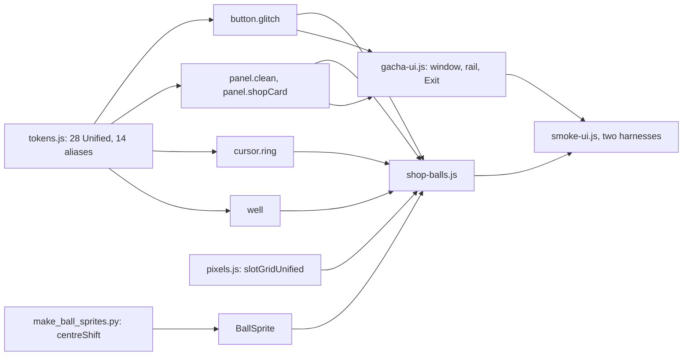
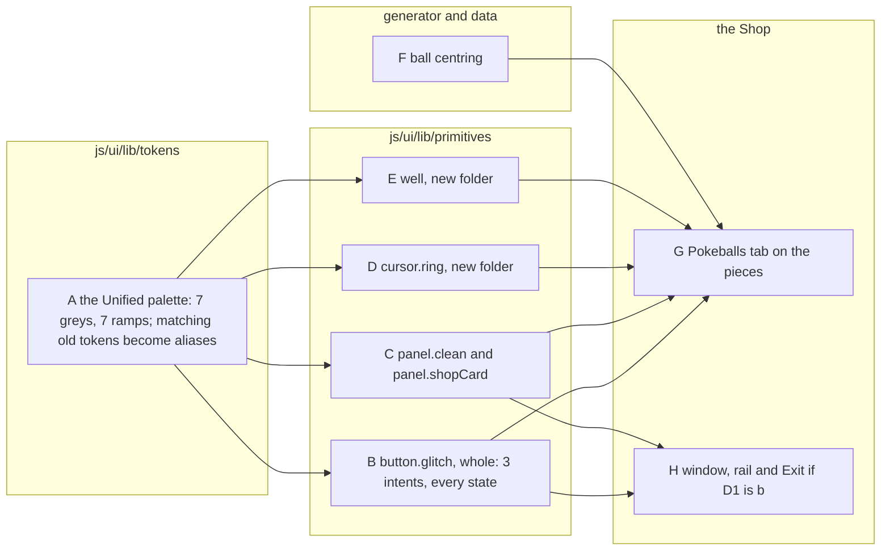

# 128 - Shop Pokeballs Look Plan (2026-11-21, rev 2, approved and built)

## Status (2026-11-21, Quick)

Approved with D1 (b) convert the window, rail and Exit; D2 (a) centring everywhere; D3 placeholder names accepted.
Built in one step. Owed by Jess: `node tools/check.js`, `npm run format`, `node tools/smoke-ui.js`, then the feel test.

| Where the build differs from this plan | Why |
|---|---|
| No cancel state on button.glitch | Superseded 2026-11-20 (2026-11-20-155-dialog-answers-never-share-an-intent): the back-out is Neutral. |
| No NEED entries for cursor.js and well.js | The primitives register under G.Lib, which NEED already checks ('Lib'), as the other primitives do. dev.html has both scripts and both stylesheets. |
| js/systems/catch.js unchanged | Its header never said the unlock and belt asked; only shop-balls.js did. |
| tokens-harness does not compare old values | That needs copied values. Checked once instead: all 100 older tokens resolve to the same colour as before the aliasing; 28 Unified tokens added. |
| New pattern slotGridUnified (pixels.js) | The board's belts sit on the slot grid in the Unified greys (grey.panel squares, grey.raised lines); the game's slotGrid keeps the old greys for the move slots until #126. |
| The menu cursor gained isShownOn, ringOn and keyPressCountOf | The marks a self-drawn cursor needs (data-cursor-shown, which the smoke reads), the ring's target, and a key press counter so button.glitch plays its press by keys too. |
| The well's slot class is shop-belt-slot, not catch-slot | catch-slot carries the catch screen's square border and black fill. The smoke reads the new name. |

Resolved after the build (Jess 2026-11-21):
- cursor.ring is 2 px, as the board draws it (decision 2026-11-21-cursor-ring-2px).
- The wobble's tilt frames keep their lean: no sideways centring, up and down only, so no bob (decision
  2026-11-21-ball-centring-keeps-wobble-lean). The harness checks it.

---

The last piece of #128's Shop slice (S6, #137): the Pokeballs tab gets the look Jess approved on the board
(decision 2026-11-20-155-main-shop-pokeball-look), pulled forward from #126. #137's rules in G.Catch do not change.
A prose plan with no code. It is checked against .claude/skills/coding-principles/SKILL.md as amended for this work by
decision 2026-11-21-unify-work-builds-final-building-blocks: every piece this tab draws is built whole, as its final
library primitive under its board name. Tracked as a comment on #128 (draft at the end).

## Opening (agreed 2026-11-21)

| Item | |
|---|---|
| Goal | The game's Pokeballs tab matches the approved board look, drawn from final library pieces; buying, unlocking, belts, arranging and selling work as today. |
| Done when | Every point of the look decision holds in the game (Part G); a buy, an unlock and a belt persist after a reload; Jess's feel test passes, which also clears #137's owed playtest. |
| End-goal test | smoke-ui.js's Pokeballs section rewritten to the new look, plus two new harnesses (Tests); `node tools/check.js` ends "check: all passed". |
| Scope ruled | Pieces are built whole as primitives (decision 2026-11-21-unify-work-builds-final-building-blocks). Unlock and belt buys stop asking (decision 2026-11-19-155-dialog-clean-cancel-state-and-input-modes). |

## What gets built, and where it lives

## Decisions for Jess before the build

| # | Decision | Options | Recommended |
|---|---|---|---|
| D1 | The window frame, the rail and Exit are on this tab but are drawn by js/ui/gacha-ui.js for all four tabs. | (a) As today until #126. (b) Convert them now: panel.clean window, rail icons 1 px in, Exit as button.glitch Neutral. The other three tabs keep their old cards and rounded buttons inside the new frame until #126. | (b). Under the new ruling the tab draws them and the pieces now exist whole. The cost is a mixed look inside the other three tabs instead of on this one. |
| D2 | Ball centring moves every BallSprite drawing (the catch screen's belt and owned faces too) by about 1 art px. | (a) Everywhere. (b) This tab only. | (a): one art fix with one home. |
| D3 | Names for what the board has not named yet. | The Unified tokens under the board's placeholder names (color.grey.panel, color.teal.base and the rest); the berry pocket's round slot as a primitive named `well` (states: empty, holding). | Accept both. A later rename is one edit in tokens.js and one in the well file. |

Already ruled, listed so nothing goes in quietly:
- **The asks go.** An unlock and a belt buy pay on the press, like a ball buy. The shift-click that only skipped the ask goes too. Shift for "up to 10" stays.
- **Locked cards keep a bright button.** A dimmed card never dims its button. Master and the Coming soon cards, dimmed whole today, keep a full-strength refused Unlock.
- **No selection cursor with the mouse.** Hovering a button plays its swipe.
- **Character Upgrades still asks** before its pocket buys until #126.

## The parts, each with its plan check

| Part | Files and spot | What changes | Reuses | New, and why | Not built | Size |
|---|---|---|---|---|---|---|
| A Tokens | js/ui/lib/tokens/tokens.js: a new Unified palette block after the HUD kit's | The 28 Unified colours (decision 2026-11-18-155-unified-palette): 7 greys and the red, green, blue, yellow, purple, pink and teal ramps (light, base, dark), each with its job line. Old tokens with the exact same value become aliases of their Unified token (hud.outline to grey.ink, hud.body to grey.panel, hud.checker to grey.raised, hud.slate to grey.slate, hud.cursor to yellow.base, rim.focus.base to green.base, low.fill to red.base, the card name's secondary to teal.base, the white label to grey.white), so there is no visible change. | G.Tokens.color, ramp, the alias support tokens.js already has | The palette is the building block every unified piece reads. | Moving old tokens whose values differ (old teal #29ceff, bonus yellow and the rest): that is #126's fold. | about +45 lines (286 now) |
| B button.glitch | js/ui/lib/primitives/button/button.js and button.css; menu-window-kit.js CursorButton | GlitchButton, ported whole from the board: - the three intents (Neutral teal, Negative red, Positive green) as a lookup table - rest: a transparent body, white bar and label - the focus swipe, with the rest bar taking the focus bar's colour (the sliver fix) - the press and release CRT - refused, at rest and focused, with the shake - disabled - the cancel look - the secret glitch state - any size, Michroma, label size as a prop  CursorButton gets one prop choosing the look; on glitch it draws no corners, because the swipe is the cursor. | CursorButton's cursor, hover, refusal toast and press (#151); font.michroma | No existing button has this shape or these states. | Retiring button.slanted and button.rounded (#126). The secret state ships with no trigger; the meta-narrative calls it later. | button.js about +70, button.css about +250 |
| C panel.clean, panel.shopCard | js/ui/lib/primitives/panel/panel.js and panel.css; menu-window-kit.js ItemCard | CleanPanel: square corners, a 1 px edge as a real CSS border (the scaling fix), a body and edge from tokens. panel.shopCard is CleanPanel with a grey.raised body and a teal.base edge. VerticalCard takes a frame (thin or shopCard) and a sizes table; today's CARD stays the default. | VerticalCard's layout and its dimmed and button-stays-lit looks; ItemCard | panel.clean is the window and panel piece for #126; shopCard is every Shop card. | Retiring ThinPanel and FlatPanel (#126). | panel.js about +40 |
| D cursor.ring | new js/ui/lib/primitives/cursor/cursor.js and cursor.css; menu-window-kit.js ringIf | cursor.ring, whole: 3 px, 2 px off the rim, yellow.base, steady, plus its CRT on a move (flattens to a line, then a dot; opens back past full with one flicker). ringIf sits beside cornersIf. | The cursor's position, hover, move events and mouse-mode hiding | The ruled cursor for every round piece. The folder is the future home of cursor.bar too. | cursor.bar (this tab does not draw it); moving the corners (#126). | about 60 lines across the two files |
| E well | new js/ui/lib/primitives/well/well.js and well.css | `well`: a round slot with a grey.panel fill; empty shows an ink ring, holding shows a ramp's base ring; it holds content (a ball, later a berry or a type glyph). | Tokens | The berry pocket's round slot, which the belts, the catch belts, the berry pocket and the move slots all draw. | Moving those other screens onto it (#126). | about 40 lines |
| F Ball centring | tools/make_ball_sprites.py; js/data/ball-sprites.js (regenerated); hud-kit-items.js BallSprite | The generator measures each frame's opaque box (17 balls by 17 frames) and writes each frame's shift in whole art px. BallSprite applies it, times the scale, mirrored when flipped. | The generator's existing PIL pass; BallSprite as the only menu ball drawer | The measurement lives in the generator because pixel reads are blocked under file://. | Changes to the in-run canvas ball. | about +20 generator, +4 BallSprite |
| G Pokeballs tab | js/ui/shop-balls.js; css/bw-shop.css; js/systems/catch.js header comment only | Details in the list below. | G.Catch for every rule; the arrange code; REFUSALS, settle and toasts; ScrollBox; BallSprite; ItemCard and CursorButton | None in logic. | New scroll.bar art (drafted, not reviewed). | shop-balls.js shrinks a little (483); bw-shop.css about +15 |
| H Window, rail, Exit (D1 b) | js/ui/gacha-ui.js (the window markup, the RAIL place, the EXIT button); css/bw-shop.css .shop-window | The window becomes panel.clean, the rail icons sit 1 px in, and Exit becomes button.glitch Neutral at 156 x 54. | panel.clean, button.glitch | | The other tabs' insides (#126). | small |

**Part G in detail:**
- **Cards:** ItemCard with the shopCard frame at the ball card's sizes (224 px tall, button 140 x 36, label 14 px). The ball is frame 9, flipped, at 2x and centred. The buttons are button.glitch, Positive.
- **Grid:** all 17 balls scroll in today's ScrollBox.
- **Belts:** PixelPanel, called by its library name instead of hud-kit's Box re-export (a rename, as the ruling allows), in color.rim.belt (unbought: the fainted ramp). Each holds six 52 px wells 8 px apart, three belts 20 px apart, the last 12 px from the pane's right edge.
- **Wells:** each slot is a `well` with cursor.ring.
- **Belt number:** Michroma 16, white with a 1 px ink stroke, on the belt's top-left corner.
- **Sell:** Negative, 204 px. **Belt buy:** Positive, 186 px.
- **Asks removed:** the unlock and belt asks and the shift-click tracking. The toasts stay.
- **Touched-code cleanups:** confirmSpend, shiftClick and the "You will have N left" note go (about 15 lines). The header comments here and in catch.js are corrected.

**New files** (C and D add four): each new script goes in BOTH the dev.html script block, after the button and panel primitives, AND js/main.js's NEED array. Each new CSS file gets its link in dev.html. Then rebuild before publishing.

## Tests

| # | File | Kind | What it checks | Why it is needed |
|---|---|---|---|---|
| 1 | tools/smoke-ui.js, shopFlow's Pokeballs section (about lines 1484 to 1910), CHANGED | Relations | New selectors. An unlock and a belt each take exactly their price, change the tab, and open no ask. A dimmed card's button keeps full opacity and refuses. Each card's button is centred and fits its card, and each label fits its button. Each belt holds six wells, numbered 1, 2, 3. By keys, a well shows the ring with no corners and a focused button shows no corners; with the mouse there is no ring. A focused button's rest bar computes the same colour as its focus bar. Each ball's visible centre sits within 1 screen px of its well or picture centre. The shift-click check is removed. Under D1 (b), the other tabs' Exit checks get the new class names. | It already covers this tab end to end; updating it beats duplicating it. |
| 2 | docs/proposals/ball-sprites-harness.js, NEW | Shape | Every ball has a shift for every frame; each shift is a whole number of art px, within half the frame size. | A bad regeneration passes the syntax check and would only show as off-centre balls. |
| 3 | docs/proposals/tokens-harness.js, NEW | Shape and wiring | Every token resolves to a hex through its aliases (no unknown names, no cycles). The 28 Unified tokens exist, with every ramp having light, base and dark. Each old token now aliased resolves to the same hex it had before (the before values are read from tokens.js's Unified table, not copied in). | No harness reads G.Tokens today. Aliases added here would throw on first draw if one is wrong, and tokens.js is built to load in Node for harnesses. |
| 4 | Mutation runner | none | | No logic in G.Catch or the arrange code changes. The two new harnesses check static data shape, which their own checks cover. |
| 5 | Intent scenarios | none | | No moves are touched. |
| 6 | Debug sets | none | | The feel test uses your save. |
| 7 | tools/check.js | no change | | It already runs every *harness*.js under docs/. |

## Feel test (you, in the browser, about a minute)
Hard reload dev.html?dev. No fresh save is needed.
1. **By keys:** on the Pokeballs tab, walk the cards. Each button swipes green with no white sliver.
2. **Locked cards:** Master's Unlock shakes and stays bright.
3. **Unlock:** buy Great's Unlock. There is no question, and the card lights with "Buy 150".
4. **Belts:** buy a belt, again with no question. Walk the wells: a steady yellow ring, with a CRT on each move.
5. **Arranging:** pick up, swap, and sell a ball.
6. **By mouse:** hovering a button shows its full shape, and no ring shows.
7. **Centring:** balls are centred in the wells and on the cards.
8. **D1 (b) only:** check the window edge, the rail and Exit on all four tabs.

## Risks
- **Aliasing old tokens** ties them to the Unified ones. The values match, so nothing moves now, and #126's renames then move every reader together, which is the intent.
- **Four new script and CSS files:** forgetting the NEED array shows the "failed to load" screen. That is the first thing to check if it appears.
- **Ring CRT timing** is ported as-is and may want a feel tweak.
- **smoke-ui.js is 2714 lines**, past the 1000-line mark. This plan edits it in place; issue draft below.

## Drafts

**Comment on #128 (you paste it):**
> S6 finish: the Pokeballs tab gets its approved look (decision 2026-11-20-155-main-shop-pokeball-look), pulled
> forward from #126 and drawn from final library pieces built whole (decision
> 2026-11-21-unify-work-builds-final-building-blocks): the Unified tokens, button.glitch, panel.clean and
> panel.shopCard, cursor.ring, well. Unlock and belt buys stop asking (decision
> 2026-11-19-155-dialog-clean-cancel-state-and-input-modes). Done when: every point of the look decision holds, buys
> persist after a reload, and Jess's feel test passes (clears #137's owed playtest). Test: smoke-ui.js Pokeballs
> section rewritten, plus docs/proposals/ball-sprites-harness.js and tokens-harness.js; check.js all passed.
> Plan: docs/ASCII Concept Maps/128 - Shop Pokeballs Look Plan.md.

**Issue draft (only if you want it filed): "Split shopFlow out of tools/smoke-ui.js"**
> smoke-ui.js is 2714 lines; shopFlow alone is about 1380. Move it to tools/smoke-shop.js with the shared boot and
> check helpers, no check changes. Done when both files run green and each is under 1500 lines.
