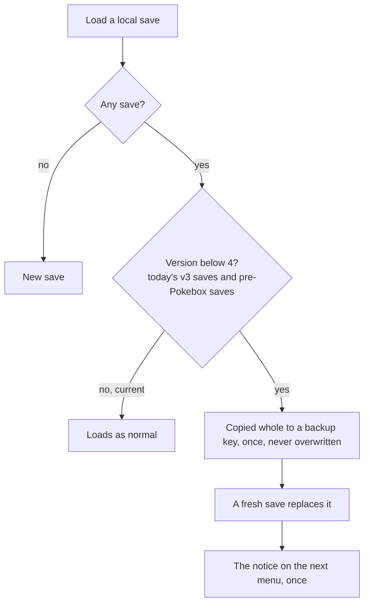

# 132 - New Save Slice Opening and Plan (S1 of #128, 2026-11-15)

Rules: acquisition spec section 9 (docs/ASCII Concept Maps/Old txt files/Acquisition v2 - Spec.txt), precedent
docs/decisions/2026-11-03-pokebox-is-a-clean-save-checkpoint.md. No code.

## Rulings (Jess, 2026-11-15)
- Settings (ps.settings: volume, language, layout) are kept. They are preferences, not progress.
- The reset goes live as soon as S1 lands on this branch.
- No new harness. The test that already covers this reset is updated in place.

## Today vs after

## Opening

| Item | Agreed |
|---|---|
| Goal | Every save from before the acquisition rework is set aside whole and replaced by a fresh one. A current save is untouched. |
| Done | Version 4; old saves backed up once and reset, with the notice once; settings and accounts untouched; check.js clean; Jess sees the notice once on first load. |
| End-goal test | docs/proposals/pokebox-copies-harness.js section 7, which already checks this reset: an old save loads fresh, the backup is whole, one notice, no second backup, a reload keeps progress, accounts kept. It is changed to the new version and backup key. No new file, no mutants, no browser check. |

## Plan

| File | Where | Change |
|---|---|---|
| js/core/db.js | the version constant and the backup keys near the top | Version 3 to 4. A new backup key for pre-acquisition saves next to the prebox one. Old prebox backups already in browsers stay where they are. |
| js/core/db.js | the local load (the clean save checkpoint) | The reset applies to any save below version 4 as well as a save with no Pokebox. Same steps as today: backup once, fresh save, notice flag. A current save still goes through the normal fill-in of missing fields. |
| js/game.js | the notice after login | Text becomes: title "New save needed", body "This update changes how you get Pokemon, so your save starts fresh.", note "Your old save is kept in this browser as a backup." |
| pokebox-copies-harness.js section 7 | the sample old save and the backup key | The sample becomes a v3 save with a Pokebox (today's real shape), so it proves the version reset, not only the old prebox one. The rest of the section stands. |
| docs | decision file and DECISIONS index; #132 comment; STATE | The settings and live-now rulings. |

Risks: your dev.html save resets on first load after this lands (backup kept). Playing main in the same browser and coming
back resets again, and only the first backup is kept. The Firebase cloud path is deferred, so a `deferred` issue gets filed for its version check.
