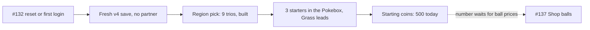
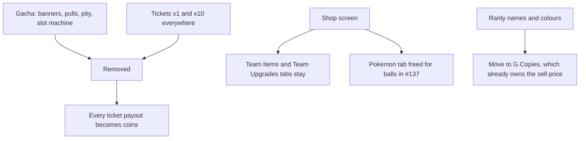

# 133 and 134 - Gacha Removal and Starter Pick, Slice Openings (2026-11-15)

Rules: acquisition spec sections 8 and 9 (docs/ASCII Concept Maps/Old txt files/Acquisition v2 - Spec.txt). No code.

## Finding first: #134 is already built

The starter pick (js/ui/test.js, js/data/starters.js) already offers all 9 regions, gives the region's 3 starters
(Grass leads) and runs for any save with no partner. The #132 reset hands a fresh save with no partner, so a new
v4 save already goes through it. The one open item is the starting coin number.

## #134 opening (proposal)

| Item | Proposal |
|---|---|
| Goal | A brand new save ends up with the chosen region's 3 starters and a sensible start. |
| Done | Jess plays a fresh save through the pick once and confirms it. The starting coins stay 500 for now, reviewed at #137 when ball prices exist. |
| End-goal test | None new: the existing Pokebox harness already checks a fresh save starts clean, and your one playthrough covers the screen. |
| Build | Nothing, unless the playthrough finds a gap. Close #134 after your confirmation. |

## #133 opening: what the gacha removal touches

| Area | What happens |
|---|---|
| Removed | js/systems/gacha.js, js/ui/slots.js (the slot machine), the Pokemon tab and its markup in dev.html, the pull and pity code, the banner tabs. Their script and NEED-list entries (dev.html, js/main.js). |
| Kept, moved | Rarity names and colours (menu.js, icons.js and slots.js read them from G.Gacha) move to G.Copies next to the sell price. |
| Kept | The Shop's Team Items and Team Upgrades tabs. js/ui/gacha-ui.js keeps those two tabs; the Pokemon tab goes. The Shop opens on Team Items until #137 fills the freed tab. |
| Tickets out | The HUD pill, the pickup kinds and their sprites, the player's ticket counters, banking tickets in game.js, the ticket fields and pity in the save, the achievement for 100 pulls, the ticket debug tool. |
| Ticket payouts become coins | See the table below. |

## Coin amounts (needs your number)

What a ticket was worth: an x1 ticket is one pull, and the average pull sells for about 38 coins
(sell prices 15 / 30 / 60 / 120 / 300 at rates 45 / 30 / 17 / 6.5 / 1.5 percent). An x10 ticket is ten pulls with a guaranteed 4 star or better, about 400.

| Source | Paid before | Proposal |
|---|---|---|
| Wild kill (1 in 400) | 1 x1 ticket | Drop this payout entirely; kills already feed Silver and the end-of-run coins |
| Meowth thief | 20 coins x5 | Unchanged |
| Gholdengo thief | 6 coins x5 and an x10 ticket | the coins plus 400 |
| Lost Pokemon rescue | 12 coins x5 and a ticket | the coins plus 40 |
| Big chest | 9 coins x4, 1 to 3 tickets, 15% an x10 | the coins plus 40 each ticket and 400 for the x10 |
| Missions and achievements | x1 tickets (2 to 5) and x10 tickets (1 to 10) | 40 coins per x1, 400 per x10, added to the coins they already pay |

One shared constant (40 per x1, 400 per x10) so the whole thing retunes in one place. The amounts are provisional until
#97 (upgrades) settles what gold buys; the conversion keeps income where it was.

## #133 opening (proposal)

| Item | Proposal |
|---|---|
| Goal | No route gives a ticket or opens a gacha; everything that paid tickets pays coins. The Shop still works. |
| Done | The pieces in the table are gone; every ticket source pays coins by the shared constant; the Shop opens and its two tabs work; check.js clean; Jess opens the Shop and plays a short run. |
| End-goal test | The existing drops harness gets one relation: no drop table entry produces a ticket, and each source that paid one now pays coins. Other harnesses and smoke tests that mention tickets are updated in place (drops, gyms-only, leader-ai, pokebox-copies, pokebox-sources, smoke-berry-slots, smoke-team). No new harness. |
| Risk | The save loses its ticket and pity fields; safe, since #132 already gives every old save a fresh v4 one. The online ranking reads tickets with a safe default, and it is deferred. |

## Calls for Jess

| # | Question | Recommendation |
|---|---|---|
| C1 | Close #134 after you play a fresh save through the pick, with coins at 500 until #137? | Yes |
| C2 | Coin conversion 40 per x1 and 400 per x10, and drop the wild-kill ticket payout? | Yes, provisional until #97 |
| C3 | Shop opens on Team Items until #137 fills the freed tab? | Yes |
