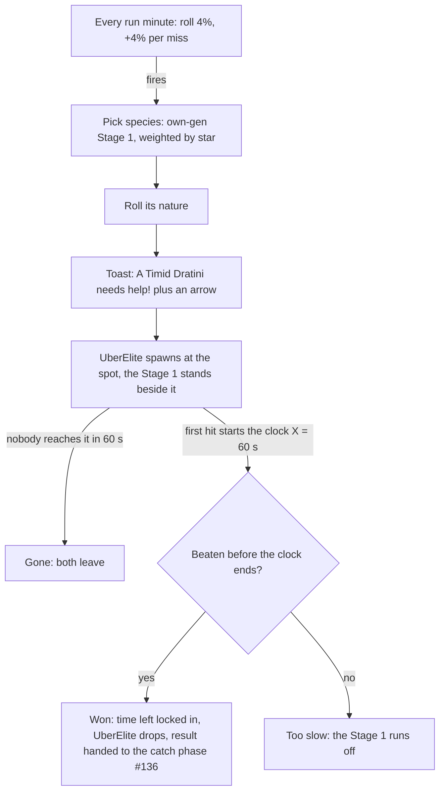

# 135 - Rescue Event Slice Opening (S4 of #128, 2026-11-15)

Rules: acquisition spec section 2 (docs/ASCII Concept Maps/Old txt files/Acquisition v2 - Spec.txt). No code.

## What the slice is

The catch phase, the belt and the empty-belt rule belong to #136 (S5). S4 ends at a recorded result that #136 picks up.
Until #136 lands, a win pays the UberElite's drops and a toast, and nothing else.

## What exists and what is new

| Piece | Today | S4 |
|---|---|---|
| Event roll | Mid-game events use a 4 to 5 minute timer (js/systems/events.js) | A new per-minute roll, separate from it |
| Elite | js/entities/elite.js, HP from a damage-times-time budget (js/systems/elites.js) | An UberElite built on the same class with a bigger budget |
| Arrow and toast | Gyms (blue) and shops (orange) in js/ui/hud.js | A third colour, for rescues |
| Stage 1 data | None. Only "can still evolve" exists (js/data/evolvable.js) | A generated file from pokeapi, with a tool and a --check line in check.js like evolvable |
| Nature | Rolled when a copy is made (js/systems/copies.js) | Rolled when the rescue is created, kept for #136 |

## Opening (proposal)

| Item | Proposal |
|---|---|
| Goal | A rescue fires on the spec's cadence in a solo run, shows its toast and arrow, spawns a timed UberElite, and ends in one of three recorded results (gone, too slow, won with time left). |
| Done | A test passes for cadence, pool, weights and the three outcomes. Jess plays a run with the rescue forced on and sees the toast, the arrow, the guard and the clock. check.js is clean. |
| End-goal test | One new harness, docs/proposals/rescue-harness.js, built on relations, not copied numbers: certain by roll 25, about 1.4 rescues per 10 minutes (the spec's figure), reset after a rescue, no rolling while the run clock is stopped; each region's pool matches the spec's pool table and every member has no pre-evolution in the pokeapi csv; the pick weights stand 8 : 4 : 2 : 1; an untouched rescue is gone at 60 s; a win with time left gives a value between 0 and 1; a slow fight gives none. No mutants file unless you want one. |

## Plan

| File | Where | Change |
|---|---|---|
| tools/stage_one_data.js (new), js/data/stage-one.js (generated), tools/check.js, dev.html, js/main.js | next to the evolvable data | The Stage 1 set from pokeapi, with a --check line; babies count; Gholdengo is added as the one exception |
| js/systems/rescue.js (new), dev.html, js/main.js | a new system next to events | The roll, the species pick, the nature, the event states and their timers, the result hand-off. Runs on the run clock |
| js/entities/ (the elite class) and js/systems/elites.js | beside the elite | The UberElite: an elite with the bigger HP budget and a fight clock that starts on the first hit |
| js/ui/hud.js | the arrow code | The rescue arrow and its label, plus the fight clock over the UberElite |
| js/game.js | the run update | Calls the rescue system each frame, resets it with the run |
| js/core/debug.js | next to the other debug tools | G.Debug.rescue() forces one now, for your feel test |
| docs | STATE, decision file, issue comment | The rulings below |

Risks: the UberElite is a hard damage check mid-run, so the first numbers are guesses for playtest. A rescue can fire at a bad
moment (a boss alive, the gym arena), which the calls below settle.

## Calls for Jess

| # | Question | Recommendation |
|---|---|---|
| C1 | S4 stops at the recorded result; a win pays only the UberElite's drops and a toast until #136? | Yes |
| C2 | The 60 s fight clock starts at your first hit on the UberElite (like an elite's enrage clock); the other 60 s is the time to reach it, then both leave? | Yes |
| C3 | UberElite strength: an elite's build with HP sized for a 40 s fight (an elite is 25 s), same power. Tuned in playtest. | Yes |
| C4 | The rescued Stage 1 stands beside the UberElite, helpless, so you can see what you are saving? | Yes, small |
| C5 | A roll that fires while you are in the gym arena: the rescue is lost (matches "a missed rescue is gone"), or it waits until you leave? | Lost |
| C6 | Rescues do not fire in co-op for now (deferred)? | Yes |
| C7 | Arrow colour: green, matching the Lost Pokemon, so gyms stay blue and shops orange? | Green |
