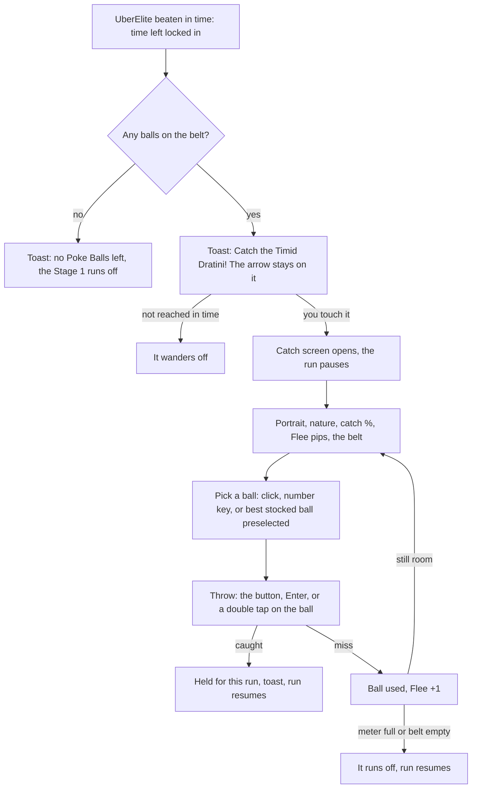
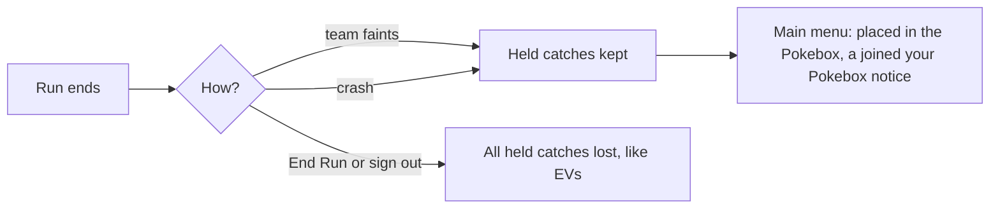

# 136 - Catch Phase Slice Opening (S5 of #128, 2026-11-15)

Rules: acquisition spec sections 3 and 4 (docs/ASCII Concept Maps/Old txt files/Acquisition v2 - Spec.txt), changed by Jess's
design below (contact opens the catch, not an automatic pause). No code.

**Status: built 2026-11-15, every recommendation approved (Jess).** Ruling: docs/decisions/2026-11-15-136-catch-on-contact-and-held-catch-rulings.md.
Tests: docs/proposals/rescue-harness.js parts 5e and 6, and the catch flow in tools/smoke-ui.js. C11's keep-or-sell list is #146.

## What the slice is

The keep or lose rule rides on the flag that already decides EVs at the run end (fall and crash keep, a quit loses), so it
needs no new rule in the run end.

## What exists and what is new

| Piece | Today | S5 |
|---|---|---|
| Rescue win | G.Rescue records "won" with time left, pays drops, the Stage 1 leaves | The Stage 1 stays, waits to be touched, then the catch |
| Pausing screen on contact | Shops: walk in, the run pauses (G.Game.openShop), refused over another screen | The same pattern opens the catch screen |
| Belt | None in the save (the menu bar shows Poke Balls, a leftover count) | A save field: one shared count, Poke Balls only this slice |
| Copies | G.Copies.add with method "rescue" already defined | A caught copy keeps the rescue's nature; the rest rolls as usual |
| Held catches | None | A list for the run, placed in the box at the main menu |
| Screen style | BW popups: Inventory window, EV screen, End Run | A BW popup in the same frame |

## Opening (proposal)

| Item | Proposal |
|---|---|
| Goal | A won rescue leaves its Stage 1 waiting; touching it opens a BW catch screen (portrait, catch %, Flee pips, belt) where Poke Balls are thrown with our equation; catches are held and reach the Pokebox only when the run ends by a fall or crash. |
| Done | The harness passes. Jess forces a rescue (G.Debug.rescue), wins, touches the Stage 1, sees the screen, throws, and after a fall finds the catch in the Pokebox with its nature. check.js and format clean. |
| End-goal test | Extend docs/proposals/rescue-harness.js (no new harness). Relations: odds rise with more time left and fall with higher BST inside a band; every band's top beats the next band's bottom; odds never pass the ceiling; a throw uses exactly one ball; misses until flee equal the nature bucket's allowance (easy above default above hard); an empty belt never opens the screen; nothing enters the box mid-run; a fall and a crash keep every held catch, a quit keeps none; a kept catch has method rescue and the rescue's nature; an old save without the belt field loads with the starting belt. One headless check (in an existing smoke if one fits): touch opens the screen and a throw closes it. |

## Plan

| File | Where | Change |
|---|---|---|
| js/systems/catch.js (new, G.Catch), dev.html, js/main.js | next to rescue | Odds (spec E3 ladder, 90% ceiling), Flee buckets by nature, one throw, the belt use, the held list, placing them at the run end |
| js/systems/rescue.js | the win and the update | A won rescue keeps the Stage 1 in a waiting state with its own timer; touching it asks the game to open the catch; refused over another screen, retried next frame (as shops) |
| js/game.js | beside openShop and in endRun | An openCatch that pauses like a shop; endRun hands held catches to G.Catch with the keep flag; reset with the run |
| js/ui/catch-ui.js (new), css/bw-catch.css (new), dev.html | a new screen section | The popup: portrait, name and nature, star, catch % for the selected ball, Flee pips, the belt strip, Throw and Let it go |
| js/core/db.js | the save defaults | The belt field, null-checked and defaulted for old saves |
| js/ui/menu.js | main menu entry | Places held catches, the "joined your Pokebox" notice |
| js/ui/hud.js | the rescue arrow | The arrow and a short label stay on the waiting Stage 1 |
| js/ui/pause-run-info.js | Run Info | FB6: a "Caught this run" line, if C8 says yes |
| js/core/debug.js | next to G.Debug.rescue | A way to open the catch screen straight away for the feel test |
| docs | spec, decision file, STATE, #136 | The contact change and the rulings below |

Risks: a second pausing screen on contact can collide with level-up or item picks, so it uses the shop's refusal rule. The
belt has no restock until #137, see C3. Strings are English only.

## Calls for Jess

| # | Question | Recommendation |
|---|---|---|
| C1 | After the win the Stage 1 waits for you to touch it. How long, on the run clock, before it wanders off? | 30 s, with the arrow and a countdown, as the rescue wait |
| C2 | "Same UI as our new areas" means the BW popups (Inventory window frame, EV and End Run screens)? | Yes, the Inventory window frame |
| C3 | Restock is #137. Until then, the belt refills to 6 Poke Balls at each run start, tagged legacy and removed by #137? | Yes, otherwise a playtester runs dry after 6 throws |
| C4 | Throwing: click or number key selects, Throw button or Enter or Space throws, a double click or double tap on a ball throws it | Yes |
| C5 | Can you walk away? A "Let it go" button (and Esc) asks once, then it runs off and you keep your balls | Yes, asked through G.UI.ask |
| C6 | A throw plays a short ball wobble (about 1 s, the result shown after) | Yes, three wobbles, kept short |
| C7 | Empty belt at the win: told at once, the Stage 1 runs off (spec) | Yes |
| C8 | FB6, show held catches in the run | A "Caught this run" count in pause Run Info |
| C9 | FB4, other run endings (Return Home, Next Region, a Legendary Boss) | Kept, the run ended normally |
| C10 | FB5, End Run loses every catch of the run (as EVs) | Accept |
| C11 | Box full at the run end: the spec's keep-or-sell list is a screen of its own | This slice auto-sells the overflow with a notice; the list becomes its own issue (two boxes hold 1,000, so it is rare) |
| C12 | Odds shown as a whole percent; ceiling 90%; flee 5 / 3 / 1 | Yes, all playtest values |
