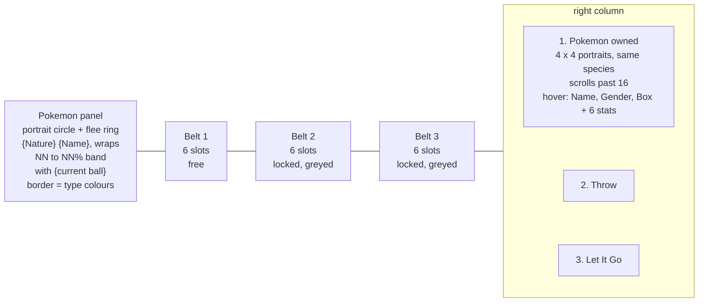
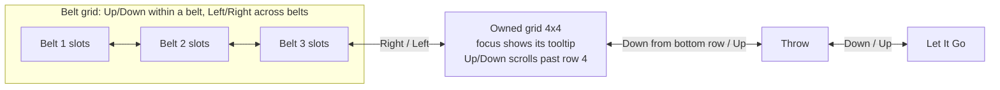
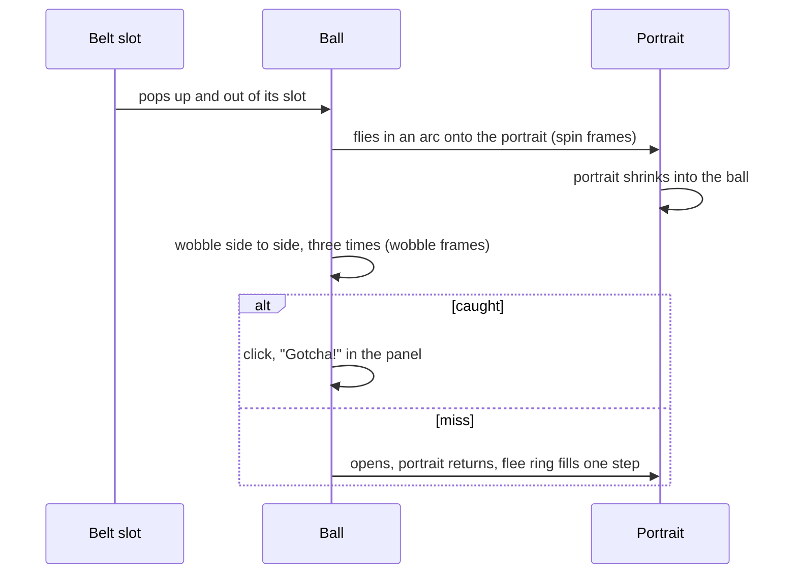
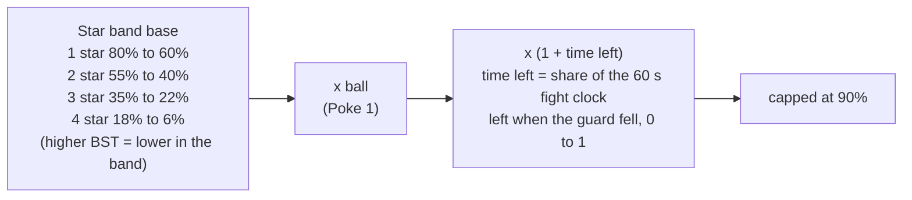
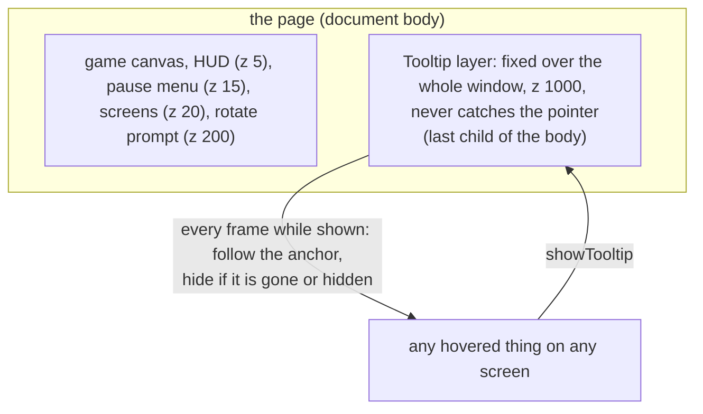

# 136b, Catch screen redesign plan (follow-up to #136)

Source: `assets/excalidraw/Catch Pokemon Popup.svg` (Jess, 16 Nov) plus two playtest notes: double click does not throw,
and the arrow keys should move a visible selection cursor. Status: **built 2026-11-16, waiting on Jess's feel test**
(#136, Needs Playtest). Q1 to Q8 answered by Jess on 2026-11-16. "Changes made during the build" below lists what moved
from the plan.

## Slice opening (agree before the build)

| Item | Proposal |
|---|---|
| Goal | The catch screen matches the mockup, double click throws, and the arrow keys plus the B2 cursor drive every control. |
| Done | Jess opens a catch with `G.Debug.catch()`, plays it by mouse only and by keyboard only, and it looks like the mockup. |
| End-goal test | `tools/smoke-ui.js` catch flow grows (no new harness): a real double click on a belt ball throws it; the arrow keys move the cursor across belt, owned grid and buttons, and the cursor sits on what Enter acts on; Enter on Throw throws the current ball; Esc still asks before letting go; the shown band always contains the true chance and is 30 points wide; the flee ring's filled share equals misses over misses allowed. Relations only, no copied numbers. |

## Why double click fails today

A single click selects the ball, and selecting redraws the whole belt strip. The second click of the pair lands on a
brand-new button, so the browser never pairs the two clicks into a double click. Fix: selecting moves the highlight on
the existing cells instead of rebuilding them, and the double click is caught once on the belt container (it survives
any redraw).

## Layout (the mockup, left to right; in the right column the owned grid is on top, the buttons under it)

Every colour below is an existing token; nothing new is invented.

| Part | Look (from the mockup notes) | Source token |
|---|---|---|
| Containers | Same border shape as the IV, Moves, Cards Taken and Run Stats boxes in the pause menu's Pokemon detail | `css/pause-menu.css` detail boxes, reused |
| Pokemon panel border | Left border primary type, right border secondary type, top and bottom a gradient between them; one type = one colour | `TYPE_COLOR` (`js/core/util.js`, HUD-STYLE type table) |
| Belts | #DBB26E, #C88820, #825815 | UI-PALETTES Bag, "Poke Balls pocket" (also on `tools/ui-library.html`) |
| Pokemon owned | #C1C2C1, #9FA19F, #676967 | Normal type Light / Base / Dark (HUD-STYLE, `TYPE_COLOR.normal`) |
| Flee ring | Primary type's Dark shade | `TYPE_COLOR_DARK` |
| Ball icons | Front face (top row) of `assets/icons/pokeball/in-run-pokeballs.png` | cut by a tool, see "Ball sprites" |
| Buttons | Team / inventory / settings button shape, no X or U icons, #ffffff rim, #181818 body | existing `.bw-btn` family |
| Throw unfocused / focused | White text / #38d030 rim | mockup |
| Let It Go unfocused / focused | White at 45% / white text, #ff8a90, #e8202a, #7c1016 rim, #7c1016 body | mockup |
| Background | Same as the Run Info panel | `css/pause-menu.css` Run Info |

The ui-library page (#147) lists the catch screen's pieces under their jobs once built.

## Rules from Jess's answers

| Topic | Rule [Approved 2026-11-16 unless marked] |
|---|---|
| Catch band (Q1) | The panel shows a range 30 points wide (bandAccuracy 15 = plus or minus 15) that always contains the true chance, shifted at random so the true chance is anywhere inside it. Example: 47% can show 32 to 62, 25 to 55 or 40 to 70. bandAccuracy starts at 15; its upgrade is #97. |
| Belts (Q2) | Three belt columns drawn now; belt 1 holds today's 6 balls; belts 2 and 3 locked and greyed. Unlocking is a meta upgrade (#97 / #137). |
| Flee (Q3) | No pips. A ring around the portrait circle, like the exp ring around the run screen portrait, fills 1/n per miss (n = misses allowed). Colour: primary type Dark. |
| Owned grid (Q4) | 4 x 4 visible, a scroll bar past 16, sorted by highest IV + EV total first. |
| Old elements | Rarity star, belt count and time bonus line go. The result ("Gotcha!", "It broke free") shows inside the Pokemon panel. [Proposed] |
| Ball sheet (Q5) | Stays at `assets/icons/pokeball/in-run-pokeballs.png`, committed with this slice; the deleted BW Poke Balls sheet has no code references (checked). |

## Ball sprites (Q5, my call)

A small tool under `tools/` cuts the sheet once: the teal background keyed out, one strip per ball (Poke, Great, Ultra,
Master, so #137 needs nothing more), and a JSON file beside it naming the frame rows (front face, spin, open, wobble).
The catch screen reads the JSON, never pixel offsets. Generated output is committed, like `js/data/stage-one.js`.

## Keyboard and cursor

One focus index covers every control. The B2 selection cursor (the four yellow corner brackets from `js/ui/hud-kit.js`,
already on the HUD move slots, roster and pause menu) sits on the focused control. Mouse hover moves the same focus, so
mouse and keys never disagree.

| Key | Does |
|---|---|
| Arrows (and WASD, the same move actions) | Move the cursor. Empty and locked slots are skipped. |
| Enter on a ball | Selects it (the band updates); Enter again throws it |
| Enter on Throw | Throws the current ball |
| Enter on Let It Go, or Esc | The existing "Let it go?" ask |
| 1 to 3 | Pick a ball tier, as today (Great and Ultra arrive with #137) |
| Mouse | Click selects, double click throws, hover moves the cursor |

## Throw animation (mockup note)

Timing stays on today's clock (about 1 s of wobble, then the result), so the rules in `G.Catch` do not change.

## Files touched

| File | Change |
|---|---|
| `js/ui/catch-ui.js` | Rebuilt layout, one focus index, arrow keys, the cursor, the double click fix, owned grid with tooltips and scroll, flee ring, throw animation |
| `css/bw-catch.css` | The mockup's containers, buttons, belt columns, owned grid, ring, all from the tokens above |
| `dev.html` catch markup | New panel structure |
| `js/systems/catch.js` | The band: one random shift rolled per catch, and the band read for the screen |
| new `tools/` sprite cutter + `assets/icons/pokeball/` strips and JSON | Ball frames |
| `tools/smoke-ui.js` | The end-goal checks above, in the existing catch flow |
| `tools/ui-library.html` | The catch screen pieces under their jobs |

Risks: the owned grid reads the Pokebox and sorts it each open (small, the box is local); the type-gradient border needs
the species' types (already in the dex data). No save change.

## Changes made during the build

| Change | Why |
|---|---|
| The frame map is `js/data/ball-sprites.js` (generated), not JSON | A page opened from disk (file://) cannot fetch a JSON file. Tool: `tools/make_ball_sprites.py` (Python, Pillow; not in check.js since the work machine may lack Python). All 17 balls cut. |
| Flee ring empty part is `#e7e7e7` (the kit's paper), not the EXP ring grey | Normal's and Rock's Dark nearly matched the grey. Every type's Dark reads on the paper white, and the mockup draws a white ring. |
| The owned tooltip opens right of the window | The mockup places it there; "above" covered the grid. The kit's tooltip gained a `rightOf` side. |
| Number keys 1 to 6 throw that slot of the numbered belt; only the cursor's belt shows numbers | Jess, 2026-11-16 (replaces "1 to 3 pick a tier"). On the owned grid or buttons the numbers stay on the last belt. |
| A thrown ball leaves its own slot empty for the rest of that catch | The belt is a count; without this the last slot emptied instead. |
| `Box` moved from the pause menu's detail panel into the HUD kit (with a second rim for dual types) | Two screens use it now. The pause menu draws the same. |

## Answered (2026-11-16)

| # | Question | Answer |
|---|---|---|
| Q6 (agreed) | The band near the ends: a true chance of 8% or 88% (the ceiling is 90%) would push a 30-wide band under 0 or over 100. | Keep it 30 wide and slide it inside 0 to 100, so 8% might read 0 to 30. |
| Q7 (agreed) | One random shift per catch shared by every ball, or a fresh shift per ball tier? | One per catch, shared: switching balls then moves the band by the true difference, so a better ball always reads better. Fresh per ball could make a Great Ball look worse than a Poke Ball. |
| Q8 (agreed) | The owned tooltip's six numbers: IV + EV per stat (matches the sort), or IVs only? | IV + EV per stat, so the tooltip explains the sort order. |

## Playtest fixes 1 (Jess, 2026-11-16): built, waiting on the feel test

| # | What Jess saw | Cause | Fix |
|---|---|---|---|
| 1 | Balls and slots too big, no padding to the belt edge | The belt box's rim is 12 px thick; the 64 px slots sat 10 px from the box edge, so they overlapped it | Option B (Jess): 52 px slots, the ball at 1.5x (48 px), 4 px clear of the rim. The belts get shorter to fit six slots with the same 4 px clear at top and bottom (about 380 px tall instead of 460), centred on the window's height. |
| 2 | The cursor in Pokemon owned shows black, not yellow | The cursor's corners sit 4 px outside the cell; the owned grid is a scroll box, which clips anything outside it, so only the black inner edge shows | Approved: in the owned grid only, the cursor sits on the cell's edge (the portrait circle is 4 px in, so it still frames it). |
| 3 | Wrong buttons | I used the pause menu's buttons. The team menu's button is the B/W rip `assets/ui/team/btn.png` | A new kit button drawn from that rip's pixel layout at 4 px per art pixel (268 x 72), recoloured per the mockup: rim white ramp at rest, Throw focused green ramp, Let It Go focused red ramp with the dark red body; body `#181818`; text left-aligned like the team menu; no X or U icons. |
| 3b | Font (#99): every text on the catch screen in Monogram or Silver, at about today's sizes | | See "Font" below; one face for the whole screen. |

`136b - belt size options.png` (left A, right B; B chosen).

### Font (#99 pilot on the catch screen)

`136b - catch font options.png`: today's HudText, then Monogram and Silver (GameFont) at sizes on their pixel grids.

| Text (today) | Monogram | Silver (GameFont) |
|---|---|---|
| Name, buttons (30 px) | 32 px | 28 px |
| Band (40 px) | 48 px | 40 px |
| "with a Poke Ball", result line, slot numbers, "None owned yet" (20 px) | 16 px (too small) or 24 px (soft, off its grid) | 20 px |
| Owned tooltip | already GameFont | already GameFont |

Built with Silver (GameFont). The font files decide the crisp sizes: Silver-game.ttf is 19 font pixels per em, enlarged
140% by GameFont, so it is crisp only at multiples of 13.5714 px. Text HudText shows at 20 and 30 px is now 27.1429 px
(2 screen pixels per font pixel); the 40 px band is 40.7143 px (3). 13.57 px was too small to read, so the small lines
grew a little. Monogram-extended is an outline font with no pixel grid, so no size of it is exact. Rule recorded in
HUD-STYLE "Fonts" ([Proposed]); the rest of #99 stays open.

### Catch rate today (question 4)

`G.Debug.catch()` passes time left 0.5, so every base is multiplied by 1.5. A real win does the same with the real time
left. Every 1-star and most 2-stars land on the 90% cap; the spec meant that ("for 1 and 2 star mons the UberElite fight
is the real gate").

Why not pokeapi's capture_rate (Acquisition v1 spec, "CATCH ODDS CHECK" and round 5, Jess 2026-11-12):

| Finding | Detail |
|---|---|
| It does not track strength | Bulbasaur, Dratini and Eevee are 45, the same as Lapras, Scyther and Nihilego. Starters would be as hard as Ultra Beasts. |
| Mainline odds assume a weakened target | At full HP a throw is 23.5% median across Stage 1s, about 6% for anything good; the rescued Pokemon is never damaged, so time left stands in for HP. |
| Ruling | Round 5: odds from the BST ladder inside star tiers (E3); the flee meter keyed to nature, not capture_rate. |

These are the #136 [Open] playtest values; changing them is a balance call (levers: the star bands, the time bonus, the
90% cap), not part of these fixes.

## Bug 1 (Jess, 2026-11-16): pause menu tooltips stop working: built

Cause: the kit remembers one tooltip layer, the last one mounted. The pause menu mounts its layer once at load; the
catch screen (136b) mounts its own; closing a catch clears the record, so every pause tooltip is dropped until a reload.
Reproduced headless (a hex-corner tooltip shows before a catch, not after).

Fix, Jess's design: **one universal tooltip layer, the topmost thing on the page, always**. It replaces the per-screen
layers, so two screens can never fight over it, and it is the base nested tooltips (Path of Exile style) need later.

| Part | Change |
|---|---|
| The layer | `js/ui/hud-kit-items.js`: the kit mounts one layer on the body itself at load (fixed, the full window, z-index 1000, pointer events off). Screens stop mounting their own: the `TooltipLayer` lines leave `pause-menu.js` and `catch-ui.js`. |
| Placement | Tooltips are placed in window pixels and drawn at the hovered screen's scale (the menu stage's fit, `--pm-scale`; 1 elsewhere), so they keep today's size on every window. Sides stay above, below, leftOf, rightOf. |
| Lifetime | While a tooltip shows, the layer checks its anchor every frame: it follows it (a sliding panel carries its tooltip along) and hides it when the anchor is removed or hidden. A screen closing can never leave a tooltip behind, even if it forgets to call hideTooltip. |
| Nesting | Not built now. One tooltip at a time today; the layer's state is the one place nesting changes later (a stack of tooltips, each anchored to the one under it). |
| #102 | The layer now exists for every screen. #102 stays open for moving the old team sheet's tooltips and the browser `title` tips onto it. |
| Rule | HUD-STYLE "Every hover tooltip is the topmost layer of its screen" ([Approved] 2026-11-12) becomes "of the page", with a new decision file (`docs/decisions/2026-11-16-one-universal-tooltip-layer...`) and an index line. Z-index rule: nothing else on the page may reach 1000. |
| Tests | `smoke-pause-menu.js` and `smoke-pause-inventory.js`: "the layer is the stage's last child" becomes "the layer is the body's last child, above everything" (the covered-points checks stay). New check in `smoke-pause-menu.js`: open and close a catch, then a pause tooltip still shows (fails today). `smoke-ui.js` catch flow: the owned tooltip is in the same layer. |
| Risk | Medium-low: every pause and catch tooltip moves layer. The covered-points checks prove each one is still on top across its box. |
