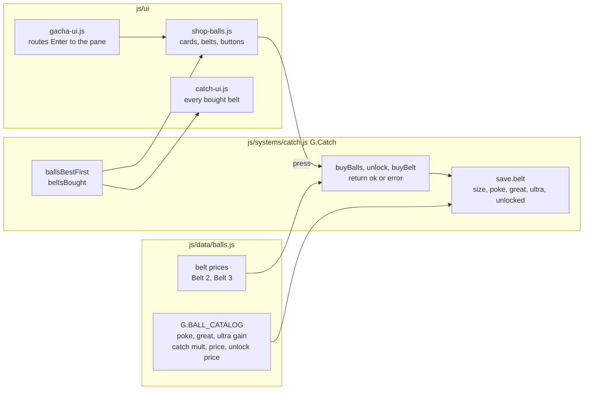
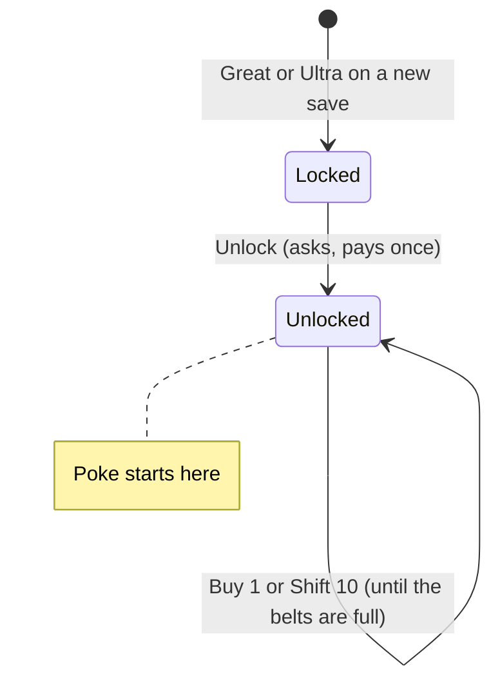

# #137 Shop balls: restock, Great and Ultra unlocks, belt size (plan)

Branch feature/128-acquisition. Child of #128 (slice S6). Rulings B1 to B8 agreed by Jess 2026-11-17.
Spec: docs/ASCII Concept Maps/Old txt files/Acquisition v2 - Spec.txt sections 4 and 10.

## Opening (agreed)

| Item | Text |
|---|---|
| Goal | Balls and belts are bought with PokeCoins and kept between runs; the free refill at run start is gone. |
| Done when | Ball, unlock and belt buys work in the Shop's Pokeballs tab and survive a reload; a run starts with the balls you own; the catch screen throws from every bought belt. |
| End-goal test | In place, no new harness: smoke-ui's Pokeballs section and rescue-harness part 6 (relations listed under Tests). |

## Rulings

| # | Ruling |
|---|---|
| B1 | Ball prices: Poke 50, Great 150, Ultra 300 PokeCoins (TUNE, BALANCE.md). |
| B2 | Unlocks: Great 5,000, Ultra 15,000. |
| B3 | Belt 2 10,000, Belt 3 15,000; Belt 3 only after Belt 2. |
| B4 | Unused balls carry over; a throw is the only thing that uses one. No refill. |
| B5 | New save: 6 Poke Balls, 1 belt. Old saves keep their belt as it is. |
| B6 | A press buys 1; Shift buys 10. Stops at a full belt. |
| B7 | The other 14 balls stay dimmed, "Coming soon." |
| B8 | It lives on the Shop's Pokeballs tab. |

### Defaults I need you to confirm or change (they change what the game does)

| # | Question | Default |
|---|---|---|
| B9 | Does buying a ball ask first (G.UI.ask)? | No: a ball buy is instant with a toast. Unlocks and belts ask (big spends), Shift-click skips the question, as TMs do. |
| B10 | Shift with too few coins or too little room for 10 | Buys as many as fit and you can afford (at least 1, else the usual refusal). |
| B11 | Must Great be unlocked before Ultra? | No order. Either unlock any time. |
| B12 | Shift by keys | Shift+Enter or Shift+Space also buys 10 (the TM tab's "a key never skips" is about the question, not a quantity). |

## Shape

## Parts

| Part | File and place | Change |
|---|---|---|
| 1 Data | js/data/balls.js, the Poke, Great and Ultra entries; a new frozen belt price table beside the catalog | Poke, Great and Ultra gain their catch multiplier (1, 1.5, 2), ball price (B1) and unlock price (B2; Poke none). The belt price table holds Belt 2 and Belt 3 (B3). Great and Ultra lines already say "1.5x" and "2x". |
| 2 Belt rules | js/systems/catch.js, the BALLS list and "the belt" section; header updated | BALLS is built from the catalog entries that have a multiplier (one home for tier facts). The belt fix-up adds great and ultra counts (default 0), an unlocked list (default empty, Poke always counts as unlocked), and caps the total at the size, trimming worst tier first. Belt constants named in K: six balls per belt, three belts at most. New: beltsBought, ballsBestFirst (the slot order both screens draw), isUnlocked, room. |
| 3 Buys | js/systems/catch.js, a new "the Shop" section | buyBalls(save, ballId, wanted): checks unlocked, room and coins, buys as many as fit and are affordable (B10), takes the coins. unlockBall(save, ballId) and buyBelt(save): pay once; a belt is always the next one (B3 holds by construction). Each returns ok or an error (locked, full, poor, done), the G.Items.buySlot pattern. |
| 4 No refill | js/systems/catch.js startRun; js/game.js line 184's comment | startRun only clears the held catches. The [Legacy behavior] notes go. |
| 5 Shop pane | js/ui/shop-balls.js | Cards: Poke and unlocked balls read "Buy 50" and so on; a locked Great or Ultra reads "Unlock 5,000"; the 14 others stay dimmed "Coming soon.". Refusals: "Not enough PokeCoins." (the Shop's existing line), "Your belts are full.". Belt Buy uses the data table and a real buy. Belt drawing uses G.Catch.ballsBestFirst and beltsBought (its own copies of those go). A pane press function routes Enter; a shift tracker (the TM tab's three lines, also set on Enter and Space, B12). Unlock and belt ask with G.UI.ask, ball buys toast (B9). Saves with G.DB.commit(true), refreshes coins. |
| 6 Routing | js/ui/gacha-ui.js press | One line: on the Pokeballs tab, hand the press to the pane first (as the TM tab does). |
| 7 Catch screen | js/ui/catch-ui.js, "the belts" section and the slot selection | Every bought belt holds balls (belts past beltsBought stay locked). The selected slot and the thrown slots become positions across the bought belts instead of belt 1 only; number keys 1 to 6 throw from the numbered belt, as the header already says. Header line about "belts 2 and 3 are locked" updated. |
| 8 Save default | js/core/db.js line 137 | The new-save belt gains great 0, ultra 0, unlocked empty. Old saves: the fix-up in part 2 fills them, nothing to clear (B5). |

## Tests (relations, in place)

| Where | Relation |
|---|---|
| rescue-harness part 6c | A run start leaves the belt as it was (no refill). Old save with only size and poke loads with great 0, ultra 0, nothing unlocked, poke unchanged. A belt over its size is trimmed worst tier first. |
| rescue-harness 6 (new lines in 6c) | Buying n balls takes exactly n x price and adds n; never more than room; a locked tier refuses and changes nothing; Shift wants 10 and gets min(10, room, affordable); unlock pays once and a second unlock refuses; Belt 3 refuses before Belt 2 is bought; a better ball's rate is higher than a worse one's for the same Pokemon. |
| rescue-harness spots that used startRun to refill | Set the belt directly instead (behavior-neutral for those checks). |
| smoke-ui Pokeballs section (149e checks rewritten in place) | Cards = catalog length; lit = balls a throw can use and are unlocked; a locked tier reads Unlock and its price; a press on Buy with coins adds one ball to the drawn belt and takes the shown price from the balance; a press with no coins toasts and changes nothing; full belts refuse; a belt Buy (after Yes) adds six empty slots and the next belt's Buy appears; reload keeps all of it. |
| smoke-ui catch section | With two belts bought, belt 2 is not locked and holds the balls past slot 6; the existing belt-1 checks hold. |

## Plan check (coding principles)

| | |
|---|---|
| Reuses | ItemCard and CursorButton refusals, G.UI.ask, G.UI.toast, G.DB.commit, the ok-or-error buy pattern (G.Items.buySlot, G.TMs.teach), the TM tab's shift tracker and pane-press routing, the existing belt fix-up. |
| New | Price fields on three catalog entries and a belt price table (data, where #149 planned them); four G.Catch functions for buys and two for slot order (one home for what both screens draw, replacing shop-balls' copy). |
| Not built | The other 14 balls; a Master Ball source; selling balls back; a fourth belt; ball prices tuned against a traced run (#131 economy pass). |
| Where it lives | Rules and money in G.Catch (it owns save.belt); drawing in the two UI files; numbers in js/data. |
| Size | catch.js about 334 to 420; shop-balls.js about 163 to 260; catch-ui.js about 614 to 630; gacha-ui.js +1. None near 1000. |
| Touched-code cleanups | Remove the [Legacy behavior] refill notes; shop-balls' BELT_PRICE and boughtBelts/beltBalls copies go (replaced by data and G.Catch); balls.js header's "#137 adds" line becomes a description. |

## As built (2026-11-17)

B9 to B12 accepted as defaulted. Built as planned, with these differences:

| Plan said | Built |
|---|---|
| Part 5: a Buy under each locked belt | Only the next belt shows a Buy (Belt 3's appears once Belt 2 is bought); this is how B3 shows on screen. |
| Tests: "reload keeps all of it" | Not a browser reload: buys save through G.DB.commit, the same path as every other save field, and the harness checks the old-save load. |
| (not in plan) | smoke-ui's catch runs set their own belt, since nothing refills it now; a cursor helper steers by screen position. |

Results: rescue-harness all passed (6a balls, 6c no refill and old saves, 6f Shop); smoke-ui all passed; check.js all
passed. smoke-pause-menu: the known "Cards Taken 401 px" failure only (TODO item 10, not this slice).
Label fit (screenshot over http): "Unlock 15,000" fits the card button with about 2 px to spare.

Risks: catch-ui's selection change (part 7) is the one fiddly bit; the existing catch smoke covers belt 1 and gains a belt 2 check. Docs to update at close: BALANCE.md (prices), STATE, TODO, DEVLOG, #137 comment, card to Needs Playtest.
