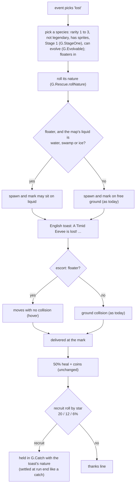

# 138 - Lost Pokemon Build Plan (S7 of #128, 2026-11-21, APPROVED and BUILT)

Opening (goal, done, test): docs/ASCII Concept Maps/138 - Lost Pokemon Slice Opening.md. Rulings: decision
2026-11-21-138-floater-escort-hover-and-water-spots. No code in this plan.

## Flow after the change

## Part A: the pool and the nature (js/systems/events.js, spawnLost and makeLost)
- What changes: the species filter drops the hover check and adds the Stage 1 and can-evolve checks. The Lost
  Pokemon also rolls a nature at spawn and keeps it, with its readable name, on the lost record.
- Reuses: G.StageOne.has (the rescue pool's Stage 1 rule), G.Evolvable.has (Eviolite's can-evolve rule),
  G.Rescue.rollNature. Both data files already load before events.js in dev.html.
- New: G.Rescue exports its existing natureName helper (one line in its return block), so the toast and the held
  entry name the nature the same way rescues do.
- Not built: no star weighting on the pick (the spec gives none; today's pick is uniform and stays uniform).

## Part B: spawn and mark points (events.js spawnLost)
- What changes: for a floater, both free-spot checks allow liquid when the map's liquid does not hurt. Walkers and
  floaters on a lava, poison or spark map keep ground only.
- Reuses: G.World.isFree's existing allow-liquid flag (landing already uses it). "Does not hurt" is the rule
  world.js already uses in walkable(): the liquid table entry has no damage.
- New: one small G.World question, "is this map's liquid safe", read from that same table; walkable() then asks it
  too, so the rule has one home (touched-code cleanup, 2 lines).

## Part C: hover escort (events.js lostTick)
- What changes: the follow step skips ground collision when the lost Pokemon floats, as enemy.js does for flying
  enemies. Whether it floats is set once in makeLost from G.Sprites.hovers.
- Not built: no water slowdown or swim logic for the follower (walkers never enter liquid today; floaters ignore it).

## Part D: recruit at delivery (events.js rescued and reward; js/systems/catch.js)
- What changes: the flat 20% grant rolled at spawn goes. At delivery the game rolls the star odds; a recruit is
  added to the run's held catches with the toast's nature, so it settles at run end like a catch (kept on a fall or
  crash, lost on a quit, sold at copy price when the box is full).
- New: a recruit-odds table by star in events.js beside its other constants (20 / 12 / 6), copied into BALANCE.md.
  G.Catch gains a hold function that adds one held entry; throwBall's own push becomes a call to it (one home for
  what a held entry is).
- Touched-code cleanup: G.onRescue in js/game.js (about 15 lines) has no caller left once reward stops calling it,
  so it is removed. fullBoxLine stays (the shiny path uses it).

## Part E: the English lines (events.js)
- The five lines in English, nature on the spawn line: "A Timid Eevee is lost! Find it and take it to the green
  marker", "Eevee is following you! Take it to the green marker", "Eevee got scared and ran away!", "Eevee got
  tired of waiting and left.", "You brought Eevee home! It thanks you." Plus the recruit line (D6).

## Part F: dev helper (js/core/debug.js)
- New: G.Debug.lost([dex]) starts a Lost Pokemon event now, of that species when given. Needed because the event
  comes only every 4 to 5 minutes and one time in three. events.js exposes one dev entry for it, as rescue.js does
  with debugFire.

## Tests (named before approval)
1. New harness, docs/proposals/lost-pokemon-harness.js. Loads the real events.js, catch.js, rescue.js, copies.js,
   db.js (guest save) and the data files, with stubbed world, sprites and enemies. Checks T1 to T6 of the opening:
   pool rule against the data on its own (pokeapi species csv read in the harness), odds order and tolerance over
   seeded deliveries, held entry and an unchanged box until settle, hover vs walker across a stubbed rock, liquid
   spots by map liquid and by floater, English lines with nature and name. Prints failures only, one line when
   clean. Why new: rescue-harness covers the rescue and catch, never events.js; this keeps both short.
   tools/check.js picks it up on its own (it runs every *harness*.js), so check.js does not change.
2. New mutation runner, docs/proposals/lost-pokemon-mutate.js, the shops-mutate pattern (env var file overrides).
   Mutants: the can-evolve filter dropped; the hover filter back; a flat 20% for every star; 2 and 3 star swapped;
   a recruit placed in the box at once instead of held; the held nature not the toast's; floaters collide;
   walkers allowed on liquid; floaters allowed on lava; the spawn line without the nature. Every one must fail the
   harness. Why: proves the harness catches each rule breaking.
3. Intent scenarios: none (no move changes).
4. Debug set for the feel test: G.Debug.lost(92) (Gastly) on a map with water: it should cross rocks and water
   behind you, and spawn or be marked on water sometimes. G.Debug.lost(133) (Eevee): a walker, ground only. Deliver
   several to see a recruit; it shows in "Caught this run", and in the Pokebox only after the run ends.
5. Existing: rescue-harness.js must still pass after throwBall calls the new hold (no edit expected).

## Decisions (new; rule changes, not plan details)

| # | Question | Options | Pick |
|---|---|---|---|
| D6 | What does a recruit say at delivery? | a. "You brought Eevee home! It will join you when the run ends." in place of the thanks line / b. thanks line, then a second toast | **a**: one toast, and it says the recruit is held |
| D7 | lang-en.js keeps six dead keys once the lines are English (the five Lost lines and "joins your team") | a. delete them / b. leave them | **a**: dead keys, nothing reads them |
| D8 | The pool is 324 species today (43 floaters), not the decision's 309 (42). Likely sprites or rarity changed since 2026-11-13 | a. the test checks the rule, the spec and decision text say 324 as of today / b. investigate first | **a**: the rule is what was ruled, the count was a measurement |
| D9 | The recruit roll moves from spawn to delivery | confirm | confirm (the odds depend on the delivered species; nothing visible changes) |

## Plan check (coding principles)
- Reuses: G.StageOne, G.Evolvable, G.Rescue.rollNature and natureName, G.World.isFree's liquid flag, the
  liquid table's damage rule, enemy.js's flying pattern, G.Catch's held list and settle, the shops-mutate pattern.
- New: the recruit-odds table, G.Catch.hold, the safe-liquid question on G.World, the natureName export, the dev
  entry and G.Debug.lost, the harness and the mutation runner.
- Not built: no star-weighted pick, no swim logic, no change to the rescue event, no co-op work.
- Where: events.js owns the event; catch.js owns held catches; world.js owns liquid rules; debug.js owns dev
  helpers.
- Size: events.js 508 to about 540, catch.js 448 to about 455, world.js 829 to about 835, rescue.js +1. Already past
  1000 and touched: js/core/debug.js (1461, grows about 15 for G.Debug.lost; its split is the existing
  refactor/debug-split branch, not this slice) and js/game.js (1678, shrinks about 15 with G.onRescue gone).
- Touched-code cleanups: walkable() asks the new safe-liquid question; G.onRescue removed.

## Risks
- Hover skips walls, so a floater can be pulled through a wall behind you. It follows you closely, so it should
  read as fine; watch for it in the feel test.
- A floater spawn on water means you wade (60% speed, water types excepted) to touch it.
- Save: nothing new is saved (held catches live in memory until settle). No fresh save needed; a normal reload of
  dev.html?dev is enough.

## Deferred (co-op)
- The host's delivery broadcast carries no nature and the old grant flag, so a guest's recruit is wrong in co-op.
  Draft issue for Jess: "Co-op: Lost Pokemon recruit and nature for guests", labels deferred, area:engine.

## After the build
Changelog entry (new: floating Pokemon can be lost; chg: recruit odds by star, held until the run ends, English
lines), BALANCE.md (recruit odds), spec section 5 marked built, #138 comment, card to Needs Playtest.

## Built (2026-11-21, Quick)
- As planned, D6 to D9 as picked. One kept behavior: a recruit still plays the shinyGet sound the old join played.
- Checks run in Quick's sandbox (Node is not reachable from Quick on the work machine): lost-pokemon-harness all
  passed; rescue-harness all passed; all 10 mutants caught; every touched file parses. Not run: tools/check.js,
  npm run format, the headless smokes (Jess runs them).
