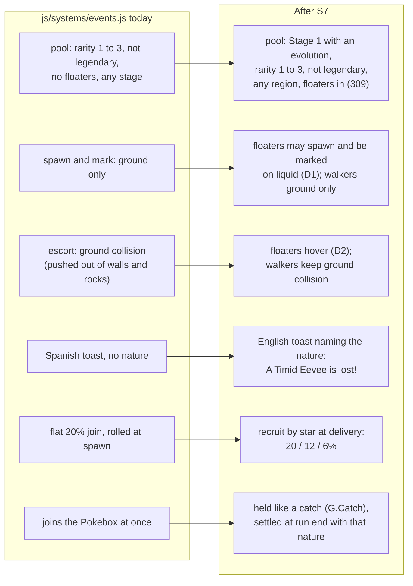

# 138 - Lost Pokemon Slice Opening (S7 of #128, 2026-11-21, AGREED)

Branch feature/138-146-lost-and-full-box. Rules: decision 2026-11-12-acquisition-no-gacha-catch-candy-legendaries,
spec "Acquisition v2 - Spec.txt" section 5, decision 2026-11-21-138-floater-escort-hover-and-water-spots (H1, H2).
Opening only: goal, done, test. The prose build plan follows once these are agreed.

## What the code does today vs the slice

Unchanged: the 120 s timer, enemy damage to it, the 50% heal and the coin drop on delivery (coins came with S2).

## Goal
Lost Pokemon becomes the second recruit route: any Stage 1 from any region (floaters included) can be lost, its
toast names its nature, and delivering it recruits at the star odds as a held catch.

## Done when
1. The end-goal test below passes inside `node tools/check.js`, with its mutants killed.
2. Jess feel tests in dev.html?dev: a floater escorted over rocks, a floater spawned or marked on water, a walker
   still on ground, the toast, and a recruit that shows in the Pokebox only after the run ends.
3. #138's comment says what shipped, the card goes to Needs Playtest, docs (spec section 5, STATE, BALANCE if the
   odds land there, changelog) are updated.

## End-goal test (relations, per docs/TEST-FIRST.md)

| # | Check | Relation |
|---|---|---|
| T1 | Pool | Every pooled species is Stage 1, has an evolution, rarity 1 to 3, not legendary; every species meeting those is pooled, floaters included; the count is whatever that rule gives over the data (see the plan's D8 on 309 vs 324) |
| T2 | Odds | Over many seeded deliveries, 1 star recruits more often than 2 star, 2 star more than 3 star, each within tolerance of 20 / 12 / 6% |
| T3 | Held | A recruit adds one entry to the run's held catches with the toast's nature; the Pokebox is unchanged until the run settles, then gains that copy under S5's keep or lose rules |
| T4 | Hover | A floater following across a rock ends past it; a walker on the same path is pushed out |
| T5 | Spots | On a liquid map allowed by D1, floater spawn and mark points may be on liquid; walkers never; on a disallowed liquid, nobody |
| T6 | Toast | Every Lost Pokemon line is English; the spawn line contains the rolled nature's name and the species name |

Where: a new harness beside the others in docs/proposals/ (dev check, never ships), registered in check.js.

## Decisions (agreed with Jess 2026-11-21)

| # | Question | Ruling |
|---|---|---|
| D1 | Which liquids may a floater's spawn and mark sit on? | Water, swamp and ice only (they do not hurt); on lava, poison or spark floaters use ground |
| D2 | Does hover also pass walls? | Yes, it skips all collision like hover enemies |
| D3 | Lost Pokemon toasts | All five lines rewritten in English (owner exception to the inherited-keys rule) |
| D4 | Does a recruit count in "Caught this run"? | Yes, it is a held catch |
| D5 | Star | The pokedex rarity, 1 to 3 |

Recorded in decision 2026-11-21-138-floater-escort-hover-and-water-spots. Build plan:
docs/ASCII Concept Maps/138 - Lost Pokemon Build Plan.md.

## Notes
- Correction to the earlier summary: ground collision only pushes out of walls and solid props, and water only
  slows, so today a walker escort is stopped by rocks, not water.
- Deferred hook (co-op): the host's Lost Pokemon broadcast carries the old flat grant; the nature and held recruit
  for guests are a `deferred` issue to draft, not built here.
- #146 (keep-or-sell when the box is full) follows on this branch and decides what the settle does with a held
  recruit when the box is full.
