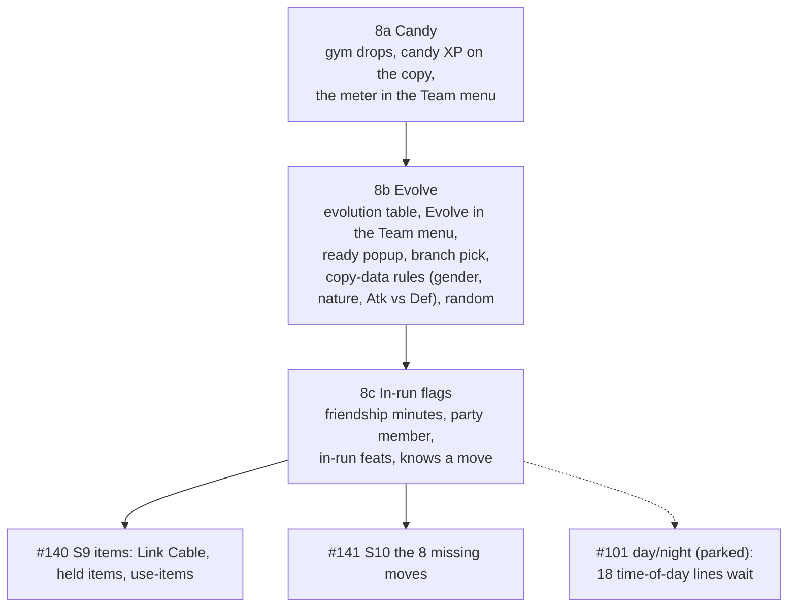

# 139 - Candy and Evolution Slice Opening (S8 of #128, 2026-11-21, REVISED by the grilling)

Branch feature/138-146-lost-and-full-box (covers #138 to #146). Rules: decision
2026-11-12-acquisition-no-gacha-catch-candy-legendaries (A9, A10, T4 to T6, T5b, T5c), decision
2026-11-15-128-exp-candy-unparked-97-ships-with-new-save, spec "Acquisition v2 - Spec.txt" section 6.
Opening only: scope, goal, done, test, decisions. The prose build plan follows once these are agreed.

## Revised by the grilling (Jess 2026-11-21)
Rulings: decision 2026-11-21-139-oor-level-candy-sources-friendship-model (supersedes CD1, CD3, F0, F1 of
2026-11-21-139-candy-opening-rulings; CD2, CD4, D5 to D8 stand). Order: 8a, grill #97, the starting-move picker
with #150, 8b, the friendship grilling, 8c.

- 8a now: candy drops from gym leaders, UberElites and elites (rarity roll, sizes by source, x loop), the candy
  bag, giving candy to a copy in the Team menu, the OOR level and its meter, G.Debug.candy. No picker.
- The picker (after #97): needs a learnset rebake with levels and the egg-move unlock data.
- 8c: friendship is the 0 to 255 field, not minutes; waits on its own grilling. Fatigue is a stub (own issue).
- C1 to C6 below still hold, with "candy XP" read as the OOR level's XP; C2 gains: gym > UberElite > elite in
  expected candy XP per run. The size table is proposed in the 8a build plan.

Everything below this line is the first draft, kept as history.

## What exists today
Nothing. No candy, no evolution data, no evolve action anywhere in js/. pokeapi has what is needed:
pokemon_evolution.csv (676 rows), growth_rates.csv and experience.csv, base_happiness in pokemon_species.csv.

## S8 is too big for one slice: proposed split

| Part | Requirement lines it makes possible (spec counts) | Waits on |
|---|---|---|
| 8a | none yet (the meter fills) | nothing |
| 8b | plain level 297, gender / nature / Atk vs Def, random 4 | 8a |
| 8c | friendship 18, party member 2, in-run feats 6, knows a move 14 (6 of them; 8 need #141) | 8b |
| later | stones 50 (see D6), trade 26 and held items (#140), time of day 18 (#101) | as listed |

Each part opens and closes like a slice (goal, done, test; issue comment; Needs Playtest). This file opens 8a in
full; 8b and 8c get their own openings when 8a lands.

## 8a: goal
Gym leaders drop Exp Candy, and candy permanently raises a copy's candy XP along its species' mainline growth curve
toward its evolution, shown as a meter in the Team menu.

## 8a: done when
1. The 8a harness passes inside node tools/check.js, mutants killed.
2. Jess feel tests: win a gym, see the drop, give candy to a copy, the meter moves and survives a reload; an old
   save loads with every copy at 0.
3. #139 comment, card to Needs Playtest, spec section 6 and BALANCE.md updated, changelog entry.

## 8a: end-goal test (relations, per docs/TEST-FIRST.md)

| # | Check | Relation |
|---|---|---|
| C1 | Cost | XP to a copy's next evolution equals the growth-rate XP at its evolution level (only evolutions with a level take candy, D8), read in the harness from pokeapi on its own (Abra 2,535, Venusaur line 27,021 as spot checks) |
| C2 | Drops | A later gym never drops less candy than an earlier one; a later loop never less than an earlier one (if D2 is a) |
| C3 | Permanent | Candy XP only rises, survives a save round trip, and is never written by a run start |
| C4 | Old saves | A copy with no candy field reads as 0 and nothing else on it changes |
| C5 | Overflow | Per D4 and D8: candy never goes onto a copy past its final level-based evolution, nor onto a copy whose next evolution has no level |
| C6 | Not stats | Candy changes no stat, level or move of the copy in a run (A10) |

## Decisions (8a needs D1 to D5 and D8; D6 and D7 are scope). D1 to D7 accepted 2026-11-21 as picked
(decision 2026-11-21-139-candy-opening-rulings).

| # | Question | Options | Pick |
|---|---|---|---|
| D1 (CD1) | Drop table | a. by gym order / b. by loop / c. flat | **a**: gyms 1-2 an S (800), 3-4 an M (3,000), 5-6 an L (10,000), 7-8 an XL (30,000). A full 8-gym clear gives 87,600 XP: a median line (33,084) finishes in one clear, Dragonite (207,968) in about 2.4. A run that only beats gym 1 still banks 800 (no wasted run) |
| D2 (CD2) | Loop scaling | a. x loop number / b. the same | **a**: going deeper pays more, the one-knob rule (design reference, principle 9) |
| D3 (CD3) | Other sources | a. gyms only / b. also elites, rescues, missions | **a** for now, as the decision says; revisit in playtest if early runs feel dry |
| D4 (CD4) | Overflow past the last evolution | a. wasted / b. blocked / c. refunded | **b**: with D5 a, you simply cannot give candy to a copy that is done, so nothing is lost |
| D5 (new) | How candy reaches a copy | a. a candy bag on the save; you give candy to the copy you choose in the Team menu (mainline) / b. split automatically over the team that ran | **a**: the player steers which line evolves, and D4 b needs it |
| D6 (scope) | Stones "drop from gyms" (50 lines) have no slice yet. The run-tier Stones (Fire Stone and so on) are run items today | a. 8c also adds stones as gym drops kept on the save / b. a new #128 child issue | **b**: 8c is already large; I draft the issue |
| D7 (scope) | Which Team menu gets the meter and later Evolve | a. today's (js/ui/menu-team-copies.js), its new pieces built from the library per decision 2026-11-21-unify-work-builds-final-building-blocks / b. wait for #126's rebuild | **a**: #126 is far off, and the unify rule keeps the pieces reusable |

| D8 (new, found while checking C1) | 131 evolutions have no level (friendship, stones, trade, most babies) | RULED (Jess 2026-11-21): they use their normal requirement only, no candy. Candy applies only to evolutions with a level | ruled |

## Friendship minutes (T5b, for 8c, asked now so 8c is not blocked)
Ruled 2026-11-21: cumulative across runs (F0), 45 min at base 70, inverse, cap 90 (F1). F2 to F9 open in
docs/ASCII Concept Maps/139 - Friendship Minutes Deep Dive.md.

## Notes
- Save: candy XP is a new field on each copy (absent from old saves, read as 0) and the bag is a new save field
  (absent reads as empty). No fresh save needed.
- #144 (cloud save version check) is on this branch's number range but labeled deferred: it stays out under
  local-first. #145 is a pause-menu bug, not a #128 child; it can ride this branch if Jess wants.
