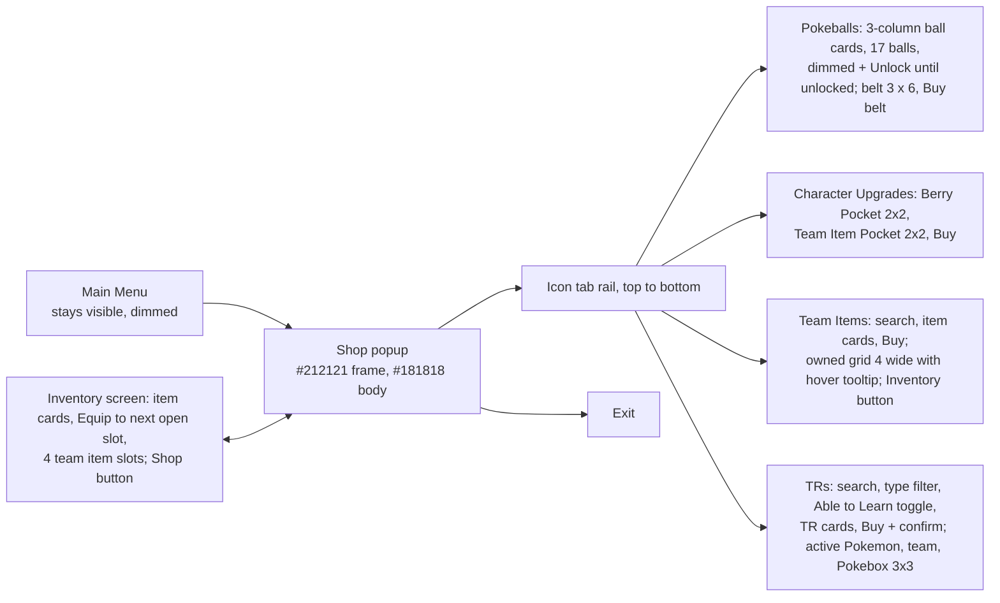
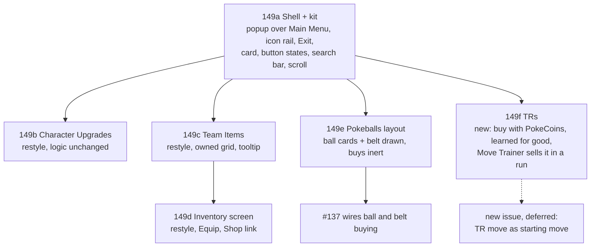
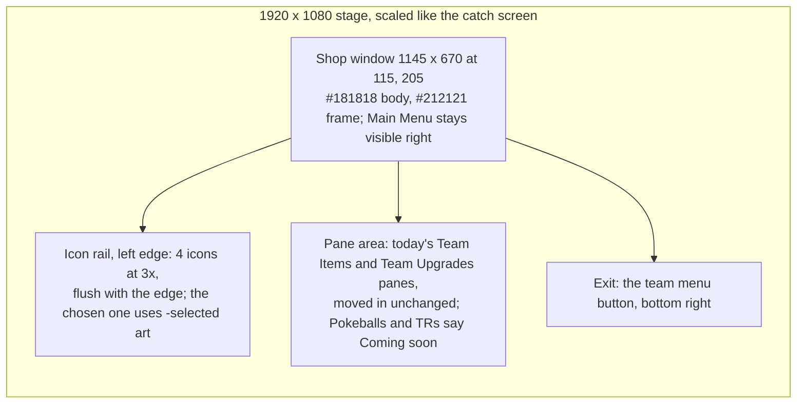
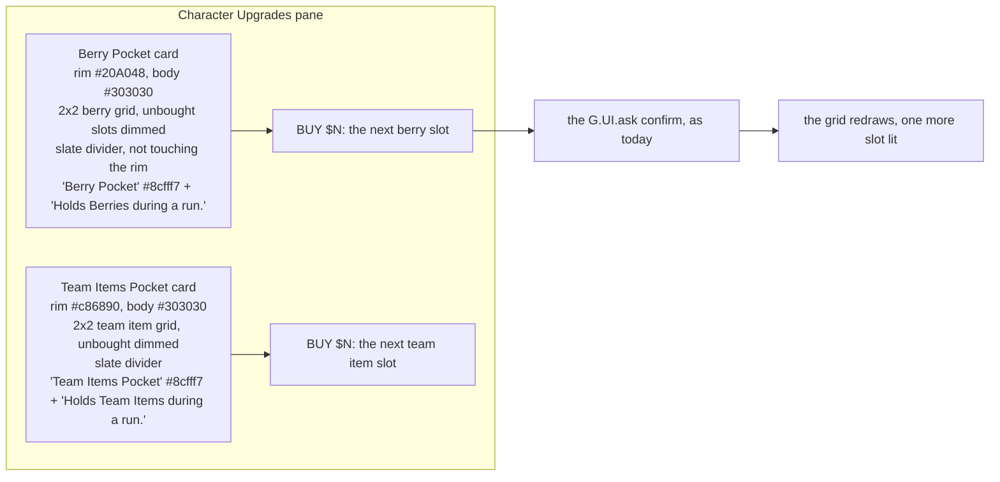

# #149 Shop menu rework: slice opening

Source: Jess's mockups, committed 0ea72871 (assets/excalidraw/Shop-*.svg, Main-Menu-Inventory.svg, Hover Tooltip.svg),
tab icons in assets/ui/shop_icons/. Branch rework/shop (off feature/128-acquisition). Status: DRAFT, sub-slice openings to agree.

## Which screen (confirmed by Jess 2026-11-16)
#149 is the **Main Menu Shop** (screen scr-gacha, js/ui/gacha-ui.js, PokeCoins, between runs), the screens that buying
Pokeballs to refill the belt touches. The in-run Move Trainer and TM Mart (js/ui/shop-ui.js) keeps its look; only its
Trainer stock changes (TRs, below). The issue body named shop-ui.js by mistake and was corrected the same day.

## Rulings so far (Jess 2026-11-16)
| # | Ruling |
|---|---|
| R1 | #149 builds all four tabs: Pokeballs, Character Upgrades, Team Items, TRs. |
| R2 | A TR bought in the Main Menu teaches a Pokebox Pokemon the move for good. In a run that move is sold by the **Move Trainer** (Trainer prices, cheaper than the TM Mart), not the TM Mart. |
| R3 | Picking a TR move as the starting move is a Team, Upgrade menu purchase: deferred, own issue. |
| R4 | The Inventory screen restyle is part of #149 (it shares the item panel and links to the Shop). |
| R5 | rework/shop merges into feature/128-acquisition before #137 starts. |
| R6 | A learned TR **joins** the Pokemon's random Move Trainer pool (not a guaranteed offer). |
| R7 | TR prices go by move power (temporary bands, drafted at 149f for Jess to approve). |
| R8 | The Shop sells every TM as a TR; Able to Learn = the selected Pokemon's TM compatibility. |
| R9 | Build order a, b, c, d, e, f. |

Decision: docs/decisions/2026-11-16-149-main-menu-shop-four-tabs-trs-learned-for-good.md.

## What the mockups ask for

## Sub-slices (each opens with its own goal, done and test)

| Sub-slice | Changes game rules? | Notes |
|---|---|---|
| 149a | No | the tab rail swaps panes; old panes sit inside until restyled |
| 149b | No | berry and team item slot buying as today |
| 149c | No | same unlocks and prices; description moves into the card |
| 149d | Small | Equip fills the next open slot (today: pick the slot) |
| 149e | No | cards show Unlock, belt shows Buy; both inert until #137 |
| 149f | **Yes** | new save field (each Pokemon's learned TRs, absent = none); the Trainer pool gains them |

## Draft opening for 149a (first to build)
- **Goal:** the Shop opens as the mockup's popup over the Main Menu with the four-icon rail and Exit; the shared card,
  button and search pieces exist for the tabs to use.
- **Done when:** every purchase you can make today still works, the rail switches tabs (selected icon art on the chosen
  tab), mouse and keyboard reach every tab, Buy and Exit, and Exit returns to the Main Menu.
- **End-goal test:** smoke-ui gains a Shop pass: open from the Main Menu, four tabs, each opens its own pane, a team item
  buy and a berry slot buy spend PokeCoins and show as owned, a Buy you cannot afford is not focusable, Exit closes it.
  Relations only, no prices copied from data.

Opening agreed by Jess 2026-11-16 ("Build").

## 149a build plan

| Part | Reuses | New | Where |
|---|---|---|---|
| Window and pane area | the catch screen's window look, pm-stage, fitToStage | static markup in scr-gacha | dev.html, css/bw-shop.css (new file, one link line) |
| Rail and Exit | HUD kit TeamButton, Cursor, REST_RIM / FOCUS_RIM | a small Preact piece drawing 4 tabs and Exit | js/ui/gacha-ui.js |
| Keys | the Main Menu's keydown pattern | Q / E or a click switch tabs (no cursor on tabs); the cursor sits on Exit, Enter presses it, Esc closes | js/ui/gacha-ui.js |
| Test | smoke-ui's page boot | a Shop pass (the agreed end-goal test) | tools/smoke-ui.js |

- Opens on Team Items, as today. The tab order matches the mockup: Pokeballs, Character Upgrades, Team Items, TRs.
- The pane is where Team Upgrades lives today; it becomes Character Upgrades (the name changes now, the look in 149b).
- **Not built here:** the cursor inside the panes (their Buy buttons keep today's mouse and Tab key until 149b and 149c rebuild
  them), Pokeballs and TRs content, renaming gacha-ui.js (a file rename costs a script tag, a NEED entry and the build list;
  left for a later cleanup).
- Risk: the old panes' styles inside the scaled stage; they keep their own layout and scroll inside the pane area.

**149a built 2026-11-16, Needs Playtest.** smoke-ui's Shop pass (9 checks) passes; smoke-berry-slots now clicks the new
rail. Also done: the Main Menu's Shop subtitle names the four tabs; the dead `#scr-gacha .box.wide` rule left style.css.
Next: 149b Character Upgrades.

**149a feel-test fixes (Jess 2026-11-16):** the tabs take no cursor and no tooltip (the Hover Tooltip mockup is for the
later UI unification, not the tabs); they never move and sit flush with the window's left edge; Q / E switch them. Exit
is smaller: the team menu button at 3 px per art pixel (156 x 54; the kit's TeamButton gained an artPixel option, the
catch screen keeps 4). smoke-ui's Shop pass now has 10 checks.

**Cursor fix (Jess 2026-11-16):** the cursor follows the device in use (decision
2026-11-16-selection-cursor-follows-the-device-in-use): with the mouse it shows only on the eligible item under it, or
nowhere; a key press snaps it back to the last item. The page-wide mode is the kit's inputMode. smoke-ui Shop pass: 11 checks.

**149a signed off (Jess 2026-11-17, feel test good).** #149 stays open for b to f.

## Draft opening for 149b (Character Upgrades), for Jess to agree
Source: assets/excalidraw/Shop-Character-Upgrades.svg.

- **Goal:** the Character Upgrades tab looks like the mockup: two pocket cards in the pause menu's detail-panel shape,
  each showing its 2x2 grid (the kit's ItemGrid, as the pause menu's Run Inventory draws it), with one BUY $N button that buys
  the next slot. Prices, order, caps and the save fields stay the same.
- **Done when:**
  - Both cards draw from the save: lit squares equal the slots owned, dimmed squares the rest.
  - Each BUY shows the next slot's price, asks first, then spends PokeCoins and lights one more square.
  - A full pocket's button reads Full and cannot be pressed. A BUY you cannot afford cannot be pressed or focused.
  - The selection cursor reaches both BUY buttons and Exit (arrows, Enter, hover), following the device in use as in 149a.
  - The old list rows and their text are gone.
- **End-goal test:** smoke-ui's Shop pass grows. It checks these relations:
  - Each grid's lit-square count equals the save's slot count, and lit plus dimmed equals the cap.
  - After a BUY, the count rises by one and PokeCoins fall by the price the button showed.
  - A full or unaffordable BUY is disabled and the cursor skips it.
  - Arrows move the cursor between the two BUYs and Exit.
  smoke-berry-slots keeps passing, adjusted to the new button.

| Open question | My default |
|---|---|
| Q1 What fills the empty space ("maybe for more upgrades")? | Nothing, left empty for now |
| Q2 What does a full pocket's button say? | "Full", disabled |
| Q3 Does an unaffordable BUY still show its price? | Yes, dimmed, same as the 149a rule |
| Q4 Do the squares get a tooltip (for example "Slot 3, not bought")? | No tooltip in 149b |

Opening agreed by Jess 2026-11-17 ("agreed, build"), defaults Q1 to Q4 taken.

**149b built 2026-11-17, Needs Playtest.**
| Part | What |
|---|---|
| Pane | two pocket cards (260 x 390) in the kit's Box with a #303030 body; 2x2 ItemGrid of 56 px squares, unbought dimmed; slate divider; name in #8cfff7, line in white (wraps) |
| Buy | the team menu button at 3 px per art pixel, "Buy N" or "Full"; disabled (dimmed, price kept) when full or unaffordable; asks first, as before |
| Cursor | the pressable Buys then Exit; arrows step them (no wrap), Enter presses, disabled Buys never take it |
| Kit | Box gains a body colour option; TeamButton gains disabled |
| Gone | the old slot rows and their .shop-up styles |
| Tests | smoke-ui Shop pass: 15 checks (grids match the save, a Buy adds one slot for its label's price, arrows, Enter asks, Full, unaffordable); smoke-berry-slots reads the pocket |

Next: 149c Team Items.
