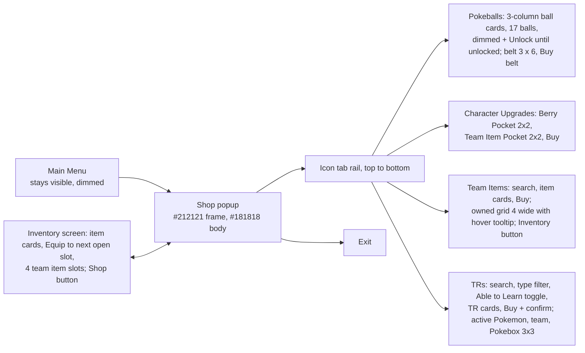
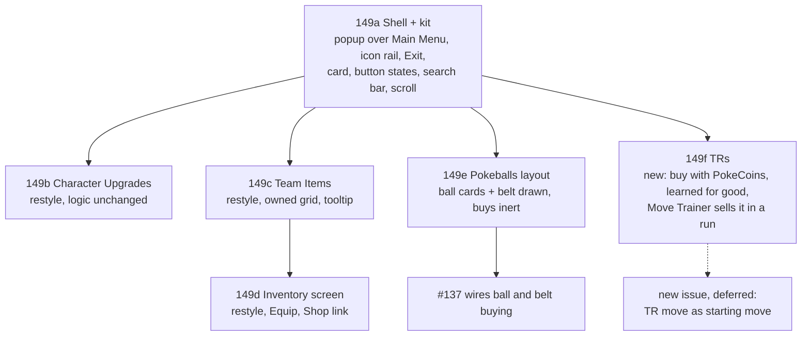
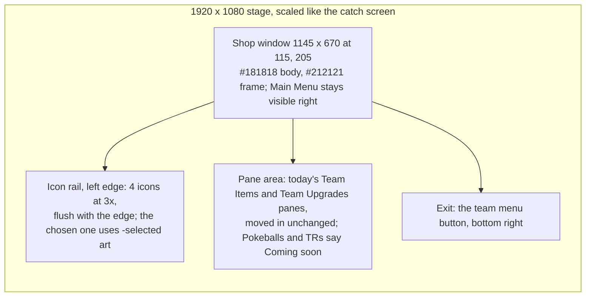
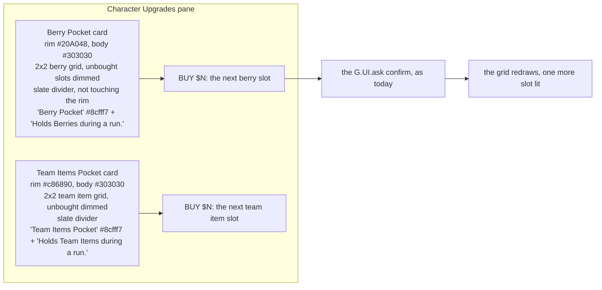
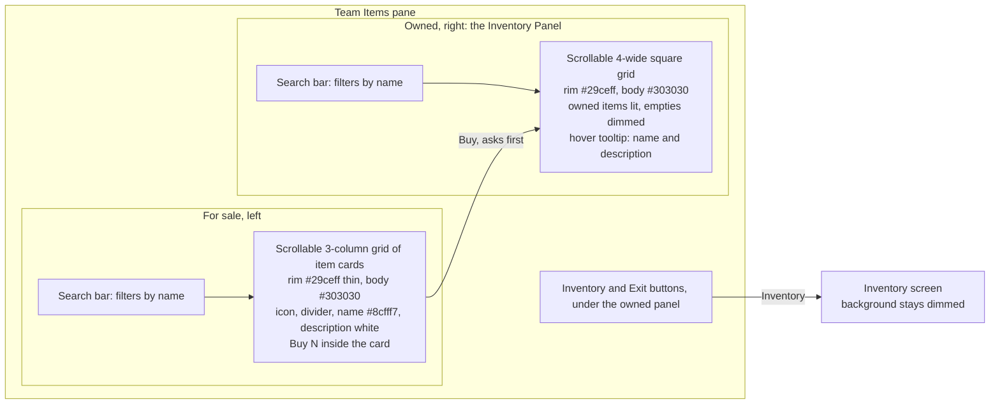
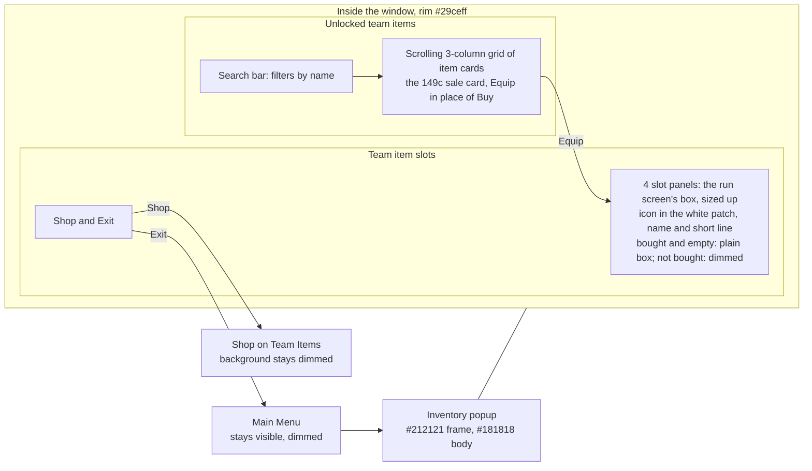
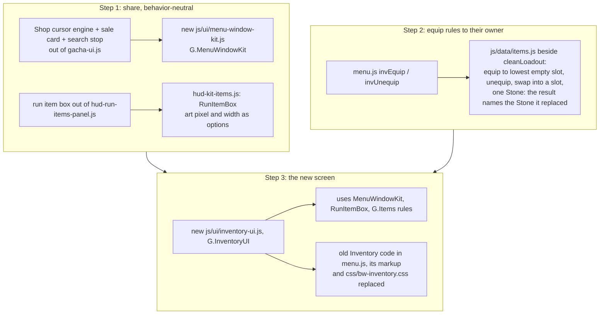

# #149 Shop menu rework: slice opening

Source: Jess's mockups, committed 0ea72871 (assets/excalidraw/Shop-*.svg, Main-Menu-Inventory.svg, Hover Tooltip.svg),
tab icons in assets/ui/shop_icons/. Branch rework/shop (off feature/128-acquisition). Status: DRAFT, sub-slice openings to agree.

## Which screen (confirmed by Jess 2026-11-16)
#149 is the **Main Menu Shop** (screen scr-gacha, js/ui/gacha-ui.js, PokeCoins, between runs), the screens that buying
Pokeballs to refill the belt touches. The in-run Move Trainer and TM Mart (js/ui/shop-ui.js) keeps its look; only its
Trainer stock changes (TRs, below). The issue body named shop-ui.js by mistake and was corrected the same day.

## Rulings so far (Jess 2026-11-16)
| # | Ruling |
|---|---|
| R1 | #149 builds all four tabs: Pokeballs, Character Upgrades, Team Items, TRs. |
| R2 | A TR bought in the Main Menu teaches a Pokebox Pokemon the move for good. In a run that move is sold by the **Move Trainer** (Trainer prices, cheaper than the TM Mart), not the TM Mart. |
| R3 | Picking a TR move as the starting move is a Team, Upgrade menu purchase: deferred, own issue. |
| R4 | The Inventory screen restyle is part of #149 (it shares the item panel and links to the Shop). |
| R5 | rework/shop merges into feature/128-acquisition before #137 starts. |
| R6 | A learned TR **joins** the Pokemon's random Move Trainer pool (not a guaranteed offer). |
| R7 | TR prices go by move power (temporary bands, drafted at 149f for Jess to approve). |
| R8 | The Shop sells every TM as a TR; Able to Learn = the selected Pokemon's TM compatibility. |
| R9 | Build order a, b, c, d, e, f. |

Decision: docs/decisions/2026-11-16-149-main-menu-shop-four-tabs-trs-learned-for-good.md.

## What the mockups ask for

## Sub-slices (each opens with its own goal, done and test)

| Sub-slice | Changes game rules? | Notes |
|---|---|---|
| 149a | No | the tab rail swaps panes; old panes sit inside until restyled |
| 149b | No | berry and team item slot buying as today |
| 149c | No | same unlocks and prices; description moves into the card |
| 149d | Small | Equip fills the next open slot (today: pick the slot) |
| 149e | No | cards show Unlock, belt shows Buy; both inert until #137 |
| 149f | **Yes** | new save field (each Pokemon's learned TRs, absent = none); the Trainer pool gains them |

## Draft opening for 149a (first to build)
- **Goal:** the Shop opens as the mockup's popup over the Main Menu with the four-icon rail and Exit; the shared card,
  button and search pieces exist for the tabs to use.
- **Done when:** every purchase you can make today still works, the rail switches tabs (selected icon art on the chosen
  tab), mouse and keyboard reach every tab, Buy and Exit, and Exit returns to the Main Menu.
- **End-goal test:** smoke-ui gains a Shop pass: open from the Main Menu, four tabs, each opens its own pane, a team item
  buy and a berry slot buy spend PokeCoins and show as owned, a Buy you cannot afford is not focusable, Exit closes it.
  Relations only, no prices copied from data.

Opening agreed by Jess 2026-11-16 ("Build").

## 149a build plan

| Part | Reuses | New | Where |
|---|---|---|---|
| Window and pane area | the catch screen's window look, pm-stage, fitToStage | static markup in scr-gacha | dev.html, css/bw-shop.css (new file, one link line) |
| Rail and Exit | HUD kit TeamButton, Cursor, REST_RIM / FOCUS_RIM | a small Preact piece drawing 4 tabs and Exit | js/ui/gacha-ui.js |
| Keys | the Main Menu's keydown pattern | Q / E or a click switch tabs (no cursor on tabs); the cursor sits on Exit, Enter presses it, Esc closes | js/ui/gacha-ui.js |
| Test | smoke-ui's page boot | a Shop pass (the agreed end-goal test) | tools/smoke-ui.js |

- Opens on Team Items, as today. The tab order matches the mockup: Pokeballs, Character Upgrades, Team Items, TRs.
- The pane is where Team Upgrades lives today; it becomes Character Upgrades (the name changes now, the look in 149b).
- **Not built here:** the cursor inside the panes (their Buy buttons keep today's mouse and Tab key until 149b and 149c rebuild
  them), Pokeballs and TRs content, renaming gacha-ui.js (a file rename costs a script tag, a NEED entry and the build list;
  left for a later cleanup).
- Risk: the old panes' styles inside the scaled stage; they keep their own layout and scroll inside the pane area.

**149a built 2026-11-16, Needs Playtest.** smoke-ui's Shop pass (9 checks) passes; smoke-berry-slots now clicks the new
rail. Also done: the Main Menu's Shop subtitle names the four tabs; the dead `#scr-gacha .box.wide` rule left style.css.
Next: 149b Character Upgrades.

**149a feel-test fixes (Jess 2026-11-16):** the tabs take no cursor and no tooltip (the Hover Tooltip mockup is for the
later UI unification, not the tabs); they never move and sit flush with the window's left edge; Q / E switch them. Exit
is smaller: the team menu button at 3 px per art pixel (156 x 54; the kit's TeamButton gained an artPixel option, the
catch screen keeps 4). smoke-ui's Shop pass now has 10 checks.

**Cursor fix (Jess 2026-11-16):** the cursor follows the device in use (decision
2026-11-16-selection-cursor-follows-the-device-in-use): with the mouse it shows only on the eligible item under it, or
nowhere; a key press snaps it back to the last item. The page-wide mode is the kit's inputMode. smoke-ui Shop pass: 11 checks.

**149a signed off (Jess 2026-11-17, feel test good).** #149 stays open for b to f.

## Draft opening for 149b (Character Upgrades), for Jess to agree
Source: assets/excalidraw/Shop-Character-Upgrades.svg.

- **Goal:** the Character Upgrades tab looks like the mockup: two pocket cards in the pause menu's detail-panel shape,
  each showing its 2x2 grid (the kit's ItemGrid, as the pause menu's Run Inventory draws it), with one BUY $N button that buys
  the next slot. Prices, order, caps and the save fields stay the same.
- **Done when:**
  - Both cards draw from the save: lit squares equal the slots owned, dimmed squares the rest.
  - Each BUY shows the next slot's price, asks first, then spends PokeCoins and lights one more square.
  - A full pocket's button reads Full and cannot be pressed. A BUY you cannot afford cannot be pressed or focused.
  - The selection cursor reaches both BUY buttons and Exit (arrows, Enter, hover), following the device in use as in 149a.
  - The old list rows and their text are gone.
- **End-goal test:** smoke-ui's Shop pass grows. It checks these relations:
  - Each grid's lit-square count equals the save's slot count, and lit plus dimmed equals the cap.
  - After a BUY, the count rises by one and PokeCoins fall by the price the button showed.
  - A full or unaffordable BUY is disabled and the cursor skips it.
  - Arrows move the cursor between the two BUYs and Exit.
  smoke-berry-slots keeps passing, adjusted to the new button.

| Open question | My default |
|---|---|
| Q1 What fills the empty space ("maybe for more upgrades")? | Nothing, left empty for now |
| Q2 What does a full pocket's button say? | "Full", disabled |
| Q3 Does an unaffordable BUY still show its price? | Yes, dimmed, same as the 149a rule |
| Q4 Do the squares get a tooltip (for example "Slot 3, not bought")? | No tooltip in 149b |

Opening agreed by Jess 2026-11-17 ("agreed, build"), defaults Q1 to Q4 taken.

**149b built 2026-11-17, Needs Playtest.**
| Part | What |
|---|---|
| Pane | two pocket cards (260 x 390) in the kit's Box with a #303030 body; 2x2 ItemGrid of 56 px squares, unbought dimmed; slate divider; name in #8cfff7, line in white (wraps) |
| Buy | the team menu button at 3 px per art pixel, "Buy N" or "Full"; disabled (dimmed, price kept) when full or unaffordable; asks first, as before |
| Cursor | the pressable Buys then Exit; arrows step them (no wrap), Enter presses, disabled Buys never take it |
| Kit | Box gains a body colour option; TeamButton gains disabled |
| Gone | the old slot rows and their .shop-up styles |
| Tests | smoke-ui Shop pass: 15 checks (grids match the save, a Buy adds one slot for its label's price, arrows, Enter asks, Full, unaffordable); smoke-berry-slots reads the pocket |

Next: 149c Team Items.

**149b signed off (Jess 2026-11-17, feel test good).**

## Draft opening for 149c (Team Items), for Jess to agree
Source: assets/excalidraw/Shop-Team-Items.svg. Today: 25 team items, one price (100,000), descriptions up to 85 characters.

- **Goal:** the Team Items tab looks like the mockup. A searchable grid of item cards for sale, each with its own Buy, sits beside
  a searchable panel of the items you own, with Inventory and Exit buttons. Prices, unlocks and the save stay the same.
- **Done when:**
  - Every unowned team item has one card: icon, name, description, and Buy with the price.
  - Buy asks first, spends the price, and moves the item from the sale grid to the owned panel.
  - A Buy you cannot afford shows white text at 45%, cannot be pressed, and never takes the cursor.
  - Each search bar narrows its own grid by name as you type.
  - Hovering an owned square shows its name and description in the shared tooltip layer.
  - Inventory opens the Inventory screen with the background still dimmed. Exit returns to the Main Menu.
  - The cursor reaches every pressable Buy, Inventory and Exit by keys or mouse. The old list and detail column are gone.
- **End-goal test:** smoke-ui's Shop pass grows. It checks these relations:
  - Sale cards plus lit owned squares equal the number of team items.
  - A Buy takes the item from the sale grid to the owned grid, and coins fall by the price its label showed.
  - Typing in a search bar leaves only cards whose names contain the text, and clearing it brings them all back.
  - At 0 coins every Buy is disabled and the arrows skip them.
  - Hovering an owned square shows a tooltip naming that item.
  - Inventory leaves the Shop for the Inventory screen.

| Open question | My default |
|---|---|
| Q1 How many squares does the owned grid have? | One per team item in the game (25): owned items first, the rest dimmed |
| Q2 How do the arrows move in the card grid? | Up, down, left and right across the pressable Buys; Right from the last column goes to the owned side's Inventory and Exit |
| Q3 Does an owned square take the cursor? | No, mouse hover only (tooltip). Owned items have nothing to press |
| Q4 What does the sale grid say when you own everything? | "You own every team item." |
| Q5 The tooltip's pin icon (Hover Tooltip mockup) | Not in 149c; it belongs to the later UI unification (#126) |

**149c opening agreed (Jess 2026-11-17), with two changes:**
- Q1: the owned grid is 4 across and holds owned items only, with dimmed empty squares filling out its visible rows. It
  scrolls, since content updates will add many more team items than today's 25 (a test kit).
- Q3: owned squares take the selection cursor. With the cursor (keys now, a controller later) an item's tooltip shows after
  a delay, 1 s by default, set in the Settings menu, so keyboard and controller players still see tooltips. Mouse hover
  stays instant. The delay is a new settings field; an old save without it reads as 1 s.
- Test changes: sale cards plus owned items equal the number of team items. The arrows reach owned squares, and the cursor
  resting on one shows its tooltip only after the set delay.

**149c built 2026-11-17, Needs Playtest.**
| Part | What |
|---|---|
| Sale side | search bar over a scrolling 3-column grid of 186 x 350 cards: thin #29ceff rim, #303030 body, icon, divider, name #8cfff7, description, Buy N (white at 45%, disabled and skipped when unaffordable) |
| Owned panel | thin #29ceff rim, search bar over a scrolling 4-across ItemGrid, dimmed empties filling at least 5 rows; hover tooltip at once |
| Buttons | Inventory beside Exit (this tab only) opens the Inventory screen over the still dimmed Main Menu |
| Cursor | Buys you can press, owned squares, Inventory, Exit; an arrow goes to the nearest item that way and scrolls it into view (the 149b paths come out the same); resting on an owned square shows its tooltip after the Tooltip Delay |
| Setting | Settings, Controls, Keyboard: Tooltip Delay 0.5 / 1 / 1.5 / 2 s (default 1). Decision 2026-11-17-cursor-tooltips-after-a-settable-delay |
| Kit | ItemGrid gains columns and a per-slot overlay; new SearchBar (Enter or Esc lets go of the keys and goes no further) |
| Gone | the old item list, detail column and their styles |
| Tests | smoke-ui Shop pass now 21 checks (149c adds coverage, card Buy, both searches, hover tooltip, delayed cursor tooltip with unaffordable Buys skipped, Inventory) |

Found while testing: Esc in a search box closed the whole Shop; the box now keeps its Enter and Esc to itself.
Next: 149d Inventory screen.

**149c feel-test fixes (Jess 2026-11-17, screenshot assets/screenshots/team-item-shop-bug1.png):**
| # | Fix |
|---|---|
| 1 | The owned grid's scroll box has 6 px of room around the squares, so the cursor's corners are never clipped |
| 2 | The cursor also moves with the movement keys as bound in Settings (WASD by default), besides the arrows |
| 3 | A key move scrolls only the item's own scroll box, enough to show the whole card behind a Buy (it used scrollIntoView, which also scrolled the pane) |
| 4 | The Team Items pane reaches 86 px lower, so the sale grid and its bar end level with the bottom of Inventory and Exit |
| 5 | Cause of the clipped search bar and owned panel: that pane scroll (all of it moved as one). The pane is now overflow: clip, which code cannot scroll; the sale side and the owned panel stay separate boxes |
Also: each opening of the Shop sends both scroll boxes back to the top.

**149c feel-test round 2 (Jess 2026-11-17):**
| # | Fix |
|---|---|
| 1 | Space under the sale grid's last row (one card gap), so the last cards show whole at the end of the scroll |
| 2 | The owned panel is 377 wide, 4 px inside the pane, so a scaled-down stage never rounds its right rim away |
| 3 | The search bars are cursor stops at the top of their areas: Up from an area's top item goes to its search bar, never the other grid; Up never leaves an area; Down with nothing below goes on to Inventory and Exit; Enter on a search bar starts typing (Enter or Esc gives the keys back) |
| - | The sale side sits 6 px in from the pane's top and left, so the cursor on its search bar shows whole; its list still ends level with Inventory and Exit |

**149c feel-test round 3 (Jess 2026-11-17):** Up goes row by row, even to a row scrolled out of sight; the search bar only
from the top row; sideways never lands on a search bar. No selection cursor with the mouse anywhere in the Shop (the button
under it shows its green rim). No corners on a search bar: its green rim shows the keys' cursor is there. Decision
2026-11-17-no-selection-cursor-with-the-mouse.

**149c signed off (Jess 2026-11-17, feel test good after three fix rounds).** Next: 149d Inventory screen.

## Draft opening for 149d (Inventory screen), for Jess to agree
Source: assets/excalidraw/Main-Menu-Inventory.svg. Today (js/ui/menu.js, scr-inventory): a slot column, an icon list and a
detail column; click a slot to target it, double-click an item to equip it there, right-click a slot to empty it.
Save fields stay as they are: save.teamItems (unlocked) and save.teamLoadout (equipped, by slot, gaps allowed).

- **Goal:** the Inventory screen looks like the mockup and works with one button per item. A searchable grid of your
  unlocked team item cards, each with Equip, sits beside the four team item slots drawn like the run screen's, with Shop
  and Exit under them. Which items you own, how many slots you bought and the one-Stone rule stay the same.
- **Done when:**
  - Every unlocked team item has one card (icon, name, description, button). Nothing locked shows.
  - The slot panels: one per bought slot, plain when empty, the item's icon and name when filled; slots not bought yet
    show dimmed, up to 4.
  - Equip puts the item in the lowest-numbered empty bought slot and saves at once. Its button then reads Unequip.
  - Unequip empties that item's slot; the other slots keep their places.
  - With every bought slot full, Equip cannot be pressed and never takes the cursor.
  - The search bar narrows the grid by name as you type.
  - Shop closes the Inventory and opens the Shop on Team Items, background still dimmed. Exit returns to the Main Menu.
  - The cursor follows the Shop's rules (keys only, nearest item that way, search bar at the top, Up stays in its area,
    tooltip after the Tooltip Delay) and reaches every pressable button, the filled slots, Shop and Exit.
  - The old slot column, icon list, detail column, the targeting, double-click and right-click, and their styles are gone.
- **End-goal test:** smoke-ui gains an Inventory pass (the existing check that the Shop's Inventory button opens it stays). Relations:
  - Card count equals the save's unlocked team items; typing narrows to names containing the text; clearing restores them.
  - Lit slot panels equal G.Items.runSlots; lit plus dimmed equals the slot cap.
  - With slot 1 empty and slot 2 filled, Equip lands in slot 1 (the lowest empty), the save's loadout holds it there,
    and the card's button reads Unequip.
  - Unequip empties only that slot.
  - With every bought slot full, every Equip is disabled and the arrows skip them.
  - Equipping a second Stone leaves exactly one Stone in the loadout (see Q3).
  - Shop leaves the Inventory for the Shop's Team Items tab; Exit returns to the Main Menu.

| Open question | My default |
|---|---|
| Q1 How do you unequip? | The equipped item's card button reads Unequip. Pressing a filled slot also unequips it |
| Q2 Every bought slot is full: what does Equip show? | "Full", disabled (dimmed), skipped by the cursor; unequip something first |
| Q3 Equip a second Stone while one is equipped | It takes the first Stone's slot (a swap in place, no question asked), as today |
| Q4 What does a filled slot panel show? | Icon in the patch, the name in the band, the item's short description at the right, like the run screen outside a run |
| Q5 Card order | Game order; equipped cards stay in place (their button says Unequip), no extra chip |
| Q6 The title, "N of M unlocked" count and help line | Gone, as in the mockup; the empty grid keeps "Nothing unlocked yet. Gym leaders and bosses can drop team items." |
| Q7 Does Exit go back to the Shop when you came from it? | No, Exit always returns to the Main Menu; Shop is the way back |

**149d answers (Jess 2026-11-17):**
| # | Ruling |
|---|---|
| Q1 | Agreed: the equipped card's button reads Unequip; pressing a filled slot also unequips |
| Q2 | Every bought slot full: Equip reads **Swap**, not dimmed, the cursor still takes it. Pressing it shows "Select a slot to swap." between the slots and Shop / Exit. Keys: the cursor jumps to slot 1, arrows pick a filled slot, Enter swaps the two items. Mouse: click an equipped slot to swap |
| Q3 | Agreed, plus a toast: "Can only have One Stone equipped." |
| Q4 to Q6 | Agreed |
| Q7 | Exit always returns to the Main Menu; Shop always opens the Shop |

Follow-ups asked: Q8 how a swap is cancelled; Q9 a Stone swapped in while another Stone sits in a different slot.
- Q8 agreed: Esc (or a mouse click anywhere but a filled slot) cancels a swap; the line goes and the cursor returns to Swap.
- Q9 agreed: a Stone's Swap skips the slot pick and goes straight into the other Stone's slot, with the toast.
- Settled with Jess: while picking a slot to swap, pressing a filled slot swaps; otherwise it unequips.

**Opening agreed (Jess 2026-11-17), build with the coding principles.**

## 149d build plan
Done in three steps; steps 1 and 2 change nothing you can see (smoke-ui's Shop pass and the run HUD stay as they are).

| Part | Reuses | New | Where, and why there |
|---|---|---|---|
| Cursor engine | gacha-ui.js's focus / hover / cursorOn, the arrows' nearest-item step with areas and search stops, scroll into view, movement keys, CursorTip, cornersIf | one factory: each screen hands it its host, its eligible items, what Enter and Esc do, and any extra keys (the Shop's Q / E) | js/ui/menu-window-kit.js: two real users now (Shop, Inventory), #126 will add more; moving it keeps gacha-ui.js under 1000 lines |
| Item card | the 149c SaleCard and its .shop-card styles | the button's label, disabled state and action become options (Buy N, Equip, Unequip, Swap) | same file; the class names keep their shop- prefix (renaming is #126's job) |
| Slot panel | the run HUD's B2 box (grid painter, patch, name band, text area) | RunItemBox with its art pixel, width and a dimmed look as options; the HUD keeps 2 px per art pixel and 140 wide | hud-kit-items.js, the kit's item pieces; the HUD panel becomes its first user |
| Equip rules | cleanLoadout, runSlots, the group field | equip (lowest empty bought slot, or the other Stone's slot), unequip (others keep their places), swap into a chosen slot (the old item leaves the loadout); each answers what happened, so the screen can toast | js/data/items.js, the owner of the loadout rules; the screen only draws and routes |
| Inventory screen | Shop window size and place (1145 x 670), its frame and body colours, TeamButton for Shop and Exit, SearchBar, ScrollBox, G.UI.toast | the window: search + 3-column cards left; 4 slot panels right (3 px per art pixel, 120 art wide: 360 x 96 each), the swap line under them, Shop and Exit at the bottom | js/ui/inventory-ui.js, its own file and G module; the section keeps the id scr-inventory (ui.js and game.js read it) |
| Links | G.GachaUI.open, G.MenuUI.open | Main Menu's Inventory row and the Shop's Inventory button call G.InventoryUI.open; Shop calls G.GachaUI.open (Team Items, dimmed background kept); Exit calls G.MenuUI.open | menu.js and gacha-ui.js each lose their own openInventory |

**Cursor on the Inventory:** areas are the card side (its search bar on top) and the slot side. Eligible: the search bar,
every card button, filled slots, Shop, Exit. While picking a slot to swap: only the bought slots, starting on slot 1.

**Tests (end-goal test from the opening):**
- smoke-ui gains an Inventory pass with the opening's relations, plus: Swap shows the line and moves the cursor to slot 1;
  Enter on a slot swaps (the old item's card reads Equip again); Esc cancels with the loadout unchanged; a second Stone's
  Equip or Swap leaves one Stone and shows the toast.
- docs/proposals/items-f3d2-harness.js gains checks for the three new G.Items rules (updated in place, no new harness):
  lowest empty slot with a gap, full means no equip, unequip keeps the others' places, swap, the one-Stone replacement.
- The Shop pass and smoke-berry-slots must pass unchanged after step 1.

**Not built:** tooltips on the slot panels (the panel already shows the name and description); drag and drop; renaming
gacha-ui.js or the shop- class names (#126); a slot order rearrange.

**Size:** gacha-ui.js shrinks (about 870 to 650 lines). New: menu-window-kit.js (about 300), inventory-ui.js (about 350).
menu.js loses about 150. js/data/items.js grows about 50 (already past 1000; it is the data and rules file, no split
here). Two new script lines in dev.html; neither file needs a NEED entry (the Shop's is not in it either).

**Touched-code cleanups:** the dead .inv-* styles and css/bw-inventory.css go with the old screen (its link line in
dev.html too); the Main Menu's Inventory subtitle text stays.

**Risk:** step 1 moves the 149c cursor rules Jess signed off after three rounds; the Shop pass (30 checks) is the guard,
and the cursor feel gets a quick re-check in the Shop at feel test.

**149d built 2026-11-17, Needs Playtest.**
| Part | What |
|---|---|
| Shared pieces | js/ui/menu-window-kit.js (G.MenuWindowKit): the Shop's cursor rules as createMenuCursor, CursorButton, ItemCard, SearchStop; the Shop now uses them (smoke-ui Shop pass 30 checks unchanged) |
| Slot box | the run HUD's team item box is the kit's RunItemBox (hud-kit-items.js), art pixel and width as options; the run screen keeps 2 and 140 (smoke-hud-overlay passes) |
| Rules | js/data/items.js: firstEmptySlot, equipTeamItem, unequipTeamItem, swapTeamItem (one Stone: the result names what it replaced); items-f3d2-harness section 6 |
| Screen | js/ui/inventory-ui.js (G.InventoryUI): the Shop's window; search and 3-column cards (Equip / Unequip / Swap); 4 slot panels 360 x 96, unbought dimmed; "Select a slot to swap."; Shop and Exit |
| Gone | the old Inventory code in menu.js and its markup; css/bw-inventory.css rewritten for the new window |
| Wiring | game.js boot calls G.InventoryUI.init (after the Main Menu, so a key that closes the Inventory never reaches the Main Menu); the Inventory left game.js's per-frame "Esc returns to the menu" list (Esc first cancels a swap); tools/ui-library.html loads the two new scripts |
| Tests | smoke-ui Inventory pass, 18 checks; smoke-berry-slots, smoke-pause-inventory, smoke-team, smoke-ui-library pass; check.js clean |

Found while building: a cursor whose key listener was added at load time ran before the Main Menu's, so Enter on Exit closed
the Shop and the Main Menu then reopened it; each screen now adds its listener in its init, as before.
Filed during the build (Jess): #151 a button you cannot afford still takes the cursor and toasts "Unable to Afford" (every
menu; decision 2026-11-17-unaffordable-buttons-take-the-cursor), #152 the pocket Buy's unaffordable look.

**149d feel-test round 1 (Jess 2026-11-17, screenshot assets/screenshots/inventory-bug1.png):**
| # | Fix |
|---|---|
| 1 | Enter on the Shop's Inventory closed the Shop and the Inventory never showed: the Inventory's key listener read the same Enter and pressed its Exit. A key a menu window handles now goes no further (createMenuCursor) |
| 2 | With only one slot bought, Swap swaps with it at once (no slot pick) |
| 3 | No teal frame inside the window: the cards and slots sit in the window itself (30 px from its edges); Shop and Exit sit where the Shop's Exit does, so nothing moves between the two screens |
| - | Filed: #153 the Main Menu selects with Enter or Space and moves with the arrows only; the Shop and Inventory select with Enter only and move with the arrows and WASD |
smoke-ui: Shop pass 30 checks (the Inventory check now by Enter and by click); Inventory pass 20.

**149d feel-test round 2 (Jess 2026-11-17):** the card list widens toward the slots: three cards 220 wide (the Shop keeps 186; ItemCard takes a width), search bar as wide as the list. The only issue found in that playtest.

**149d signed off (Jess 2026-11-17, feel test good after two fix rounds).** #149 stays open for 149e and 149f. Next: 149e Pokeballs layout.
