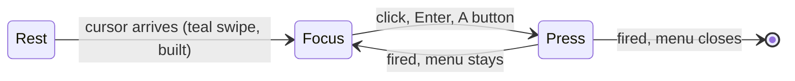
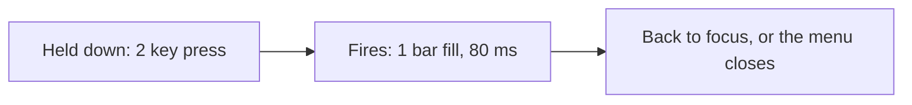
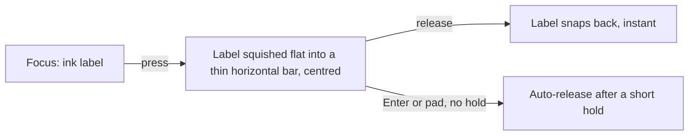
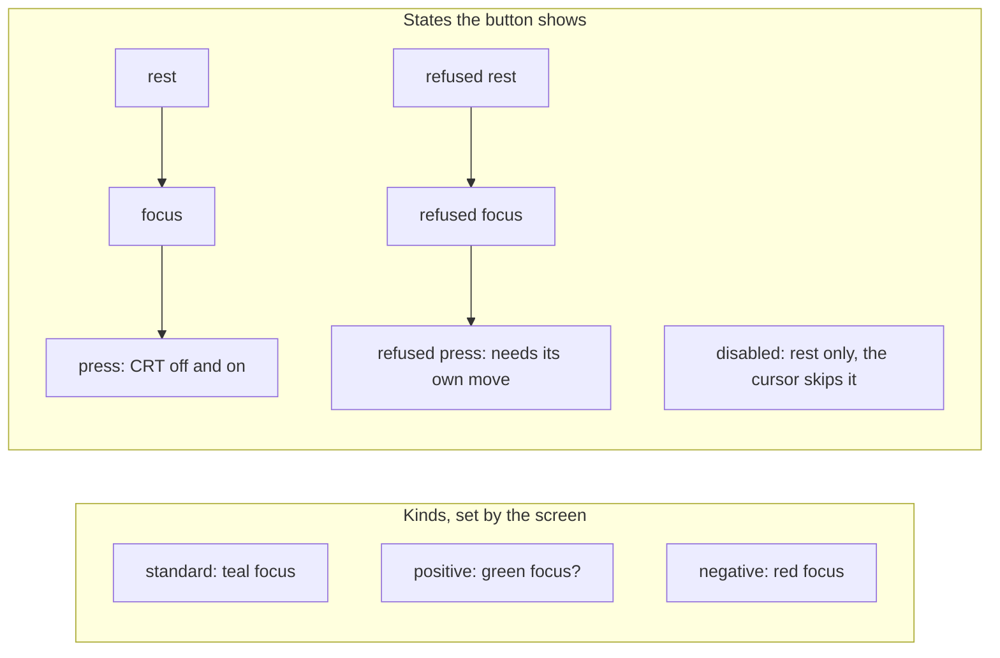

# 155, Glitch Draft: press ideas (brainstorm, 2026-11-18)

Built so far: rest (grey body, white bar) and focus (one right-to-left teal swipe, ink bar, 200 ms, linear).
Next: a standard press. The glitch effect itself is saved for a later narrative feature (Jess), so press uses none of it.

The look so far, which press has to fit: flat colour fills, one hard edge that moves (the swipe), linear timing with no
easing, the 45 degree corner cut, and the 6 px bar on the right.

## Options (all in the current language)

| | Idea | Reuses | Time | Feel |
|---|---|---|---|---|
| 1 | **Bar fill**: the ink bar's left edge sweeps left across the body, so the button goes ink with teal text, then snaps back to focus | The swipe (a hard edge moving) and the bar | about 80 ms in, back on release | Firm, clearly "committed" |
| 2 | **Key press**: the body moves 2 to 3 px toward the bar while the bar thins from 6 px to 2 px, like a key going down | The bar, read as the key's side | held, 0 ms in | Physical, quiet |
| 3 | **Tone step**: the teal body steps one tone darker while held, with no movement | The Unified teal ladder | 0 ms | Quietest, menu-safe |
| 4 | **Corner bite**: the 45 degree cut jumps from 5% to about 12% while held | The shape's own corner | 0 ms | Small and unique to this button |

## Lean

- **1 is the best fit.** It says "press" in the same words focus uses, with a hard edge moving the other way, ink over
  teal (the inverse of focus).
- If 1 flashes too much on menus that stay open (Settings), use **2 + 3** instead.
- With Enter or the pad there is no "held" phase, so whatever plays on fire must work alone.

## Jess's idea (2026-11-18): squish the label into a bar

| Detail | Default to try | Why |
|---|---|---|
| Squish speed | 1 or 2 hard steps, about 60 ms | Fast enough to land on the input; steps keep pixel text crisp |
| Bar thickness | 2 px | Reads as a line; 6 px would echo the side bar but looks like smeared text |
| Pivot | Vertical centre of the label | The bar sits where the text was |
| Letter gaps | Kept, so the bar is dashed, one dash per letter | A free hint of the word; a solid bar is the alternative |
| Release | Instant snap, no bounce | No easing anywhere else in the look |
| Enter or pad | Squish, hold about 60 ms, snap | There is no physical release |
| Press that closes a menu | Cut | The squish already landed on the first frame |

Fits the look: the button already has a vertical bar, and the label turning into a horizontal one is the same shape.

## Questions that narrow it

1. Is press the held-down look, the moment it fires, or both?
2. When a press closes the menu (Resume), does the animation finish first or cut?
3. Strong (1) or quiet (2, 3)?

## Built (2026-11-18): press is a CRT switching off, release a CRT switching on

Ink, 140 ms off and 130 ms on. Jess: "perfect". On the board: Glitch Draft tab, tools/library/glitch-draft.css.

## The full set (draft, Jess 2026-11-18)

| Open | Note |
|---|---|
| Is positive its own colour? | Today green is every button's focus. With teal as the standard, green may only be needed for Buy and Confirm |
| Refused press | A press that only says why (#151). Not the glitch (saved for narrative). The CRT starts to switch off and springs back? |
| Selected | A toggle or tab that stays on (Settings, the board's own tabs). Is it a state of this button? |

## Built (2026-11-18): the full button set

Neutral (teal), negative (red.base, takes or gives away), positive (green.base, spends). Each: rest, focus, press (CRT),
refused (grey.mid bar and label), refused focus (grey.mid body, the kind's colour on the bar), refused press (a 120 ms
sideways shake), disabled (refused's rest with ink text; the cursor skips it). Colours only from Tokens, Colours,
Unified (Jess).

Selected is not a button state: a toggle (and maybe tabs) is its own primitive, later.
