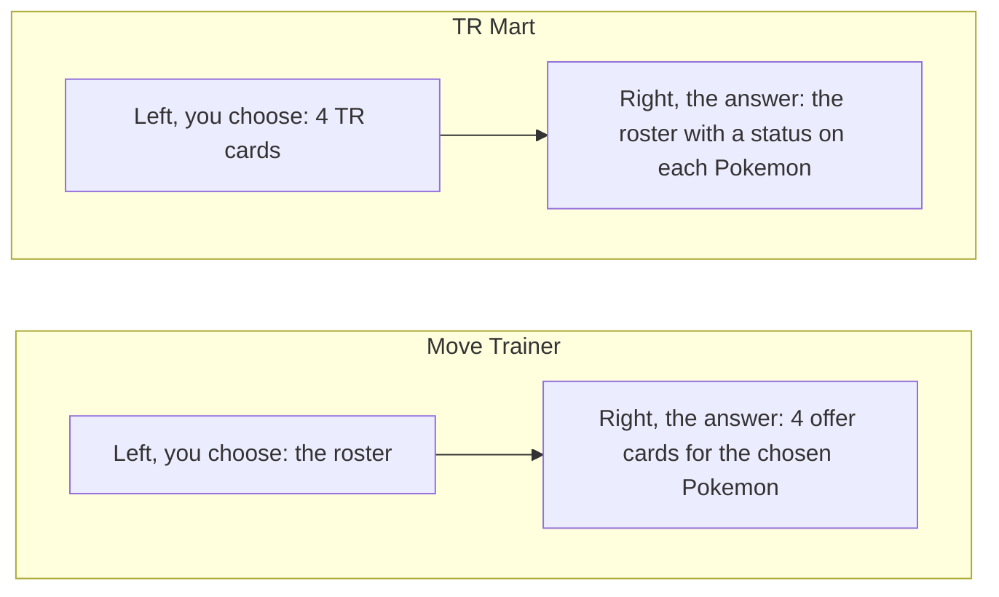
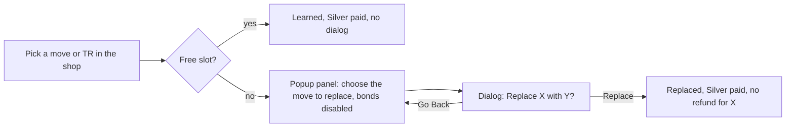

# 155 - Run Shops Layout (2026-11-20)

Slice opening for `run.hud.moveMart` (the Move Trainer) and `run.hud.trMart` (the TR Mart, code id `mart`). Source: js/ui/shop-ui.js, docs/proposals/move-shop-plan.md, decision 2026-11-04-move-shop-move-trainer-and-tm-mart-buildings-silver, and Jess's rulings of this session. Board pages only; the game changes at #126.

## What differs

| | Move Trainer (`run.hud.moveMart`) | TR Mart (`run.hud.trMart`) |
|---|---|---|
| You choose first | a Pokemon | a TR |
| The screen then answers | that Pokemon's 4 offered moves | which Pokemon can learn that TR |
| You buy by | picking an offer card | picking a Pokemon |
| The price lives on | each offer card | the TR card |
| Reroll gives | new offers for that Pokemon | 4 new TRs |

## Layout: mirrored (Jess 2026-11-20)

The thing you choose from sits left; the answer sits right. Both share the window, the Silver counter, Reroll and Back.

Shared: Silver counter, Reroll (greyed at 0, hidden on the forget step), Back and Esc, the forget step (loose moves only, bonds greyed).
`cursor.ring` goes on the roster portraits in both.

## TR Mart roster status

| Status | Symbol (game Silver) | Look | On Enter or click |
|---|---|---|---|
| Can learn it | √ (U+221A) | normal | the purchase |
| Knows it | = (U+003D) | dimmed | toast: it already knows it |
| Cannot learn it | none | dimmed | toast: it cannot learn it |
| Full (all four slots are bonds) | × (U+00D7) | dimmed | toast: every slot is a bond |

- A member with four loose moves shows √: buying opens the forget step.
- A refusal toast fires on Enter or a mouse click, never on the cursor moving over a dimmed portrait.
- Symbols are placeholders until Jess's icons replace them. Silver-game has no ✓ or ✗.

## Rulings (Jess 2026-11-20)

- Each shop page draws its default state only. Reroll at zero, a refused portrait, a dimmed card and the like are states of the primitives inside (button.glitch, card, portrait.round), not page states.
- A Silver buy does not ask. No purchase dialog.
- The forget step is its own panel that pops up on top of the shop panel, so it is its own board piece, not a state of the shop page.
- Replacing a move is three steps (Jess 2026-11-20): pick the move or TR, a popup panel to choose which move to replace, then a dialog "Replace X with Y?" with Replace (red, Negative) and Go Back (teal, Neutral), opening on Go Back.

## Open before the build

1. The forget panel's name on the board (suggested: `run.hud.forgetMove`).
2. The dialog's words: title "Replace move?", message "Replace X with Y?" (X and Y are move names), buttons Replace and Go Back.

## Slice opening (Jess to edit)

- Goal: the two shop pages (default state), the forget panel and its Replace ask on the board from approved pieces.
- Done: each of the three pages is drawn and Jess approves each.
- Test: a board check that the pages draw the roster, the offers or TRs, and the forget panel's loose moves with bonds disabled, as relations and not copied values.
