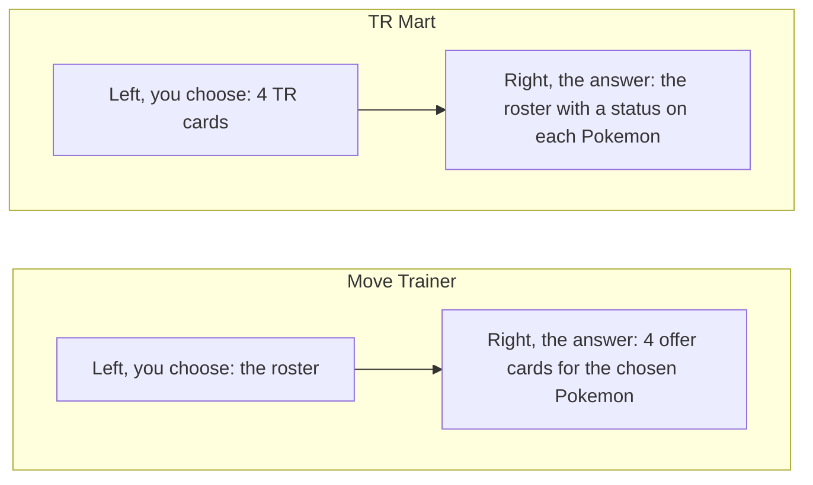
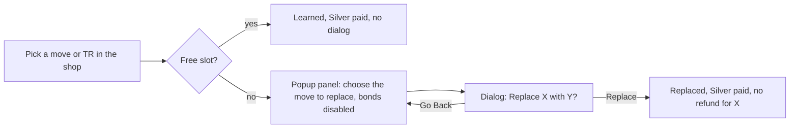
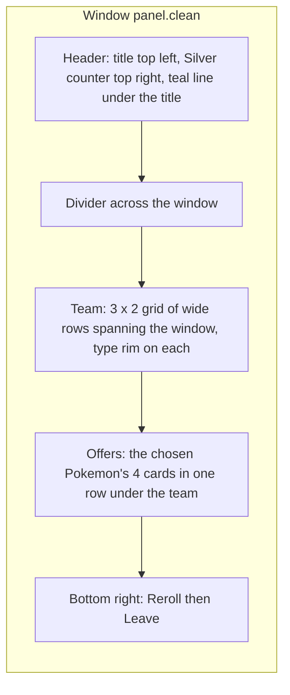
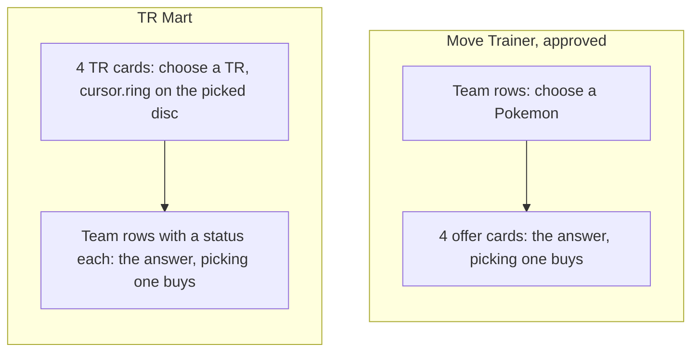

# 155 - Run Shops Layout (2026-11-20)

Slice opening for `run.hud.moveMart` (the Move Trainer) and `run.hud.trMart` (the TR Mart, code id `mart`). Source: js/ui/shop-ui.js, docs/proposals/move-shop-plan.md, decision 2026-11-04-move-shop-move-trainer-and-tm-mart-buildings-silver, and Jess's rulings of this session. Board pages only; the game changes at #126.

## What differs

| | Move Trainer (`run.hud.moveMart`) | TR Mart (`run.hud.trMart`) |
|---|---|---|
| You choose first | a Pokemon | a TR |
| The screen then answers | that Pokemon's 4 offered moves | which Pokemon can learn that TR |
| You buy by | picking an offer card | picking a Pokemon |
| The price lives on | each offer card | the TR card |
| Reroll gives | new offers for that Pokemon | 4 new TRs |

## Layout: mirrored (Jess 2026-11-20)

The thing you choose from sits left; the answer sits right. Both share the window, the Silver counter, Reroll and Back.

Shared: Silver counter, Reroll (greyed at 0, hidden on the forget step), Back and Esc, the forget step (loose moves only, bonds greyed).
`cursor.ring` goes on the roster portraits in both.

## TR Mart roster status

| Status | Symbol (game Silver) | Look | On Enter or click |
|---|---|---|---|
| Can learn it | √ (U+221A) | normal | the purchase |
| Knows it | = (U+003D) | dimmed | toast: it already knows it |
| Cannot learn it | none | dimmed | toast: it cannot learn it |
| Full (all four slots are bonds) | × (U+00D7) | dimmed | toast: every slot is a bond |

- A member with four loose moves shows √: buying opens the forget step.
- A refusal toast fires on Enter or a mouse click, never on the cursor moving over a dimmed portrait.
- Symbols are placeholders until Jess's icons replace them. Silver-game has no ✓ or ✗.

## Rulings (Jess 2026-11-20)

- Each shop page draws its default state only. Reroll at zero, a refused portrait, a dimmed card and the like are states of the primitives inside (button.glitch, card, portrait.round), not page states.
- A Silver buy does not ask. No purchase dialog.
- The forget step is its own panel that pops up on top of the shop panel, so it is its own board piece, not a state of the shop page.
- Replacing a move is three steps (Jess 2026-11-20): pick the move or TR, a popup panel to choose which move to replace, then a dialog "Replace X with Y?" with Replace (red, Negative) and Go Back (teal, Neutral), opening on Go Back.

## run.hud.moveMart v2: stacked (Jess 2026-11-21, APPROVED: decision 2026-11-21-155-run-hud-move-mart-look)

Replaces the mirrored left/right layout for the Move Trainer. The mockup gives the relative layout only (Jess
2026-11-21: sizes are not a request); piece sizes stay with the approved pieces and the window grows to fit.

Read from the colours: team rims are the Pokemon's own type (red is a Fire sample); card rims teal; the green button
Positive (Reroll), the teal one Neutral (Leave). No Buy button on the cards (as the older move-trainer.excalidraw):
picking the card is the buy.

### The team row (Jess 2026-11-21)

run.hud.teamSlot's panel.pixel box (278 x 64, rimmed in the first type, two-type seam), portrait and name, with the
HP bar replaced by the Pokemon's chip.type chips. Fit check, in the bar's place (66 px from the left, 38 px down,
about 198 px wide before the right rim):

| Chip scale | One chip | Two chips (gap 6) | Fits |
|---|---|---|---|
| chip.type:one (Silver 10) | 60 x 17 | 126 x 17 | yes, clears the bottom rim |
| chip.type:two (Silver 20) | 116 x 32 | 238 x 32 | no: too wide, and runs past the box's bottom |

So chip.type:one. Dropped from teamSlot (run-only): the key, held item square, status chip, swap shade, HP bar.

Price (Jess 2026-11-21): a Silver coin and the number on its own line at the bottom of the card, in the button's place.
Drafted 2026-11-21 (Quick) in tools/library/run-shops-draft.js. Reroll turned Positive in the shared buttons, so the
TR Mart page shows it green too. The window is as wide as the team grid (906 px), not the Main Menu Shop's 1145.

Feel pass 1 (Jess 2026-11-21): the row box is 6 art rows taller than teamSlot (38 rows, 76 px) so cursor.ring has 2 px
of air inside the rim and the chips clear the bottom rim; face centred, name and chips centred as a pair. The price
coin was the whole 8-frame sheet squashed (the artifact); now the counter's coin, first frame, still, at 1x. The move's
type glyph sits in the move slot's well (type base in a 2 px ink ring), on the cards and the forget popup's rows.

## run.hud.trMart v2: the Move Trainer mirrored top to bottom (Jess 2026-11-21, APPROVED: decision 2026-11-21-155-run-hud-tr-mart-look)

Every aspect of the approved moveMart, with the two halves swapped: the four TR cards on top, the team rows below.
Replaces the 2026-11-20 left/right mirror above.

- Same window, rows, cards (Silver price line, no button), Reroll Positive and Leave Neutral.
- The TR card's picture is the placeholder TM disc, not the type well; the picked TR's disc carries cursor.ring
  (Jess 2026-11-21: cursor.bar at the card's full height looked wrong).
- Status at the right end of each row in Silver 30; a dimmed status dims the row, not the symbol.
- The TR price placement question is settled: the coin and number line on the card, as the Move Trainer.

Open (Jess):
1. ~~Stacked for the TR Mart too~~ Yes, mirrored top to bottom (above).
2. ~~What a wide team row holds~~ Ruled above.
3. ~~Where the price goes~~ Ruled above.

## Open before the build

1. The forget panel's name on the board (suggested: `run.hud.forgetMove`).
2. The dialog's words: title "Replace move?", message "Replace X with Y?" (X and Y are move names), buttons Replace and Go Back.

## Slice opening (Jess to edit)

- Goal: the two shop pages (default state), the forget panel and its Replace ask on the board from approved pieces.
- Done: each of the three pages is drawn and Jess approves each.
- Test: a board check that the pages draw the roster, the offers or TRs, and the forget panel's loose moves with bonds disabled, as relations and not copied values.
