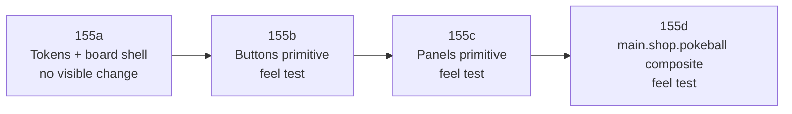
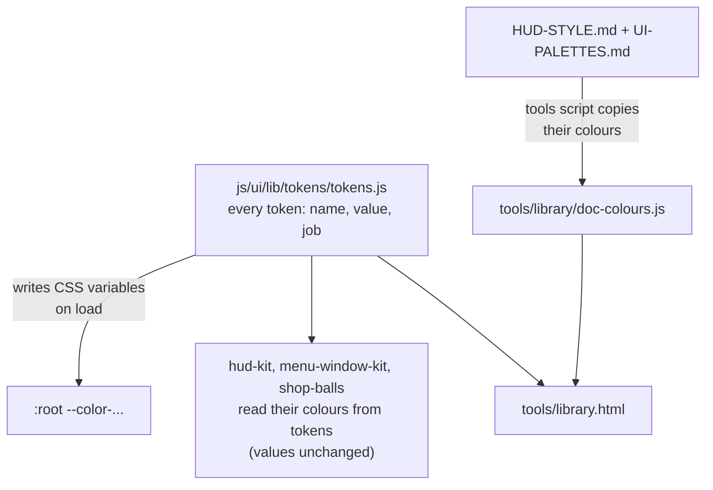
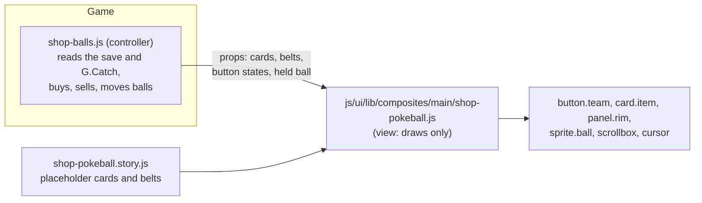

# #155 UI Library v2: build plan (for Jess's OK, 2026-11-17)

Opening (goal, done-when, test, decisions A to D): docs/ASCII Concept Maps/UI Library v2 - Slice Opening.md.
This plan says how to build it. No code here.

## What the code looks like today

The pieces the slice needs already exist, but they are tied to the game. The library board can only show a piece
without the game once it takes everything as props.

| Piece | Lives in | What ties it to the game |
| --- | --- | --- |
| Colours | `PALETTE`, rims and HP colours in hud-kit.js; type colours in util.js; belt, Sell and scroll colours in shop-balls.js and menu-window-kit.js | Spread over five files, written in code |
| Buttons (pixel-art shapes) | hud-kit.js `SlotButton` (pause menu), `TeamButton` (catch screen, Shop) | Fine on their own, but read the palette from the kit |
| Cursor button | menu-window-kit.js `CursorButton` | Reads the screen's cursor; a refusal plays a sound and a toast |
| Rim box, item card | hud-kit-hp-bars.js `Box`; menu-window-kit.js `ItemCard` | The card draws its icon with the game's icon code and its button with the cursor |
| Pokeballs tab | shop-balls.js `Pane` | Reads the save, G.Catch, G.DB directly while drawing |

## Four steps, each a commit and a check

### 155a: tokens and the board

| Part | Change |
| --- | --- |
| tokens.js (new, game code) | One data file: colour palettes (the kit palette, HP, rims, belt, Sell, scroll, the 18 type colours), fonts (families, files, the 20/30/40 sizes) and z-index layers. Each token has a name (`color.focus.base`), value and job. On load it writes every colour as a CSS variable, so CSS can use the same tokens. Loaded first in dev.html, before util.js. |
| hud-kit.js, menu-window-kit.js, shop-balls.js, util.js | Their colour tables read from tokens instead of holding the hex values. Every value stays the same, so nothing on screen changes. |
| library.html (new, tools/) | The board from your mockup: title, collapsible sidebar (Tokens, Primitives, Composites with HUD and Menus, Basic Editor marked "coming next"), main area. Loads only the Preact files, tokens.js, the library pieces and their stories; no game scripts. Tokens pages: Colours with two tabs (game palettes from tokens; every HUD-STYLE and UI-PALETTES colour), Fonts, z-index layers. Clicking a name copies it. |
| doc-colours.js (new, tools/) | The doc colours for the second Colours tab, made by a small tools script from the two docs (a page opened from disk cannot read the .md files). A check fails when it is out of date. |
| smoke-ui-library.js (rewritten in place) | Checks the new board as in the opening's test. The old page's checks stay in the same file until the old page retires. |
| pack_itch.js (tools) | Packs the library's CSS files with the game (it packs only css/ and assets/ today). |

### 155b: Buttons

| Part | Change |
| --- | --- |
| js/ui/lib/primitives/button/ (new: button.js, button.css, button.story.js) | `PixelShape`, the move slot shape and the two buttons move here from hud-kit.js: `button.slot` (pause menu, End Run) and `button.team` (catch screen, Shop). They take label, size, rim colours, focused, disabled and refused as props, and call onPress and onHover. |
| hud-kit.js | Passes the moved pieces on under their old names, so no screen's code changes. |
| menu-window-kit.js `CursorButton` | Stays the game's adapter: it turns the screen cursor into `focused` and a refusal into the sound and toast, then draws `button.team`. |
| Story | Each button type in every state (rest, focused, refused, disabled) with placeholder labels; its tokens, font, size, and its place names (`main.shop.pokeball.sellButton`, `pause.menu.resume`, ...). |
| Board | Primitives, Buttons page. |

### 155c: Panels

| Part | Change |
| --- | --- |
| js/ui/lib/primitives/panel/ (new) | `panel.rim` (today's `Box`) and `card.item` (today's `ItemCard`). The card takes its picture and its button as content, so it no longer needs the icon code or the cursor. |
| menu-window-kit.js `ItemCard` | Stays as a thin wrapper that hands the card its icon and its `CursorButton`, so the Shop's other tabs and the Inventory don't change. |
| Story and board | Primitives, Panels page: the rim box in several colour ramps, the card lit, dimmed, dimmed with a lit button. |

### 155d: the composite `main.shop.pokeball`

| Part | Change |
| --- | --- |
| shop-balls.js | Split in two. The drawing (cards grid, belts, Sell, belt Buy, carried ball) moves to the composite and takes everything as props. The rules (buy, sell, move, the cursor items, the keys) stay in shop-balls.js, which passes the props in. |
| Three more primitives | The composite also draws the ball sprite, the scroll box and the cursor corners, so they move into the library the same way: `sprite.ball`, `scrollbox`, `cursor`. |
| Board | Composites, Menus, `main.shop.pokeball`: the whole tab with placeholder balls and belts, the list of primitives it uses, and its source images (the ball sprite sheets). |
| Tests | smoke-ui's Shop checks pass unchanged (the tab works the same). The shop-screens-mutate mutants that match shop-balls.js lines get updated to the new lines. |

## Decisions for Jess

| # | Question | Default |
| --- | --- | --- |
| 1 | Tokens as a JS data file (tokens.js) instead of theme.css. The pixel-art buttons get their colours in code, so one data file has to feed both code and CSS; tokens.js writes the CSS variables itself. | Yes (this changes the opening's "theme.css") |
| 2 | Type colours move from util.js into tokens (util.js then reads them) | Yes, one home |
| 3 | Fonts: the game keeps its font loading in CSS this slice; the check confirms tokens list the same files | Yes |
| 4 | z-index layers: tokens name today's layers with today's numbers; the CSS switches to the names in a later slice | Yes |
| 5 | The composite needs three more primitives (ball sprite, scroll box, cursor), and the board loads the ball sprite data and images as the composite's source images | Yes |
| 6 | Feel tests after 155b, 155c and 155d; 155a has none (no visible change, checked by smoke) | Yes |

## Plan check

| | |
| --- | --- |
| Reuses | The kit's existing pieces (moved, not rewritten), Preact and htm already in js/vendor, the existing smoke-ui-library and smoke-ui, the old page's styles for the board's look |
| New | tokens.js; library folder with button, panel, sprite, scrollbox, cursor primitives and the shop-pokeball composite, each with a story; library.html; doc-colours.js and its maker script |
| Not built | Basic Editor, Bars, Modal, HUD composites, other Shop tabs, the Excalidraw export, moving the per-screen CSS variable sets to tokens, CSS using z-index names. Each is a later slice under #126. |
| Size | shop-balls.js shrinks by about half; hud-kit.js shrinks; no file passes 1000 lines |
| Behavior | None. Every step is a move with the same values; Jess's feel tests confirm |

## Risks

| Risk | Handling |
| --- | --- |
| Load order: tokens and the library must load before the kit | dev.html order plus the NEED list in main.js; check.js and smoke-ui catch a miss |
| A colour read from tokens differs from the old value by a typo | 155a's check compares every moved value with the old one before the old line is deleted |
| The old library page breaks when pieces move | Its checks stay in smoke-ui-library until it retires |
| 155d is the biggest refactor (drag, keys, Sell all touch the view) | The controller keeps every handler; the view only calls them. smoke-ui's Shop checks plus your feel test |

## As built: 155a (2026-11-17)

| Planned | Built |
| --- | --- |
| tokens.js | js/ui/lib/tokens/tokens.js: 5 colour palettes (96 colours, aliases allowed), 7 fonts, 16 page layers. Every moved value checked equal to the old one before the old lines went. |
| Type colours move (decision 2) | Jess chose move. util.js reads them; tokens.js loads first in dev.html, main.js NEED, move-lab, ui-library, 3 tools and 21 harnesses. |
| Kit reads tokens | hud-kit.js (PALETTE, FAINTED_RIM, HP_COLOURS, REST_RIM, FOCUS_RIM), menu-window-kit.js (SCROLL_COLOURS), shop-balls.js (SELL_RIM, BELT_RIM) |
| library.html | Built to the mockup. Colours (Game palettes, Style docs tabs; a doc colour that is already a token shows the token name), Fonts (samples at each crisp size), z-index layers. Later pages say which step builds them. Click a name to copy it. |
| doc-colours.js | tools/library_doc_colours.js writes tools/library/doc-colours.js; check.js runs it with --check |
| smoke-ui-library | Board checks added beside the old page's (10 checks). Two deliberate breaks (a game script on the board, no Style docs tab) both failed it. |
| pack_itch.js | Not changed yet: there is no library CSS until 155b, so it moves to 155b. |

Differences from the plan:
- The board does not remember the sidebar open or closed: file:// pages share localStorage with the game's save, so it
  writes nothing there (checked).
- The old page's script list was nine scripts behind dev.html since #137 (its smoke was failing); resynced.
