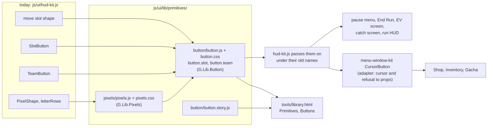

# #155 step 155b: Buttons (plan for Jess's OK, 2026-11-18, Quick)

Parent plan: docs/ASCII Concept Maps/155 - UI Library v2 Build Plan.md (155b row). No code here.
Goal: the two pixel-art buttons live in the library, take props only, and show on the board in every state.
Done when: the board's Buttons page draws both buttons in every state with no game scripts, and every screen that
uses them looks and behaves as before. Test: smoke-ui-library (changed, below), smoke-ui unchanged, your feel test.

## What moves where

## What I found in the code (changes to the parent plan)

| Finding | Effect |
| --- | --- |
| PixelShape draws 9 non-button pieces too (HP bars, chips, items, map, portraits, cursor, pause panels) | It gets its own primitive, not the button folder (decision 1) |
| TeamButton has no refused state; the Shop greys the label from its wrapper (bw-shop.css) | button.team needs a refused prop for the board to show it (decision 2) |
| The board loads no Preact today | library.html adds the vendor Preact files (allowed by the smoke's script rule) |
| The old page (tools/ui-library.html) mirrors dev.html's script order, and its smoke checks that | It gets the same two new scripts |
| SlotButton's label uses the HUD text classes in css/hud-overlay.css (text shadow) | The board links that stylesheet for now (decision 4) |
| No mutant matches any hud-kit.js line | No mutate file to update |

## Parts

| Part | Files and spot | Change |
| --- | --- | --- |
| A. Pixels | new js/ui/lib/primitives/pixels/pixels.js and pixels.css | PixelShape and the letter-grid painter move here unchanged. The `.hud-pixels` rule moves from css/hud-overlay.css (line 47). |
| B. Button | new js/ui/lib/primitives/button/button.js and button.css | The move slot shape, the slot button size, the rest and focus rims, the page-focus guard, SlotButton (`button.slot`) and TeamButton with its grid cache (`button.team`) move here. button.team gains `refused`. CSS: the `.pm-button` base rules (pause-menu.css 273 to 296), the `.hud-team-button` rules (hud-overlay.css 417 to 430) and the refused label rule (bw-shop.css 199). Their raw colours become token variables of the same value. |
| C. Story | new js/ui/lib/primitives/button/button.story.js | button.slot and button.team at rest, focused, refused and disabled, placeholder labels, with their tokens, font, size and place names (`pause.menu.resume`, `endRun.menu.home`, `ev.menu.learn`, `catch.menu.throw`, `main.shop.pokeball.sellButton`, ...). |
| D. Kit | js/ui/hud-kit.js | Drops the moved code and reads it from G.Lib; returns every name it returns today, so no screen file changes. |
| E. Adapter | js/ui/menu-window-kit.js `CursorButton` | Passes its refusal to button.team as `refused` instead of a wrapper class. Keys, sound and toast unchanged. |
| F. Loading | dev.html, js/main.js NEED, tools/ui-library.html | Two script tags after the Preact files and before hud-kit.js; two stylesheet links first in the list, so every screen rule still overrides them. NEED gains `Lib`. The old page mirrors the scripts. |
| G. Board | tools/library.html | Loads the Preact files, the two primitives and the story; links the two library stylesheets and css/hud-overlay.css. The Buttons entry stops saying "later" and shows the page. |
| H. Packing | tools/pack_itch.js | Also packs the library's CSS files (carried over from 155a). |

## Decisions for Jess

| # | Question | Default |
| --- | --- | --- |
| 1 | PixelShape gets its own primitive (`pixels`) instead of living in the button folder, since 9 other pieces draw with it | Yes |
| 2 | button.team takes `refused` (label at 45%, rim kept); CursorButton passes it; the Shop's wrapper rule moves into button.css | Yes |
| 3 | Class names stay as today (`pm-button`, `hud-team-button`, `hud-pixels`). `button.slot` and `button.team` are board names only; renaming classes touches 4 screen stylesheets, later slice | Keep |
| 4 | The board links css/hud-overlay.css for the HUD text classes. The text styles move into the library with the Bars/HUD slice | Yes |
| 5 | Library pieces register on one namespace, `G.Lib` (`G.Lib.Pixels`, `G.Lib.Button`), the way tokens register on `G.Tokens` | Yes |
| 6 | Tokens for the label white and the refused 45% white, added only if no existing token has that job | Yes |

None of these changes what the game does; all are structure.

## Plan check

| | |
| --- | --- |
| Reuses | PixelShape, the letter-grid painter, the move slot shape, both buttons and their CSS, moved not rewritten; G.Tokens for every colour; the smoke's existing raw-colour and script checks |
| New | Two primitive folders (pixels, button), one story, G.Lib. Nothing existing holds library pieces yet |
| Not built | A pixels story (every button shows it), class renames, the button.team label's base placement (each screen places it today; the story places it the Shop's way), HUD text in the library, Panels (155c). No changelog line: nothing a player sees changes |
| Where it lives | js/ui/lib/primitives, the library's layer; drawing only, no game state |
| Size | hud-kit.js about 395 to about 230 lines; button.js about 190; pixels.js about 45. Nothing near 1000 |
| Touched-code cleanups | CursorButton's wrapper `refused` class goes (its only rule moves to button.css); the `data-refusal` the keys read stays |

## Tests

| File | What | Why |
| --- | --- | --- |
| tools/smoke-ui-library.js (changed) | New Buttons page checks: both buttons draw in all four states; the focused rim matches the `color.rim.focus` token and the rest rim `color.rim.rest` (read from tokens.js, not the page); the refused label is fainter than the rest label; disabled carries the disabled attribute and refused does not; each story lists its place names. The raw-colour check now covers pixels.css and button.css (2 files, was 0). Old page: its script-order check passes with the mirrored scripts | Proves the board half of done |
| Two deliberate breaks, run once and reverted | A raw hex in button.css; a story with a state removed. Both must fail the smoke | Proves the new checks catch what they claim (155a did the same) |
| tools/smoke-ui.js (unchanged) | Pause menu, Shop and catch checks pass as they are | Proves the game half of done: no visible change |
| node tools/check.js (unchanged) | Syntax of the new files, every harness | Standard gate |
| No new harness, mutation runner, intent scenario or debug set | No game rule changes, and no mutant targets the moved lines | |

## Risks

| Risk | Handling |
| --- | --- |
| Load order: G.Lib must exist before hud-kit.js | dev.html order, NEED, check.js and smoke-ui catch a miss |
| A moved CSS rule loses to, or beats, a screen rule after moving files | Library links go first; same selectors, so screen rules keep winning. Your feel test checks every button screen |
| The refused label moves from wrapper to button | smoke-ui's Shop Buy check plus your feel test on an unaffordable Buy |

## Feel test after the build (hard reload, save untouched)
Pause menu (hover, Enter, End's No), End Run, EV screen, catch screen (Throw, Let It Go faint until focused),
Shop (Buy, an unaffordable Buy greys and toasts, a disabled button dims, Exit), Inventory (Equip, Swap), Gacha.
