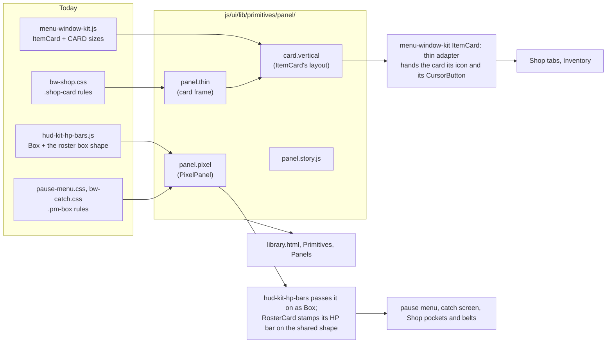

# #155 step 155c: Panels (plan for Jess's OK, 2026-11-18, Quick)

Parent plan: docs/ASCII Concept Maps/155 - UI Library v2 Build Plan.md (155c row). No code here.
Goal: the game's two panel looks and the item card live in the library, take props only, and show on the board in
every state. Done when: the board's Panels page draws them all with no game scripts, and every screen that uses them
looks and works as before. Test: smoke-ui-library (new Panels checks), smoke-ui, smoke-pause-menu and
smoke-hud-overlay unchanged, your feel test.

## What moves where

## What I found in the code

| Finding | Effect |
| --- | --- |
| Box is the roster card's shape with a flat body; RosterCard and the pause menu's empty team card draw the same shape with the HP bar stamped on | The shape moves into the panel primitive; hud-kit-hp-bars keeps only the HP bar stamp and lays it over the shared shape (same pixels) |
| Box needs Preact hooks (a gradient id per box, for dual-type rims) | The board loads preact-hooks too |
| ItemCard draws its icon with the game's icon code and its button with the screen cursor | The library card takes its picture and its button as content; ItemCard stays as the adapter that passes IconCanvas and CursorButton in |
| CARD (card sizes) lives in menu-window-kit and four screens read it from there | CARD moves with the card; menu-window-kit passes it on unchanged |
| The card's CSS has 4 raw colours: #29ceff rim, #303030 body, #495151 divider, #8cfff7 name. Two are tokens already (color.hud.checker, color.hud.slate); #29ceff exists only as color.scroll.thumb; #8cfff7 has none | Decision 3 |
| .shop-owned (the Team Items owned panel) shares the card's rim rule | It keeps its own copy in bw-shop.css this step (adopting panel.thin is a later step) |
| No mutant matches any moved line | No mutate file to update |

## Parts

| Part | Files and spot | Change |
| --- | --- | --- |
| A. Pixel panel | new js/ui/lib/primitives/panel/panel.js, panel.css | The roster box shape (left ends, straight row, grid builder without the bar, its colour letters) and Box move here as `panel.pixel` (PixelPanel): rim ramp, optional second ramp (dual type blend), body. CSS: `.pm-box > svg`, `.pm-box > *` (pause-menu.css 426 to 433), `.pm-box-gradients` (bw-catch.css 51) |
| B. Thin panel and card | same files | `panel.thin`: the 2 px flat rim on a flat body (the card frame). `card.vertical` (today's ItemCard layout): picture box, divider, name, description, a button slot at the bottom; lit, dimmed, or dimmed with its button lit. Takes picture and button as content. CARD moves here. CSS: the `.shop-card` rules (bw-shop.css 159 to 187 and 213 to 224), raw colours to tokens of the same value |
| C. Story | new js/ui/lib/primitives/panel/panel.story.js | The states below, placeholder data, place names |
| D. Kit | js/ui/hud-kit-hp-bars.js | Box comes from the library under the same name; the roster grid builder keeps only the HP bar stamp over the library's shape. Every kit name stays (rosterBoxGrid, rosterColours, Box) |
| E. Adapter | js/ui/menu-window-kit.js ItemCard | Hands card.vertical the icon (IconCanvas, or the screen's picture) and a CursorButton; passes CARD on. Its props and the four screens do not change |
| F. Button export | js/ui/lib/primitives/button/button.js | Also exports ROUNDED_BUTTON (the card reads the button's 18 rows from it, not a copied 54) |
| G. Tokens | js/ui/lib/tokens/tokens.js | Decision 3 |
| H. Loading | dev.html, tools/ui-library.html | panel.css with the library links; panel.js after button.js, before the HUD kit. No NEED change (G.Lib is in it) |
| I. Board | tools/library.html | Loads preact-hooks, panel.js and the story; the Panels entry shows the page; each state under its full name as on Buttons |
| J. smoke-ui-library | tools/smoke-ui-library.js | Panels page checks (Tests below); the raw-colour check covers panel.css |

## Stories (full names, as the buttons)

| Piece | States |
| --- | --- |
| `panel.pixel` | `rest` (white rim, the menus), `type` (one type ramp, the pause detail boxes), `dualType` (two ramps blended, the catch screen), `lightBody` (the Shop's pocket cards), `fainted` (grey, a locked belt) |
| `panel.thin` | `rest` |
| `card.vertical` | `lit`, `dimmed` (a ball not unlocked), `dimmedButtonLit` (an Unlock you can afford), `refusedButton` (a Buy you cannot afford, its label faint) |

## Decisions for Jess

| # | Question | Default |
| --- | --- | --- |
| 1 | Names by look: `panel.pixel` (the B2 box with corner bumps and a three-shade rim), `panel.thin` (2 px flat rim), `card.vertical` (picture on top, text, button at the bottom). The parent plan's `panel.rim` and `card.item` were job names | As listed |
| 2 | The Panels page shows `panel.pixel` with three type ramps (fire, water, fire to water blend) read from the type tokens | Yes |
| 3 | The card's two missing colour tokens, added now so the library CSS writes no raw colour: `color.hud.teal` (#29ceff; color.scroll.thumb becomes its alias, same value) and `color.text.secondary` (#8cfff7). The colour pass may rename them | Add now |
| 4 | Class names stay (`pm-box`, `shop-card`, `shop-card-*`, `is-dimmed`, `is-dimmed-but-button`): the smokes read them. Class renames join the button class issue | Keep |
| 5 | `.pm-box-title` (pause menu's grey box titles) stays in pause-menu.css: it is the screen's text, not the panel | Stays |

None of these change what the game does; all are structure.

## Plan check

| | |
| --- | --- |
| Reuses | Box, the roster shape, ItemCard's layout and CSS, moved not rewritten; G.Lib.Pixels; RoundedButton on the board; 155b's pass-on pattern; the existing smokes |
| New | One primitive folder (panel) with three pieces and a story; two tokens; one export from button.js |
| Not built | .shop-owned on panel.thin, the run HUD's RosterCard in the library (it is a HUD composite, later slice), Bars, Modal, class renames. No changelog line: players see no change |
| Where it lives | js/ui/lib/primitives/panel, drawing only; the HP bar stamp stays with the HP displays in hud-kit-hp-bars |
| Size | hud-kit-hp-bars.js about 407 to 340; menu-window-kit.js about 470 to 440; panel.js about 170. Nothing near 1000 |
| Touched-code cleanups | None |

## Tests

| File | What | Why |
| --- | --- | --- |
| tools/smoke-ui-library.js (changed) | Every Panels state draws and shows its full name; `panel.pixel` draws the given ramp's base (read from tokens), and `dualType` draws a gradient; a dimmed card is fainter than a lit one; `dimmedButtonLit` keeps its button at full opacity while its text dims; `refusedButton`'s label is fainter than `lit`'s; no game script on the board; raw-colour check covers panel.css | Proves the board half of done |
| Two deliberate breaks, run once and reverted | A raw hex in panel.css; a story with a state removed. Both must fail | Proves the checks catch what they claim |
| tools/smoke-ui.js, smoke-pause-menu.js, smoke-hud-overlay.js (unchanged) | Shop cards on all tabs, catch screen boxes, the pause menu's boxes, the kit names | Proves the game half: no visible change |
| node tools/check.js | Syntax and every harness | Standard gate |
| No new harness, mutant, intent scenario or debug set | No game rule changes | |

## Risks

| Risk | Handling |
| --- | --- |
| The HP bar stamp drawn over the shared shape misplaces a pixel | The shape is the same grid, built once; smoke-hud-overlay's roster checks and your feel test of the run HUD |
| A moved CSS rule loses to or beats a screen rule | Library links load first, same selectors; your feel test on each screen |
| Load order: hud-kit-hp-bars reads the panel | dev.html order; check.js and smoke-hud-overlay catch a miss |

## Feel test after the build (hard reload, save untouched)
Run HUD roster rows; pause menu team cards, detail boxes, Run Info; catch screen (a dual-type Pokemon's blended rim);
Shop: Character Upgrades pocket cards, Pokeballs cards and belts, Team Items, TMs; Inventory cards; the board's Panels page.

## As built (2026-11-18, Quick; approved as written)

| Part | Built |
| --- | --- |
| A, B | js/ui/lib/primitives/panel/panel.js (G.Lib.Panel): PIXEL_PANEL, pixelPanelRows, pixelPanelColours, PixelPanel, ThinPanel, CARD, cardButtonPlace, VerticalCard. panel.css: the .pm-box, .pm-box-gradients, .panel-thin and .shop-card rules, every colour a token variable |
| C | panel.story.js (G.Lib.PanelStories): the 10 states in the plan |
| D | hud-kit-hp-bars.js 407 to 335 lines: Box is PixelPanel; rosterBoxGrid stamps the HP bar on pixelPanelRows; rosterColours adds the bar's two letters to pixelPanelColours. Kit names unchanged |
| E | menu-window-kit.js 470 to 438 lines: ItemCard hands VerticalCard the icon, the name, the text, its attributes and a CursorButton placed by cardButtonPlace; CARD comes from the library. Props unchanged |
| F | button.js exports ROUNDED_BUTTON; the card's button height reads its rows |
| G | color.hud.teal (#29ceff, color.scroll.thumb now its alias) and color.text.secondary (#8cfff7) |
| H | dev.html and tools/ui-library.html: panel.css and panel.js after the button's |
| I | library.html: preact-hooks, panel.js, the story; the Panels page; one table drives both primitive pages; a story without a font shows none |
| J | smoke-ui-library: 6 Panels checks; the raw-colour check now covers 3 library CSS files |

Checked from Quick: every file parses; the roster box shape is letter for letter the old one at six sizes, with and
without the HP bar; the card's button lands where it did (4, 282 at 186 px wide; 41 at 260); every story draws.

Differences from the plan:
- The card's root carries a new class, panel-thin, next to shop-card (the thin panel's look); no class was removed.
- .shop-empty's two rules merged into one in bw-shop.css (it shared a selector with the moved card text rule).
- hud-kit-hp-bars no longer takes the kit's hooks (only Box used them).

