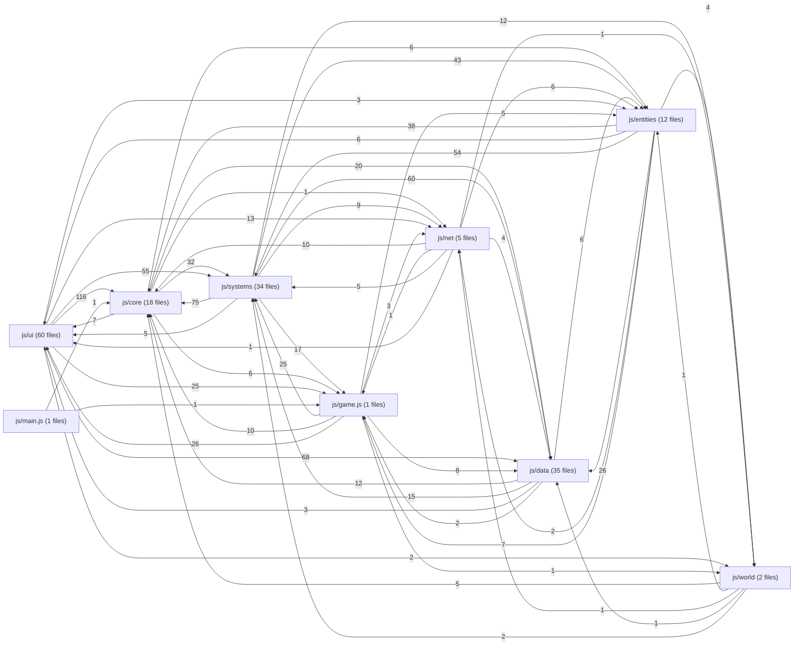

# Project dashboard

Generated by `node tools/dashboard.js` on 2026-11-22. Do not edit by hand.

## Requirement tags across the specs

| Tag | Count |
|---|---|
| Approved | 683 |
| Legacy behavior | 19 |
| Proposed | 51 |
| Open | 54 |

## Code map: which areas lean on which (count of shared `G` names)

## Design map: specs and the code files they name

```mermaid
flowchart LR
  docs_MOVE_INTENT_md["docs/MOVE-INTENT.md<br/>Approved 140, open 4, proposed 22"]
  docs_MOVE_INTENT_md --> js_data_move_attributes_js
  docs_MOVE_INTENT_md --> js_data_moves_generated_js
  docs_MOVE_INTENT_md --> js_data_move_overrides_js
  docs_HUD_STYLE_md["docs/HUD-STYLE.md<br/>Approved 131, open 4, proposed 9"]
  docs_HUD_STYLE_md --> js_ui_hud_kit_items_js
  docs_HUD_STYLE_md --> js_ui_lib_tokens_tokens_js
  docs_HUD_STYLE_md --> js_ui_ui_js
  docs_HUD_STYLE_md --> js_ui_hud_kit_chips_js
  docs_HUD_STYLE_md --> js_ui_hud_player_panel_js
  docs_HUD_STYLE_md --> js_ui_hud_js
  docs_COMBAT_RULES_md["docs/COMBAT-RULES.md<br/>Approved 95, open 4, proposed 3"]
  docs_COMBAT_RULES_md --> js_core_stats_js
  docs_COMBAT_RULES_md --> js_data_types_js
  docs_COMBAT_RULES_md --> js_systems_status_js
  docs_COMBAT_RULES_md --> js_systems_stages_js
  docs_COMBAT_RULES_md --> js_data_moves_js
  docs_COMBAT_RULES_md --> js_systems_combat_js
  docs_LEADER_AI_md["docs/LEADER-AI.md<br/>Approved 66, open 2, proposed 0"]
  docs_LEADER_AI_md --> js_data_leader_ai_settings_js
  docs_LEADER_AI_md --> js_entities_leader_ai_js
  docs_LEADER_AI_md --> js_systems_leader_info_js
  docs_LEADER_AI_md --> js_systems_gym_arena_js
  docs_LEADER_AI_md --> js_data_gyms_js
  docs_LEADER_AI_md --> js_systems_leader_memory_js
  docs_PAUSE_MENU_md["docs/PAUSE-MENU.md<br/>Approved 58, open 1, proposed 0"]
  docs_PAUSE_MENU_md --> js_ui_ev_screen_js
  BOSS_REWORK_md["BOSS-REWORK.md<br/>Approved 41, open 10, proposed 2"]
  BOSS_REWORK_md --> js_systems_gym_js
  BOSS_REWORK_md --> js_systems_elites_js
  BOSS_REWORK_md --> js_data_gyms_js
  BOSS_REWORK_md --> js_core_stats_js
  BOSS_REWORK_md --> js_entities_boss_ai_js
  BOSS_REWORK_md --> js_data_moves_js
  GDD_md["GDD.md<br/>Approved 31, open 4, proposed 3"]
  GDD_md --> js_data_funding_js
  GDD_md --> js_core_db_js
  GDD_md --> js_data_moves_js
  GDD_md --> js_systems_gym_arena_js
  GDD_md --> js_systems_events_js
  GDD_md --> js_data_enemies_js
  docs_proposals_pokebox_plan_md["docs/proposals/pokebox-plan.md<br/>Approved 32, open 1, proposed 0"]
  docs_proposals_pokebox_plan_md --> js_systems_gacha_js
  docs_proposals_pokebox_plan_md --> js_ui_menu_js
  docs_proposals_pokebox_plan_md --> js_ui_gacha_ui_js
  docs_proposals_pokebox_plan_md --> js_ui_icons_js
  docs_proposals_pokebox_plan_md --> js_data_enemies_js
  docs_proposals_pokebox_plan_md --> js_game_js
  docs_proposals_move_shop_plan_md["docs/proposals/move-shop-plan.md<br/>Approved 31, open 0, proposed 1"]
  docs_proposals_move_shop_plan_md --> js_data_learnsets_js
  docs_proposals_move_shop_plan_md --> js_systems_silver_js
  docs_proposals_move_shop_plan_md --> js_ui_hud_js
  docs_proposals_move_shop_plan_md --> js_entities_enemy_js
  docs_proposals_move_shop_plan_md --> js_systems_shops_js
  docs_proposals_move_shop_plan_md --> js_data_shop_contact_js
  docs_current_feature_planning_combat_architecture_md["docs/current feature planning/combat-architecture.md<br/>Approved 24, open 0, proposed 0"]
  docs_current_feature_planning_combat_architecture_md --> js_data_move_attributes_js
  docs_current_feature_planning_combat_architecture_md --> js_data_move_resolver_js
  docs_current_feature_planning_combat_architecture_md --> js_systems_combat_js
  docs_current_feature_planning_combat_architecture_md --> js_entities_projectile_js
  docs_current_feature_planning_combat_architecture_md --> js_systems_stages_js
  docs_current_feature_planning_combat_architecture_md --> js_systems_status_js
  docs_MOVE_AXIS_SCHEMA_md["docs/MOVE-AXIS-SCHEMA.md<br/>Approved 14, open 1, proposed 0"]
  docs_MOVE_AXIS_SCHEMA_md --> js_data_moves_generated_js
  docs_MOVE_AXIS_SCHEMA_md --> js_data_move_attributes_js
  docs_MOVE_AXIS_SCHEMA_md --> js_data_move_overrides_js
  docs_MOVE_AXIS_SCHEMA_md --> js_data_move_handler_js
  docs_MOVE_AXIS_SCHEMA_md --> js_data_move_resolver_js
  docs_MOVE_AXIS_SCHEMA_md --> js_systems_move_geom_js
  docs_TODO_notes_2026_11_md["docs/TODO-notes-2026-11.md<br/>Approved 0, open 6, proposed 2"]
  docs_TODO_notes_2026_11_md --> js_data_enemies_js
  docs_TODO_notes_2026_11_md --> js_systems_combat_js
  docs_TODO_notes_2026_11_md --> js_data_lang_en_js
  docs_TODO_notes_2026_11_md --> js_systems_elites_js
  docs_TODO_notes_2026_11_md --> js_core_stats_js
  docs_TODO_notes_2026_11_md --> js_data_pokedex_js
  docs_current_feature_planning_move_schema_post_auth_slice_7b_md["docs/current feature planning/move-schema-post-auth/slice-7b.md<br/>Approved 2, open 0, proposed 0"]
  docs_current_feature_planning_move_schema_post_auth_slice_7b_md --> js_data_changelog_js
  docs_current_feature_planning_move_schema_post_auth_slice_7b_md --> js_data_starters_js
  docs_current_feature_planning_move_schema_post_auth_slice_7b_md --> js_systems_log_js
  docs_current_feature_planning_move_schema_post_auth_slice_7b_md --> js_net_coop_js
  docs_proposals_host_model_plan_md["docs/proposals/host-model-plan.md<br/>Approved 4, open 2, proposed 1"]
  docs_proposals_host_model_plan_md --> js_data_gyms_js
  docs_proposals_host_model_plan_md --> js_entities_elite_js
  docs_proposals_host_model_plan_md --> js_systems_team_js
  docs_proposals_host_model_plan_md --> js_entities_gym_leader_js
  js_data_move_attributes_js("js/data/move-attributes.js")
  js_data_moves_generated_js("js/data/moves-generated.js")
  js_data_move_overrides_js("js/data/move-overrides.js")
  js_ui_hud_kit_items_js("js/ui/hud-kit-items.js")
  js_ui_lib_tokens_tokens_js("js/ui/lib/tokens/tokens.js")
  js_ui_ui_js("js/ui/ui.js")
  js_ui_hud_kit_chips_js("js/ui/hud-kit-chips.js")
  js_ui_hud_player_panel_js("js/ui/hud-player-panel.js")
  js_ui_hud_js("js/ui/hud.js")
  js_core_stats_js("js/core/stats.js")
  js_data_types_js("js/data/types.js")
  js_systems_status_js("js/systems/status.js")
  js_systems_stages_js("js/systems/stages.js")
  js_data_moves_js("js/data/moves.js")
  js_systems_combat_js("js/systems/combat.js")
  js_data_leader_ai_settings_js("js/data/leader-ai-settings.js")
  js_entities_leader_ai_js("js/entities/leader-ai.js")
  js_systems_leader_info_js("js/systems/leader-info.js")
  js_systems_gym_arena_js("js/systems/gym-arena.js")
  js_data_gyms_js("js/data/gyms.js")
  js_systems_leader_memory_js("js/systems/leader-memory.js")
  js_ui_ev_screen_js("js/ui/ev-screen.js")
  js_systems_gym_js("js/systems/gym.js")
  js_systems_elites_js("js/systems/elites.js")
  js_entities_boss_ai_js("js/entities/boss-ai.js")
  js_data_funding_js("js/data/funding.js")
  js_core_db_js("js/core/db.js")
  js_systems_events_js("js/systems/events.js")
  js_data_enemies_js("js/data/enemies.js")
  js_systems_gacha_js("js/systems/gacha.js")
  js_ui_menu_js("js/ui/menu.js")
  js_ui_gacha_ui_js("js/ui/gacha-ui.js")
  js_ui_icons_js("js/ui/icons.js")
  js_game_js("js/game.js")
  js_data_learnsets_js("js/data/learnsets.js")
  js_systems_silver_js("js/systems/silver.js")
  js_entities_enemy_js("js/entities/enemy.js")
  js_systems_shops_js("js/systems/shops.js")
  js_data_shop_contact_js("js/data/shop-contact.js")
  js_data_move_resolver_js("js/data/move-resolver.js")
  js_entities_projectile_js("js/entities/projectile.js")
  js_data_move_handler_js("js/data/move-handler.js")
  js_systems_move_geom_js("js/systems/move-geom.js")
  js_data_lang_en_js("js/data/lang-en.js")
  js_data_pokedex_js("js/data/pokedex.js")
  js_data_changelog_js("js/data/changelog.js")
  js_data_starters_js("js/data/starters.js")
  js_systems_log_js("js/systems/log.js")
  js_net_coop_js("js/net/coop.js")
  js_entities_elite_js("js/entities/elite.js")
  js_systems_team_js("js/systems/team.js")
  js_entities_gym_leader_js("js/entities/gym-leader.js")
```

(Top 14 specs by tag count, up to 6 code files each. The HTML dashboard has the full list.)

## Gap summary

| Kind | Count |
|---|---|
| code no doc names | 63 |
| open question | 46 |
| approved, not built | 23 |
| legacy behavior | 18 |
| decision without spec | 1 |
