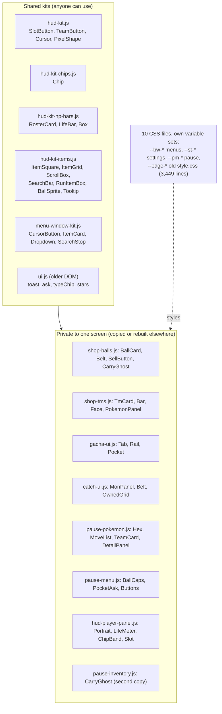

# UI component inventory (read-only survey, 2026-11-17)

What the game's UI is built from today, with a proposed shared name for each piece. Input for the design-library slice
(child of #126). Names are proposals: rename freely in your mockup, the point is that each piece has exactly one.

## Where the pieces live today

## Numbers behind "disjointed"

| Measure | Count |
| --- | --- |
| Shared UI components | 24 across 6 kit files |
| Private components (one screen only) | about 60 across 20 files |
| Distinct colours in CSS | 104 |
| Distinct colours hard-coded in UI scripts (outside icon pixel art) | about 130, most in hud.js and the kits |
| CSS variable prefixes, one per screen family | 5 (`--bw`, `--st`, `--pm`, `--edge`, `--font`) |
| Same teal (`#29ceff`) written out by hand | 5 files |
| Ball belt built twice | shop-balls.js `Belt`, catch-ui.js `Belt` |
| Carry ghost built twice | shop-balls.js, pause-inventory.js |

## Proposed names

### Tokens (the values everything uses)

| Name | What | Today |
| --- | --- | --- |
| `color.panel.*`, `color.line.*`, `color.text.*` | panel fills, rims, text | HUD-STYLE "Working colours", plus per-screen variables |
| `color.bar.hp.{high,mid,low}`, `color.bar.exp` | bar fill over shade | hud-kit `HP_COLOURS`, HUD-STYLE Bars |
| `color.status.*`, `color.effect.{good,bad}` | status and effect chips | hud-kit-chips |
| `color.type.<type>.{light,base,dark}` | 18 SV type colours | G.U.TYPE_COLOR |
| `color.focus`, `color.rest` | cursor and button rims | `FOCUS_RIM`, `REST_RIM` |
| `color.accent.teal` | scroll thumb, highlights | `SCROLL_COLOURS`, 5 files |
| `font.hud.{20,30,40}`, `font.title.{32,48}`, `font.menu` | fonts and sizes | HUD-STYLE Fonts |
| `size.artPixel`, `size.button.height` | pixel grid and fixed sizes | `BUTTON`, `CARD` in menu-window-kit |

### Components

| Name | Today | Shared? |
| --- | --- | --- |
| `button.menu` (states: rest, focus, pressed, disabled) | TeamButton, CursorButton | yes |
| `button.slot` | SlotButton (move slots) | yes |
| `button.danger` | SellButton | no, Shop only |
| `button.step` | StepButton (EV screen) | no |
| `cursor` | Cursor, CursorCorner, CursorTip | yes |
| `card.item` (shop card) | ItemCard | yes |
| `card.ball` | BallCard | no |
| `card.tm` | TmCard | no |
| `card.roster` | RosterCard | yes |
| `card.team` (pause) | TeamCard | no |
| `chip.type`, `chip.status`, `chip.effect` | typeChip, Chip | yes |
| `bar.life`, `bar.stat` | LifeBar, LifeMeter, Bars | partly |
| `belt.ball` | Belt (twice) | no |
| `grid.item`, `square.item` | ItemGrid, ItemSquare | yes |
| `scrollbox`, `searchbar`, `dropdown` | ScrollBox, SearchBar, Dropdown | yes |
| `tabs.rail` | Tab, Rail (Shop) | no |
| `tooltip` | TooltipLayer, showTooltip | yes |
| `toast`, `dialog.ask` | G.UI.toast, G.UI.ask | yes (older DOM style) |
| `ghost.carry` (dragged item) | CarryGhost (twice) | no |
| `panel.window` (menu window frame) | per-screen CSS | no shared piece |

## What this suggests for the slice

| Finding | Meaning for the library |
| --- | --- |
| The shared kits already exist | The library names and shows what is there; it doesn't start from zero |
| About 60 private pieces | Each one used by a new screen gets promoted to a kit (game-code change, approved per batch) |
| Colours are spread over CSS and scripts | One token file feeds both the CSS variables and the scripts, so a colour is renamed or changed in one place |
| Duplicates (belt, ghost) | First promotions, since they're already used twice |

## Open for Jess

| # | Question |
| --- | --- |
| 1 | Do the dotted names (`button.menu`, `color.focus`) read well in your Excalidraw notes, or do you want shorter ones? |
| 2 | Should the library hold only pieces that exist, or also planned ones you draw in a mockup first? |
