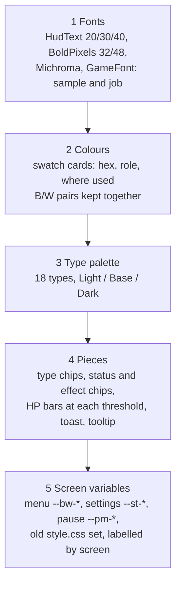

# UI Library: slice plan

A page you can open from disk that shows the whole design language, with each piece labelled with its job.
It is a dev tool (`tools/ui-library.html`, beside Move Lab) and never ships.

## Opening items (to agree before the build)

| Item | Proposal |
| --- | --- |
| Goal | One page that shows every font, colour and UI piece the game uses, each labelled with what it is for and where it is used. |
| Done when | You open it by double-clicking (file://), and every approved colour and font in HUD-STYLE shows up there, drawn with the game's own files. |
| Test | A headless check that loads the page and confirms that every hex colour in HUD-STYLE "Colour palette" appears on it, and that every font face loads. If HUD-STYLE gains a colour the page lacks, the check fails. |

## How it stays true

```mermaid
flowchart LR
  subgraph Game files, loaded as-is
    F[assets/fonts]
    C[css/*.css variables]
    U[G.U.TYPE_COLOR, G.UI.typeChip, toast]
  end
  H[HUD-STYLE.md<br/>roles and jobs] -.labels copied in.-> P
  F --> P[tools/ui-library.html]
  C --> P
  U --> P
  P --> T[headless check:<br/>every HUD-STYLE hex is on the page]
  H --> T
```

Real pieces (type chips, toasts) come from the game's own scripts, so they can't drift from the game. The labels are
written into the page from HUD-STYLE, and the check catches any colour HUD-STYLE adds that the page misses.

## Page sections



| Colour group (from HUD-STYLE) | Shown as |
| --- | --- |
| Panels and lines, Text | Single swatches with role and source |
| Bars, Status chips, Shake Off | Fill-over-shade pairs |
| Minor statuses | Hollow chip samples |
| Effect chips | Sample chips per tag |
| Wayfinding, Pause menu, Toasts | Swatches plus a live sample |

## Decisions for Jess

| # | Question | Default if no answer |
| --- | --- | --- |
| 1 | Scope: HUD-STYLE only, or also the per-screen variables (menus, settings, the old blue style.css set)? | Both. Screen variables get their own section, marked "not in HUD-STYLE" where they are not |
| 2 | UI-PALETTES sets (regions, bag, stats): show them as a "reference, not adopted" section? | Yes, at the bottom, greyed label |

## Risks

- Some HUD pieces (life meters, chip bands) only mount inside a running HUD. Those show as CSS-drawn samples using the
  same classes, not the live component. Fine for looking at, but those few could drift. The check only covers colours and
  fonts.
