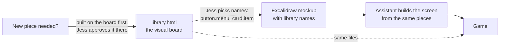
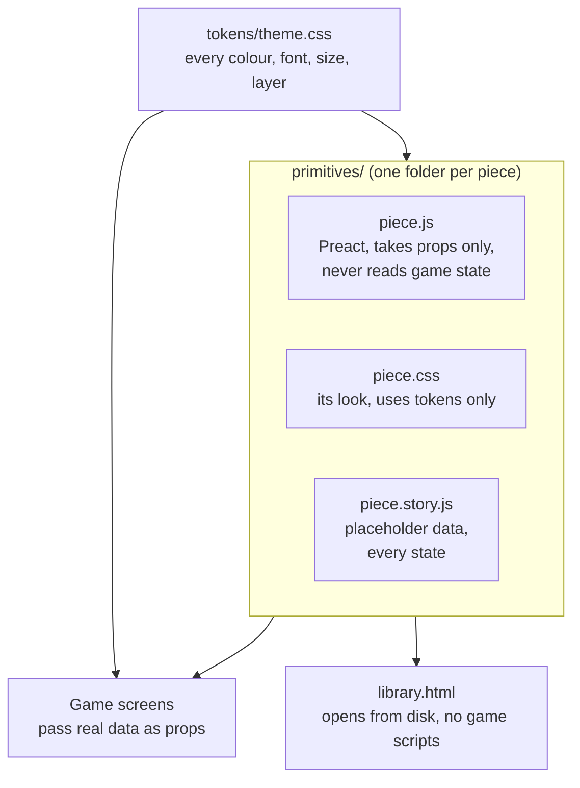
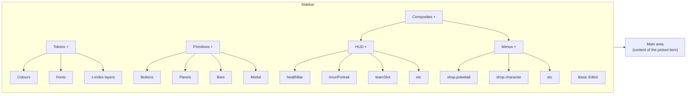
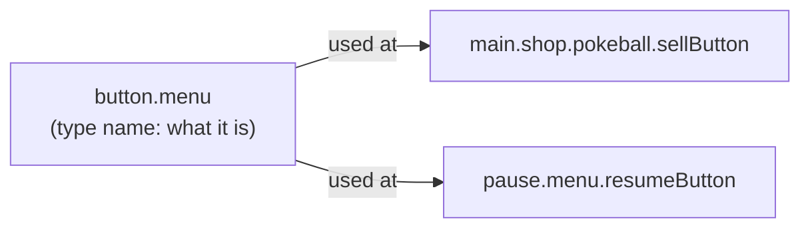

# UI Library v2: slice opening (draft for Jess, 2026-11-17)

A shared design language between Jess and the assistant. The library defines the look, and the game follows it.
Child of #126 (UI unify). Inputs: Jess's Shop pain (four tabs took over a day), docs/ASCII Concept Maps/UI Component
Inventory.md, Jess's reference layout (tokens / primitives / hud / menus, one folder per piece).

## The new flow

## How the files fit

## Jess's board mockup (assets/excalidraw/pokeswarm-library-html.excalidraw)

A window titled "PokeSwarm UI Library": a collapsible left sidebar (arrow at the top) with expandable groups, and a large
main area to its right (blank in the mockup).

What it settles: the page replaces ui-library.html (decision 2); the board has three levels, tokens, primitives, and
composites (whole HUD panels and menu tabs, not only small pieces); z-index layers are a token group; Modal is a
primitive; a Basic Editor has its own sidebar entry.

## Opening items (to agree before the build)

| Item | Proposal |
| --- | --- |
| Goal | A board page, library.html, that shows the game's tokens and pieces by name, each drawn from its own files with placeholder data in every state, so Jess and the assistant use the same names for the same things. |
| Done when | (1) theme.css holds the colour and font tokens, and the game loads it with no visible change. (2) The items in decision D live in the library with a story each (placeholder data, every state). (3) The Shop's Pokeballs tab draws from them and looks the same as now. (4) library.html opens by double-click, with the mockup's sidebar, and shows each item by name in the main area. |
| Test | One headless check (the existing smoke-ui-library, rewritten in place): the board loads from file:// with no errors and no game scripts; every story of every piece draws; every token in theme.css appears on the board with its name; no piece's CSS uses a raw colour instead of a token. Plus smoke-ui still passes on the Shop (the "looks the same" part, together with Jess's feel test). |

## What the board shows

| Section | Content |
| --- | --- |
| Tokens | Swatches and font samples, each with its name (`color.focus`), value and job |
| Pieces | Each piece in every state (rest, focus, pressed, disabled), with its name, its props and the tokens it uses |
| Copy name | Clicking a piece or token copies its name, for pasting into Excalidraw notes |
| Later slices | A tweak panel (pickers and sliders, "copy changes"), an Excalidraw library export, more pieces |

## Decisions for Jess

Answered by the mockup: 2 (replace). A, B, C answered by Jess 2026-11-17; D open.

| # | Question | Answer |
| --- | --- | --- |
| A | Main area: what shows when an item is picked? | Jess: the page for the item picked in the sidebar, with tabs where a group has several views (see "Main area pages") |
| B | Basic Editor: this slice or the next? | Jess: its own later slice |
| C | Name rule | Jess: place names are screen.panel.part, camelCase inside (`pause.pokemonDetail.portrait`, `run.hud.portrait`, `main.shop.pokeball`). Primitives keep a type name (`button.menu`); the place name says where one is used. |
| D | First slice's items | Default, not yet answered: all three token groups; primitives Buttons and Panels; one composite, `main.shop.pokeball`, built from them. Bars, Modal and the rest follow in later slices |

### Main area pages (Jess, 2026-11-17)

| Sidebar pick | Main area shows |
| --- | --- |
| Tokens, Colours | Tab 1: every palette the game uses. Tab 2: every colour in HUD-STYLE.md and UI-PALETTES.md |
| Tokens, Fonts or z-index layers | Each token with its name, value, sample and job |
| Primitives, Buttons (and each primitive group) | Every kind of button, each with its colours, fonts, size, states, and where it is used (place names) |
| Composites, Menus, `main.shop.pokeball` | The whole Pokeballs tab of the Main Menu Shop, built from library parts with placeholder data, plus a list of the primitives it uses and its source images |

### Two kinds of names

The Buttons page lists every place a button type is used; the composite page lists every type it uses. Either name
works in an Excalidraw note.

Changed 2026-11-18 (decision 2026-11-18-155-library-pieces-named-by-look): a primitive is named by its look
(`button.slanted`, `button.rounded`), not by a job like `button.menu`. Place names are unchanged.

| # | Question | Default if no answer |
| --- | --- | --- |
| 1 | Where the library lives. It is game code (the game loads it), so not under tools/. | js/ui/lib/ with tokens/, primitives/, and later hud/ and menus/ as screens move in. library.html sits in tools/ (a dev page, never ships). |
| 2 | Replace tools/ui-library.html, or keep it beside the new board? | Answered by the mockup: replace. Both stay until the new board covers what the old page shows. |
| 3 | Name style | Replaced by C |
| 4 | First pieces | Replaced by D |
| 5 | Old colour sets (`--bw-*`, `--pm-*`, `--st-*`, `--edge-*`) | Stay for now. Each screen switches to tokens when it moves into the library. |

## Risks

| Risk | Handling |
| --- | --- |
| Moving the Shop pieces is a game-code change | Behavior-neutral refactor, prose plan first, smoke-ui plus Jess's feel test |
| Pixel-art pieces (frames drawn row by row in code) are not plain CSS | Those keep their drawing code inside the piece; the story still shows them with placeholder data |
| Two pages during the change-over | Old page retires once the board covers it (decision 2) |

## Later slices (not this one)

Tweak panel with "copy changes"; Excalidraw library export from the same data; promote the duplicates (`belt.ball`,
`ghost.carry`); move the rest of the Shop, then the pause menu and HUD, piece by piece.

Added 2026-11-18 (Jess): the sidebar's Composites gain a third group, Pause (pause.pokemonDetail, pause.runInfo,
pause.inventory), beside HUD and Menus.
