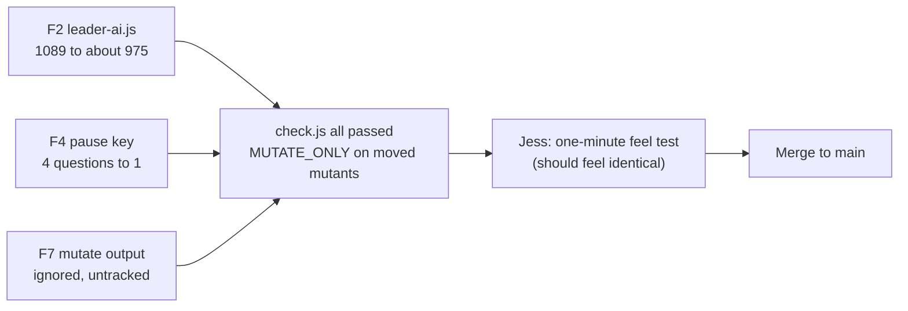
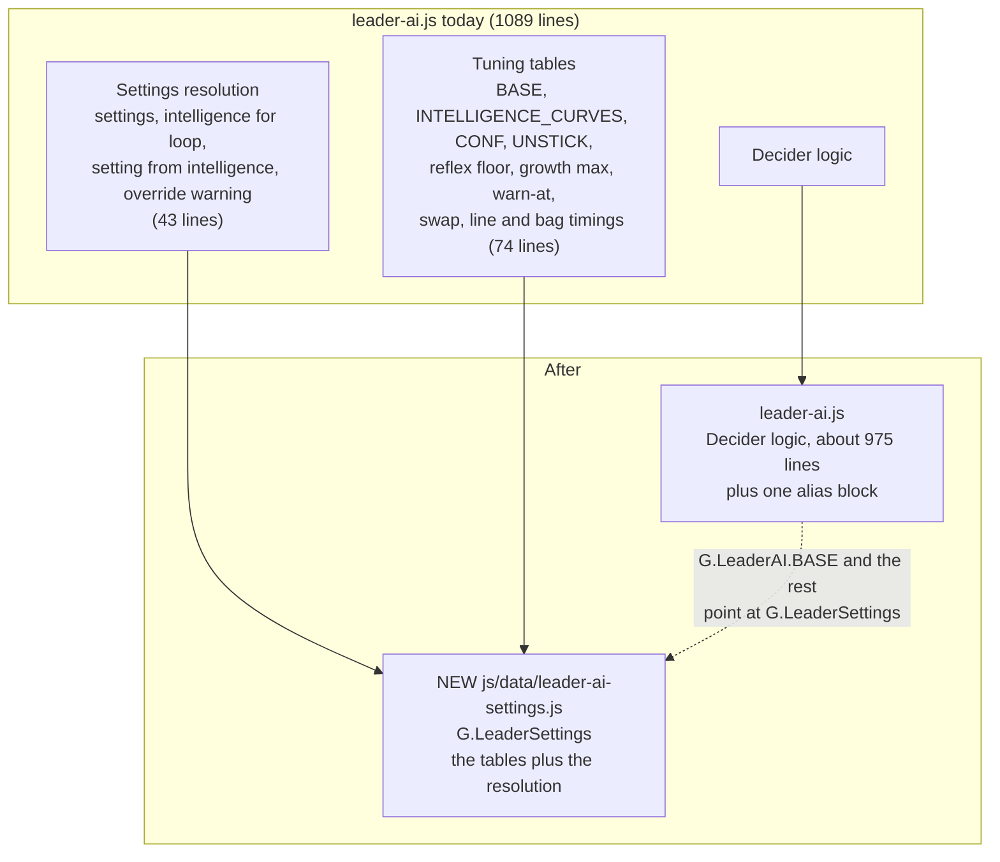
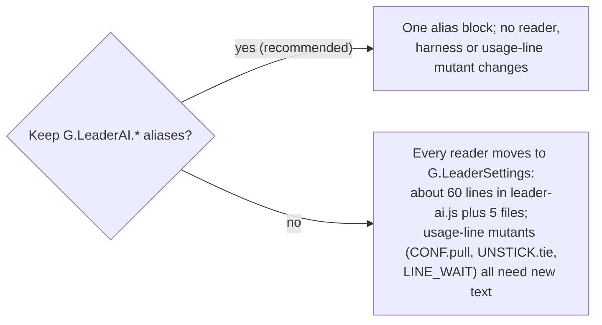
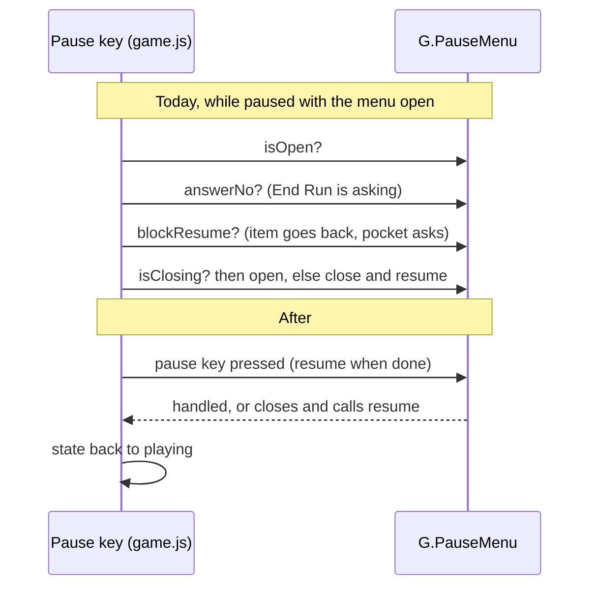

# feature/gym-leader-ai: Pre-Merge Fixes Plan (F2, F4)

From the structural review (decision 2026-11-14-structural-review-new-files-count). Both fixes are behavior-neutral.
F7 is done already (tools and config). F1, F3, F5 and F6 are issues for after the merge.

## F2: leader settings move into their own file

| Item | Detail |
|---|---|
| Stays in leader-ai.js | NONE, EPS, FAR, LOG_N, the dev switches (off, seed, capSeed), the Bag class: logic constants, not tuning |
| Why js/data | It is the authored-leader baseline BALANCE.md "Leader AI" tunes; gyms.js already holds helpers beside data (perLoop, validate) |
| Readers | Unchanged. G.LeaderAI keeps every name as an alias, so gyms.js (validator), gym.js, gym-arena.js, leader-belief.js and the harness read what they read today |
| Load order | New script in the dev.html data block after gyms.js; LeaderSettings in the NEED array before LeaderAI. It reads G.U and G.Gyms only when called |
| Docs | LEADER-AI.md code line, BALANCE.md "Leader AI" pointer, ONBOARDING module map, changelog (internal, one line) |
| Tests | leader-ai-mutate: 7 intelligence and curve mutants retarget to the new file (their text moves with it). A wiring check that each alias is the same object as its G.LeaderSettings entry. Harness 16f, 17f, check.js all passed |
| Risk | Low. A missed alias shows as "failed to load" or undefined at gym start, which check.js and smoke-leader-overlay catch |

### Decision

## F4: the pause key asks the pause menu one question

| Item | Detail |
|---|---|
| Where | game.js togglePause, the paused branch; pause-menu.js gains one entry beside answerNo and blockResume |
| What moves | The order of the four checks moves into the pause menu unchanged: End Run's No first, then the item give-back, then reopen-while-closing, then close and resume |
| What stays | Co-op branch, the Run Review branch after a run, the no-menu fallback, the quiet dev pause |
| Dropped from the review | startRun's three hides: they occur once, so a helper would only move lines (YAGNI) |
| Tests | No mutant pattern sits on those game.js lines (checked). smoke-pause-menu and smoke-pause stay green; run-info-mutate and pokebox-evs-mutate unaffected |
| Feel test | Esc mid-close turns it around; Esc on End Run's prompt answers No; Esc with a held item puts it back first |
| Risk | Low. Same four outcomes, same order |
