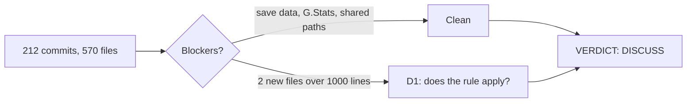
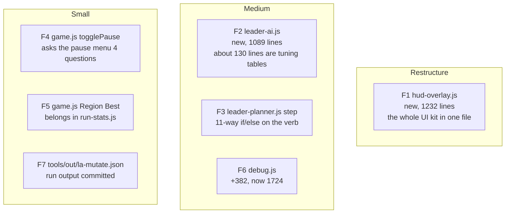
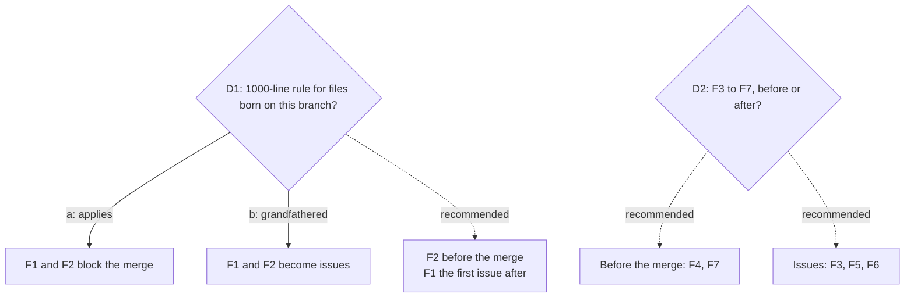

# feature/gym-leader-ai: Structural Review (2026-11-14, Quick)

Rulebook: .claude/skills/structural-review/SKILL.md. Scope: 212 commits, 570 files, +89,877 / -3,781.
Reviewed js/ and dev.html; js/net/ skipped (deferred). Limit: Quick has no hunk diff, so modified files were judged
from numstat plus the current code. New files were read whole where it mattered.

## Verdict

## Findings

Every remedy keeps behavior. Game-code remedies still go through a plan and your OK.

| # | Remedy | Load-order cost | Tests to repoint or keep green |
|---|---|---|---|
| F1 | Split on its section headers: shapes, buttons, stage fit; tooltip layer, scroll box; roster card; chips | 4 scripts in dev.html and NEED, before the HUD panels | run-info-mutate (2 patterns); smoke-hud-overlay, smoke-pause-menu |
| F2 | BASE, INTELLIGENCE_CURVES, CONF, UNSTICK, limits and timings to a js/data file | 1 script before leader-ai.js; keep the G.LeaderAI.BASE name or move readers (plan call) | leader-ai, leader-slots, gym-leader mutate; harness 17f |
| F3 | One step handler per verb in a table, as use already hands off to useSlot | none | leader-ai-mutate; harness 15 and 16 |
| F4 | Pause menu answers "pause key pressed: handled?"; game.js only flips paused and playing; one hide-all helper | none | run-info, pokebox-evs, player-entity mutate; smoke-pause-menu |
| F5 | Region key and lookup into run-stats.js; game.js keeps one call | none | run-info, run-stats mutate; run-stats-harness |
| F6 | The branch's leader, HUD and pause dev helpers to their own debug file on G.Debug | 1 script after debug.js | debug-movechecker, pokebox-evs, pokebox-stats, run-info, team-cards, type-chart mutate |
| F7 | Runner output to tools/cache/ or ignore tools/out/*.json; you untrack the file | none | none |

## Checked, no finding

- Save data: regionBest and the new settings default through the save template, merge and settings defaults.
- Shared paths: leader logic stays in its own modules; game.js, move-effects, stages, team-cards, util carry no
  leader checks.
- player.js and run-ui.js shrank. gyms.js +201 is exempt (content).
- Preact and htm in js/vendor: decision 2026-11-10-hud-on-preact-and-pngs-as-design-basis.
- boss-ai.js +48 / -17 reads as tuning shared with the new path, not new GymBrain features (a read, not a proof).

## Decisions for Jess

